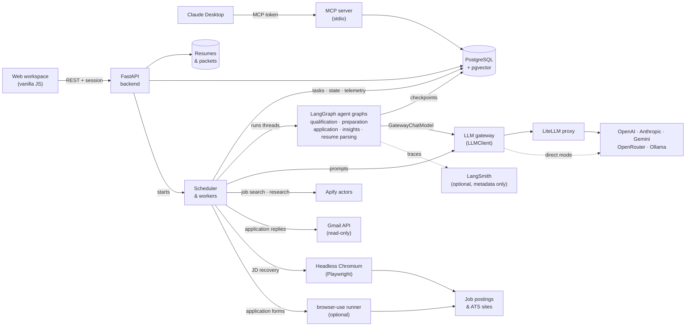

# Job Hunt OS v0.5 — Guided application workspace

A human-in-the-loop AI workflow for personal job hunting and tracking:

**Apify Hunter → Ranker → Tailor → Reviewer → Approval → Application Tracker → Follow-up**

It deliberately does **not** bypass anti-bot/CAPTCHA controls. It discovers and prepares applications, then either queues them for human approval or auto-approves reviewed materials according to your settings. External submission remains a user action.

## Workspace (v0.5 redesign)

The dashboard is a single-page workspace served from `app/static/app.js`; every number on it comes from the API.

| Screen | What it does | Main endpoints |
| --- | --- | --- |
| Overview | 30-day funnel, reply rate per board, next 10 days, weekly trend, time in stage | `GET /api/workspace/overview` |
| Today | "Do this next" (approve → tailor → follow up), follow-ups due, weekly pace; run-sheet variant | `GET /api/workspace/today` |
| Discovery · triage | One job at a time with fit reasons; keys `S` shortlist, `M` maybe, `X` skip, `⏎` shortlist & tailor | `GET /api/jobs/search?queue=true`, `POST /api/jobs/{id}/triage` |
| Discovery · table | Filter, sort, paginate and bulk-shortlist the whole pipeline. The stage filter includes "Unranked" (`stage=unranked`: jobs without a fit score) | `GET /api/jobs/search`, `POST /api/jobs/bulk-triage` |
| Running workers | Every background queue of your account in one place, a tab each: JD parsing, JD recovery, Ranking (the ranking tracker that used to be in Discovery: filtering, queue position and ETA, retry waits, finished rankings, Queue unranked jobs, Remove), Tailoring (the background task list that used to be on the Tailor screen) and Indexing (the retrieval indexer's embedding queue, one row per fact or saved answer), each with a 24-hour activity chart; every task shows its model and route (the model in use, the one its next request goes to, or for a finished task the one its last request used, or "No model call") and, beside it, what moved it off its model (failover, a backup while its model rests, LiteLLM fallback, quality escalation, or a model changed since its last request); plus a Settings tab for processing limits and rate-limit backoff. Kill stops a task and requeues it fresh; Run now puts one first in line past its retry wait, the ranking cadence and any rate-limit backoff; the rate-limit backoff can be reset | `GET /api/workers`, `GET /api/workers/{kind}`, `GET /api/workers/{kind}/activity`, `POST /api/workers/{kind}/tasks/{id}/kill`, `POST /api/workers/{kind}/tasks/{id}/run-now`, `POST /api/workers/{kind}/kill-all`, `POST /api/workers/kill-all`, `POST /api/workers/cooldowns/reset` |
| Discovery · setup | Saved search setups (named roles × locations × boards, each with its own schedule), run history with what each run searched and pulled, add a job from a URL, an uploaded PDF/DOCX/TXT description or pasted text | `GET/POST /api/search/setups`, `PUT/DELETE /api/search/setups/{id}`, `POST /api/search/setups/{id}/run`, `POST /api/search/setups/{id}/duplicate`, `GET /api/search/apify/runs/{id}/detail`, `POST /api/jobs/from-url`, `POST /api/jobs/read-file`, `POST /api/jobs/from-text` |
| Tailor | Before → after edits with the evidence each one cites; edit, accept or revert; cover letter; keyword coverage; PDF/DOCX/TXT exports. "Skip tailoring" sends the master resume unchanged (still reviewed) for postings that need no tailoring. The "Bulk tailor" view tailors or skips tailoring for many queued jobs one at a time, with progress and stop | `GET /api/tailor/{job_id}`, `PATCH /api/resumes/{id}/edits/{n}`, `POST /api/jobs/{id}/tailor`, `POST /api/jobs/{id}/skip-tailoring`, `POST /api/jobs/bulk-tailor` |
| Approvals | Pre-submit checklist, resume preview, reusable answers, notes; approve opens the apply kit, send a packet back for another tailoring pass, or reject the job outright with an optional reason | `GET /api/approvals/{job_id}`, `POST /api/jobs/{id}/revision`, `POST /api/jobs/{id}/reject` |
| Apply kit | Files to upload, answers to paste, link to the posting, confirm "mark applied" | `GET /api/jobs/{id}/apply-kit` |
| Tracker | Kanban by post-submission stage (drag or "move to"), optional extra stages, timeline, recruiter, interview scheduling, AI follow-up draft | `GET /api/tracker`, `POST /api/applications/{id}/stage`, `POST /api/applications/{id}/events` |
| AI Orchestration | The pipeline as an interactive graph: every stage, what kind of work it is (AI, deterministic, external, human gate, browser, async), the model each AI worker is assigned and the one that actually answered, live packets, one job's path and trace, model history per worker. The graph is observational; its **Models & routing** workspace is where models are managed (moved from Settings): the route (LiteLLM or direct), each worker's model, the model catalog, tiers and the auto router, the LiteLLM connection and version history, all through draft → preview → apply → version | `GET /api/orchestration/graph`, `GET /api/orchestration/live`, `GET /api/orchestration/jobs/{id}`, `GET /api/orchestration/jobs/{id}/trace`, `GET /api/orchestration/nodes/{id}`, `GET /api/orchestration/nodes/{id}/history`, `GET /api/orchestration/edges/{from}/{to}` |
| Monitoring | Seven sections — Overview, LLM usage, External APIs, Apify, Application inbox, Logs and AI optimization (JD parsing and JD recovery metrics are in Running workers). Every LLM request and every third-party call: volume, success rate, latency (avg/p50/p95/p99), failures by type, retries, rate limits, tokens, context utilisation and cost, with filters, detail views, trace lookup and the AI Optimization Advisor | `GET /api/monitoring/dashboard`, `GET /api/monitoring/external/dashboard`, `GET /api/monitoring/apify/summary`, `GET /api/monitoring/logs`, `POST /api/monitoring/analyze` |
| Knowledge bank | Searchable Answer library and Evidence bank, focused editors, verification filters, copy and removal | `/api/knowledge`, `/api/evidence` |
| Settings & profile | Candidate details and chip fields, resume variants, re-parse resume into (unverified) evidence, provider/model, your own API keys (stored encrypted), approval mode, cadence | `/api/profile`, `/api/settings`, `PUT /api/settings/keys`, `/api/preferences` |
| Setup quest | Interactive, gamified setup guide: a welcome screen for new accounts, then a quest map of ten setup tasks (profile, preferences, resume, verified facts, AI model, Apify, search setup, first run, first triage, answer bank) plus an optional Gmail bonus. The AI quest recommends Ollama Cloud's `nemotron-3-nano:30b-cloud` behind a local LiteLLM proxy, with commands to copy. Each quest links to where the work is done; quests tick off by themselves from the account's real data, earn XP and levels (Rookie → Offer Magnet) and are celebrated once. A floating tracker shows the next quest; open the guide from the sidebar or with `?` | `GET /api/setup/guide`, `PUT /api/setup/guide` |
| Sign-in | Create an account (email, password, confirm password), sign in, sign out | `/signup`, `/login`, `POST /api/auth/signup`, `POST /api/auth/login`, `POST /api/auth/logout`, `GET /api/auth/me` |

`⌘K` / `Ctrl+K` opens a command palette that searches every job.

Auto-submit is intentionally not offered: approved packets always become an apply kit, and the submit click stays yours.

## What works

- Candidate profile + master resume
- TXT, PDF, and DOCX resume upload with local storage and text extraction
- Dedicated Discovery, Approvals, Knowledge Bank, and Settings workspaces
- Reusable, human-verifiable ATS question answers
- Manual or review-threshold-based automatic approval
- Verified evidence bank to prevent resume hallucinations
- **Apify-first multi-board job discovery**
- Default Apify Actor searches LinkedIn, Indeed, Glassdoor, Naukri, Bayt and ZipRecruiter
- Configurable Apify Actor ID and custom Actor input escape hatch
- Asynchronous Actor runs persisted in PostgreSQL/SQLite
- Automatic Apify dataset ingestion + cross-run deduplication
- Lever and Greenhouse direct imports as optional fallbacks
- AI job-fit scoring
- AI resume tailoring constrained to verified evidence
- Independent hiring-manager review score
- Human approval gate
- Application tracking + follow-up due date
- AI-generated follow-up drafts
- Simple PDF export
- Email and password accounts: each account has its own jobs, resumes, settings, schedule and encrypted API keys
- Prompt-injection hardening for untrusted job descriptions
- **Application Inbox Agent**: read-only Gmail checks for replies about the applications you submitted — targeted searches, confidence-scored matching, rule-then-model classification, a tracker timeline, safe stage updates and a daily digest — see [Application Inbox Agent](#application-inbox-agent)
- **Job description recovery**: postings that arrive without a usable description are read from their URL in the background (HTTP, then headless Chromium, then AI-assisted block selection), validated and parsed — see [13. Job Description Recovery](#13-job-description-recovery)
- **Job Insights**: every approved job gets source-backed research in the background — compensation (posting first, then recruiter, Glassdoor and PayScale through configurable Apify actors), official company values kept apart from employee-reported culture, reported vs generated interview questions, questions to ask, and stage-specific prep — see [14a. Job Insights](#14a-job-insights-company-compensation-and-interview-research)
- **LiteLLM gateway**: per-worker model assignments, backups and failover, tiers, auto router, version history and rollback (AI Orchestration → Models & routing)
- OpenAI, Anthropic, Gemini, **OpenRouter**, or no-cost mock provider
- LLM monitoring (tokens, context size, latency, estimated cost, failures) and a recommend-only AI Optimization Advisor
- Claude Desktop + MCP: bulk tailoring and review with your Claude subscription, validated by the backend
- OpenRouter `openrouter/free` support plus arbitrary `:free` model slugs
- Per-stage OpenRouter models for ranking, tailoring, review, and follow-up
- OpenRouter model fallbacks and a free-only safety guard
- SQLite locally; PostgreSQL in production
- Docker deployment
- Separate cron command for scheduled follow-ups

## Architecture



The scheduler runs inside the FastAPI process, and PostgreSQL is the only queue and shared state (no Redis, Celery or
separate worker service). Every model call goes through the LLM gateway (`LLMClient`), which picks each worker's model
from its configuration and sends it to LiteLLM or straight to the provider. Every third-party call (models, Apify,
Gmail, job sites) goes through the instrumented client (`external_api`), so it shows up in Monitoring.

**Agent graphs (LangGraph).** Multi-step stages can run as LangGraph graphs (`app/agents/`): qualification (admit,
recover, parse and rank a job), resume preparation (tailor, check the facts, review, wait for approval), application
execution, Job Insights research and resume parsing. A graph conducts the existing services; it never writes job
state itself, and its model calls go through the same LLM gateway (`GatewayChatModel`). The scheduler's workers run
each graph thread under their task's lease, its checkpoints are kept in PostgreSQL so a run continues after a restart
or a pause for a person, and traces can be exported to LangSmith (metadata only, off by default). Graphs need
`AGENT_GRAPHS_ENABLED=true` and PostgreSQL; each one has its own mode (`QUALIFICATION_GRAPH_MODE`,
`PREPARATION_GRAPH_MODE`, …), and with a graph off its stage runs the same steps without one. See
[9c. Agent graphs](#9c-agent-graphs-experimental-off-by-default).

| Layer | Stack |
| --- | --- |
| Frontend | Server-rendered Jinja pages with a single-page workspace in plain JavaScript (`app/static`), no build step |
| Backend | Python 3.11+, FastAPI, SQLAlchemy 2, Pydantic v2, Alembic |
| Data | PostgreSQL (SQLite for local development), pgvector for optional retrieval, local files for resumes and packets |
| Background work | Built-in asyncio scheduler (`app/scheduler.py`) with PostgreSQL task tables (`FOR UPDATE SKIP LOCKED` leases) |
| AI | LiteLLM gateway or a direct provider (OpenAI, Anthropic, Gemini, OpenRouter, Ollama), per-worker models with failover |
| Agent graphs | LangGraph with the PostgreSQL checkpointer, LangChain core (gateway-bound chat model), optional LangSmith export |
| Discovery & research | Apify actors, Lever and Greenhouse imports |
| Browser | Playwright with headless Chromium; optional browser-use runner for application forms |
| Integrations | Gmail (read-only, OAuth), MCP server for Claude Desktop, Google ADK agent (`job_hunt_agent`) |
| Auth | Email and password accounts, HTTP-only session cookies, encrypted per-account API keys |
| Tests | pytest, Vitest + jsdom |
| Deployment | Docker, Render or Railway |

## 1. Local run

```bash
cp .env.example .env
# Add APIFY_API_TOKEN and one LLM API key, or use LLM_PROVIDER=mock for no-cost LLM testing.
python -m venv .venv
source .venv/bin/activate
pip install -e .
python -m playwright install chromium   # optional: browser fallback for job-description recovery
uvicorn app.main:app --reload
```

Set `SECRET_KEY` in `.env` first (it encrypts the API keys people save), then open http://localhost:8000 and create an account. See [Accounts and data isolation](#accounts-and-data-isolation).

Uploaded resumes are stored in `./data/resumes` by default. Set `UPLOAD_DIR` to a
persistent private volume in production and `MAX_RESUME_UPLOAD_MB` to change the
default 8 MB limit. Files must not be placed on a publicly served path.

On startup, the application runs its Alembic migrations (`app/migrations`) to the latest
revision. You can also run them explicitly with `python -m app.db_migrations` or `alembic upgrade head`.
Installs created before migrations existed are upgraded in place. Back up an existing production
database before upgrading.

### Local PostgreSQL (recommended)

With a local Postgres (for example `brew install postgresql@16 && brew services start postgresql@16`):

```bash
scripts/setup_local_postgres.sh          # creates jobhunt and jobhunt_test for $USER
```

Then set `DATABASE_URL=postgresql+psycopg://<your-user>@localhost:5432/jobhunt` in `.env` and start the app; tables are created and migrated on startup. To run the tests on Postgres instead of throwaway SQLite files:

```bash
TEST_DATABASE_URL=postgresql+psycopg://<your-user>@localhost:5432/jobhunt_test pytest
```

Or run the app and Postgres in containers:

```bash
docker compose up --build
```

## Accounts and data isolation

Anyone who can reach the site can create an account at `/signup` with an email address, a password (at least 10 characters) and the password again. Set `ALLOW_SIGNUP=false` to close sign-up once everyone you want has joined.

- **Your data is yours.** Jobs, resumes, evidence, knowledge answers, search profile and profiles, settings, search runs, applications, their events, tailored resumes, follow-ups and workflow history all belong to one account. Ownership is in the schema itself: every one of those tables has a `user_id` foreign key to `users`, indexed, `NOT NULL`, and `ON DELETE CASCADE`, so deleting an account removes its data and no row can exist without an owner.
  - **In the ORM:** `user.jobs`, `user.applications`, `user.followups`, `user.search_profiles` and so on, with `job.user` in the other direction — no manual `user_id` filtering needed.
  - **Enforced centrally** in `app/tenancy.py`, not endpoint by endpoint: every database session opened for a signed-in request only reads, updates and deletes that account's rows, and `get()` by ID returns nothing for another account's row, so another account's IDs simply return 404.
  - **New rows are stamped automatically.** A row that hangs off a job or an application (a tailored resume, an application, its events, follow-ups, workflow history) takes its owner from that parent, so work done by the scheduler and the workers — whose sessions belong to no one — is owned too.
  - An install that still holds data from before accounts existed upgrades with those rows unowned; the first account claims them, and `app.db_migrations.enforce_ownership` makes the columns `NOT NULL` on the next start.
- **Your API keys.** Each account saves its own OpenRouter, OpenAI, Anthropic and Apify keys under **Settings → Your API keys**. Searches, ranking, tailoring and follow-ups always use the account's own keys, with no fallback to anyone else's.
  - Keys are encrypted with `SECRET_KEY` and never returned by the API; only the last four characters are shown.
  - Keep `SECRET_KEY` stable and private. Changing it makes saved keys unreadable, and everyone has to re-enter them.
  - Generate one with `python -c "import secrets; print(secrets.token_urlsafe(48))"`.
- **The first account.** The first account ever created becomes the admin. It takes ownership of everything that existed before accounts were introduced, so an existing install carries on unchanged. Any `*_API_KEY` / `APIFY_API_TOKEN` values in `.env` are copied into that account, encrypted. After that, server `.env` keys are not used for anyone's work.
- **Running the system your way.** Every account's own settings control what the scheduler does for it:
  - the schedule on each of its saved search setups (manual, every N hours, daily or weekly at a local time);
  - the **Auto-rank on import** switch;
  - its AI provider and models;
  - its approval mode and follow-up cadence.

  Accounts without the needed key are simply skipped until they add one.
- **Sessions.** Passwords are hashed with scrypt. Signing in sets an HttpOnly, SameSite=Lax cookie holding a random token.
  - Only the token's SHA-256 is stored, and signing out revokes it on the server.
  - Sessions last `SESSION_DAYS` (30).
  - The cookie is `Secure` over HTTPS; force it with `SESSION_COOKIE_SECURE=true` behind a TLS proxy.
  - Five wrong passwords for an email block sign-in for 15 minutes, counted per app process.
  - Cross-site write requests are rejected.
- **Admin-only views.** The scheduler status shows job results and errors to the admin only. `ADMIN_TOKEN` still protects manual scheduler triggers and `CRON_SECRET` still protects `/api/cron/*`.

## 2. Apify job discovery

Save your Apify API token under **Settings → Your API keys** (create one in Apify Console → Settings → Integrations). The server sets the default actor:

```env
APIFY_ACTOR_ID=openclawai/job-board-scraper
```

### Saved search setups

**Discovery → Search setup** holds as many named searches as you like — "Lead AI Engineer · remote" and
"Staff SWE · Mumbai + SF" are separate setups, each with its own roles, locations, actors, boards and filters.
Pick one from the row of setups at the top of the card to edit it, **Run now & triage** to start it immediately, or
**Save as new** / **Duplicate** to branch off the one you are looking at.

Each setup carries its own schedule, independent of the others:

| When | What it means |
| --- | --- |
| Manual only | It runs when you press Run now, and never on its own |
| Every N hours | It repeats N hours (1–168) after each run |
| Daily | It runs at a time of day, in the time zone you pick |
| Weekly | It runs at that time on the weekdays you tick |

A setup stores its whole search as a `settings` blob plus `schedule_kind`, `every_hours`, `time_of_day`,
`weekdays`, `timezone`, `enabled`, `last_run_at` and `next_run_at` (`saved_searches`). The scheduler's `hunter`
job starts every enabled setup whose `next_run_at` has passed — a guarded UPDATE means two app instances cannot
start the same one twice — and `apify_sync` imports each finished run. `search_runs.saved_search_id` records which
setup started a run, so the run history says where each batch of jobs came from. Local times are converted with
`zoneinfo`, so a daily 07:00 search stays at 07:00 across daylight-saving changes
(`app/services/saved_searches.py`).

The single search profile that accounts had before this becomes a setup named "My search" the first time the
screen is opened, keeping its settings and its daily/manual schedule.

### Multiple actors

Discovery → Search setup lets you tick one or more actors. A setup's search is translated into each actor's own input schema (`app/services/actors.py`), and each actor gets the filters it supports.

Descriptions differ by board: Multi Job Board returns full descriptions for **LinkedIn** (with "Fetch full LinkedIn descriptions") and **Indeed** only; its Naukri, ZipRecruiter and Bayt listings arrive without one (and Naukri pages cannot be recovered later — they are built in the browser and block automated browsers). For Naukri, tick the **Naukri** actor and untick Naukri among Multi Job Board's boards; the setup warns when Naukri would be searched twice.

**Staying on target.** Boards match keywords loosely, so a setup keeps a run to what it asked for:

* **Primary skills** (optional, up to 3: Python, Java…). Multi Job Board adds the first skill to each role's search
  term ("Backend Engineer Python"). For every actor, an imported job has to mention one of the skills in its title or
  description (the whole description is searched). A job with no description yet is not held against the skill
  check; it is checked again when description recovery fills the text in, before parsing or ranking.
* **Scope check on import** (`app/services/search_scope.py`, deterministic). Every setup run records its roles,
  location and skills on `search_runs`. When an imported job's title names none of the roles (or skills), its
  description names none of the skills, or its location is in another country, the job is hidden like the domain
  filter: it moves to **Not matching** with the reason, gets no recovery, parsing or ranking, and **Keep this job**
  brings it back. A run covering several places (Advanced LinkedIn, per-role actors) accepts a job that fits any of
  them. With a search radius of 0, the job also has to be in the same city (Bengaluru and Bangalore count as one). A
  remote-only search hides a job only when the posting says it is on-site. Reapplying the domain lists never restores
  a job this check hid. A run without a recorded scope, or a job without a location, is never hidden.
* **Country.** Multi Job Board's `countryIndeed` (which Indeed and Glassdoor search) comes from the run's location
  when that names a country ("Bengaluru, India" → india; the last part counts first, so "London, Ontario, Canada" is
  canada). The setup's country setting is used only when it doesn't.
* **Results per search is a total.** The actor's `maxResults` counts per board and per search term. Multi Job
  Board sends `ceil(limit ÷ (boards × roles))`, and the import stops at the limit (counted as `over_limit` in the
  run's stats), counting jobs the run already brought in when it is pulled again.

| Actor | Runs | Filters it receives |
| --- | --- | --- |
| `openclawai/job-board-scraper` (Multi Job Board) | one per location, all roles | `searchTerm`/`searchTerms`, `location`, `sites`, `maxResults`, `hoursOld`, `jobType`, `isRemote`, `easyApply`, `countryIndeed`, `distance`, `offset`, `linkedinFetchDescription`, `linkedinCompanyIds`, `enforceAnnualSalary`, `proxyConfiguration` |
| `fantastic-jobs/advanced-linkedin-job-search-api` (Advanced LinkedIn) | one for everything | `titleSearch`, `locationSearch` (needs `City, State, Country`), `timeRange`, `limit`, `aiWorkArrangementFilter`, `aiEmploymentTypeFilter`, `seniorityFilter`, `directApply`, `hasSalary`, `aiVisaSponsorshipFilter`, `removeAgency`, `titleExclusionSearch` |
| `benthepythondev/remote-jobs-aggregator` | one per role | `searchKeywords`, `platforms`, `maxJobsPerPlatform`, `postedWithinDays`, `locationKeywords`, `jobTypes`, `seniorityLevels`, `salaryOnly`, `excludeKeywords` |
| `shahidirfan/Remoteok-Job-Scraper` | one per role | `startUrl`, `keyword`, `results_wanted` |
| `antishock/workatastartup-jobs-scraper` (Work at a Startup) | one for everything | `roles` (role families: each search role is mapped to `eng`, `design`, `sales`, `marketing` or `ops`), `remote`, `ycBatches`, `maxResults`, `includeCompanyDetails` |
| `automation-lab/ycombinator-jobs-scraper` (Y Combinator Jobs) | one per role | `query`, `maxItems`, `remoteOnly`, `jobType` (full-time or internship), `companyBatch` (the first YC batch), `includeDetails`, `maxDetailRequests` |
| `parseforge/hn-whoishiring-scraper` (HN Who's Hiring) | one per role | `keyword`, `month` (`current` or `YYYY-MM`), `maxItems`, `remoteOnly`, `minSalary` |
| `crawlerbros/naukri-scraper` (Naukri) | one per role × city | `keyword`, `location` (Naukri city slug: Bengaluru → `bangalore`, Gurugram → `gurgaon`, Delhi → `delhi-ncr`), `maxItems`, `jobAge` (Posted within, rounded up to 1/3/7/15/30 days), `jobType`, `workMode` (remote), `sortBy=date`. Reads each listing's `description`/`jobDescription` |
| `blackfalcondata/wellfound-scraper` (Wellfound) | one per role | `query`, `location` (city slugs), `remote`, `jobType`, `experienceLevel` (from the lowest seniority chosen), `salaryMin`, `visaSponsorship`, `maxAgeMinutes`, `excludeKeywords`, `skipReposts`, `maxResults` |

The four startup boards have their own settings on the setup (YC batches, HN thread month, minimum salary,
and whether to fetch full descriptions), and none of them except Wellfound can filter by city. Their dataset items use
their own field names, so each has an item mapping in `actors.py` (`normalize` on its spec) that turns an item into
title, company, location, URL and description before import; salary, equity, visa and batch facts from the listing
are appended to the description so ranking can see them. The raw item is kept on the job unchanged.

The picker groups actors (job boards, LinkedIn, remote boards, startups, your own), lists the settings each one reads,
and marks every filter with the selected actors that use it, so a filter nobody reads is visible as such.

Conflicting filters are reported before a run starts (for example, Multi Job Board drops `hoursOld` when Easy Apply is on). "Show exact inputs" displays the JSON each run will send, and one profile may start at most 30 runs.

**Your own actors:** "+ Add your own actor" takes a Store actor ID, how it should fan out (per role × location, per location, per role, or once) and a JSON input template. "Look up on Apify" confirms the actor exists and pre-fills the template from its input schema. Placeholders: `{{role}}`, `{{roles}}`, `{{location}}`, `{{locations}}`, `{{max_results}}`, `{{hours_old}}`, `{{days_old}}`, `{{is_remote}}`, `{{job_type}}`, `{{sites}}`, `{{country}}`, `{{skill}}` (the first primary skill), `{{skills}}`. A value that is only a placeholder keeps its type. Output items are normalized from common field names (title, company/organization, location/locations_derived, url/apply_url, description/description_text).

The dashboard starts the Actor **asynchronously**. The app persists the Apify run ID, polls its status, and imports the default dataset after the run succeeds. This avoids keeping a Render/Railway HTTP request open while the scraper runs.

### Hunter API and search profiles

The Hunter runs searches asynchronously and imports their results later:

```text
SearchProfile → Apify Hunter → async actor runs → sync results → normalize → deduplicate → RANK_PENDING
```

Start a search (it returns as soon as the actor runs are started, never waiting for the scraper):

```http
POST /api/hunter/search
```

```json
{
  "roles": ["Engineering Manager", "Head of Engineering", "Lead AI Engineer"],
  "locations": ["Singapore", "Dubai"],
  "sites": ["linkedin", "indeed", "glassdoor"],
  "hours_old": 72,
  "max_results": 20,
  "remote_only": false
}
```

One run is started per location, with up to 5 roles each (more roles are split into further runs). Every run is saved in `search_runs` with its Apify run ID and status: `PENDING`, `RUNNING`, `SUCCEEDED`, `FAILED` or `NEEDS_INVESTIGATION`. A run that fails to start never stops the others.

**Actors and adapters.** Each actor has its own adapter in `app/services/apify_adapters.py`, which builds input using only the fields that actor's schema publishes and converts its output into the internal job. Actor IDs are configuration (`.env.example`), never hard-coded in the business logic.

| Actor | Setting | Runs | Recency filter |
| --- | --- | --- | --- |
| `openclawai/job-board-scraper` | `APIFY_PRIMARY_JOB_ACTOR` | one per location, 5 roles each | `hoursOld` (exact) |
| `thirdwatch/linkedin-jobs-scraper` | `APIFY_LINKEDIN_ACTOR` | one per location, 5 queries each | `datePosted` (24h/week/month) |
| `crawlerbros/indeed-jobs-scraper` | `APIFY_INDEED_ACTOR` | one per role and location | none: filtered after import |
| `crawlerbros/glassdoor-jobs-scraper` | `APIFY_GLASSDOOR_ACTOR` | one per role and location | none: filtered after import |
| `crawlerbros/naukri-scraper` | `APIFY_NAUKRI_ACTOR` | one per role and city | `jobAge` (1/3/7/15/30 days) |

`"mode": "fallback"` searches each board with its dedicated actor instead of the multi-board one (ZipRecruiter and Bayt have no dedicated actor, so they stay on the multi-board one). When a multi-board run fails, its boards are searched once more with their fallback actors automatically (`APIFY_AUTO_FALLBACK`).

**Posting dates.** `posted_at` is the employer's posting date and is never replaced by `discovered_at`. Relative values ("3 days ago", Glassdoor's `ageInDays`) are counted back from the time the actor scraped the page, and the original value is kept in `posted_date_raw`. Values that are not exact ("30+ days ago", "2 months ago") leave `posted_at` empty rather than guessing, and a job is never dropped for being old when its date is unknown.

**Deduplication** uses, in order: the board's own job ID, the canonical posting or apply URL, then company + title + city. A posting found again by another role, board, profile or scheduled run adds an entry to the job's `discoveries` (role, location, board, actor, run) and fills in details the first discovery lacked, instead of creating a second job. Every job records `matched_search_role`, `matched_search_location`, `source_board`, `apify_actor_id` and `apify_run_id`, so you can later ask which role, location or board produces the best results.

**Search profiles** are reusable searches the scheduler runs on their own cadence:

```http
GET|POST /api/hunter/profiles          PUT|DELETE /api/hunter/profiles/{id}
POST /api/hunter/profiles/{id}/run     GET /api/hunter/runs      POST /api/hunter/runs/sync
```

A profile stores its roles, locations, sites, `hours_old`, `remote_only`, `job_type`, `max_results`, whether it is `enabled`, and `last_run_at` / `next_run_at`. The scheduler's `hunter` job starts every enabled profile that is due (a guarded UPDATE means two app instances cannot start it twice), and the `apify_sync` job imports each finished run.

**When something goes wrong:** a failed, aborted or timed-out run still imports whatever it collected; an empty dataset is a normal, successful run; items without a title or company are skipped and counted; and if a dataset no longer carries the fields an adapter needs, the run is marked `NEEDS_INVESTIGATION` and imports nothing rather than creating wrong jobs. Every run's counts (created, duplicates, missing dates, dropped as too old) are on the run itself.

### Why the Actor is configurable

Apify Actors do not all use the same input/output schema. `APIFY_ACTOR_ID` can point to another Actor. Use `custom_input` to add/override fields on the default schema, or `raw_actor_input` to send an entirely different Actor input object verbatim. The normalizer understands the default Actor plus common names such as `jobTitle`, `companyName`, `applyUrl`, `jobUrl`, and `jobDescription`.

### Default Actor inputs used by this app

```json
{
  "searchTerm": "Engineering Manager",
  "searchTerms": ["Engineering Manager", "Lead AI Engineer"],
  "location": "Singapore",
  "sites": ["linkedin", "indeed", "glassdoor"],
  "maxResults": 20,
  "hoursOld": 168,
  "isRemote": false,
  "easyApply": false,
  "countryIndeed": "singapore",
  "distance": 50,
  "linkedinFetchDescription": true,
  "enforceAnnualSalary": false,
  "descriptionFormat": "markdown",
  "proxyConfiguration": {"useApifyProxy": true, "apifyProxyGroups": ["RESIDENTIAL"]}
}
```

`searchTerms` is only sent when there is more than one role.

Use smaller `maxResults` values while testing. Apify Actor pricing is Actor-specific, so check the chosen Actor's live pricing before large searches.

## 3. LLM configuration

The preferred setup is the **LiteLLM gateway** (section 3a): every worker's model is chosen in AI Orchestration → Models
and every request goes through a LiteLLM proxy. This section covers the direct providers, used when the gateway is
off.

API keys are saved per account under **Settings → Your API keys**. The `*_API_KEY` values below only seed the first account at sign-up; the other variables set server-wide defaults (provider, models, free-only guard) that each account can override in Settings.

### Default: OpenRouter free models

```env
LLM_PROVIDER=openrouter
OPENROUTER_API_KEY=sk-or-v1-...
OPENROUTER_MODEL=openrouter/free
OPENROUTER_REQUIRE_FREE=true
```

`openrouter/free` is OpenRouter's free-model router. It chooses from currently available free models that can satisfy the request. You can also pin any currently available explicit free model by using its OpenRouter slug ending in `:free`.

The free-model catalog changes, so the application does **not** hard-code a permanent list of model names. `openrouter/free` is the most maintenance-friendly default.

### Use different models by workflow stage

All stage overrides are optional. A blank value inherits `OPENROUTER_MODEL`.

```env
OPENROUTER_MODEL=openrouter/free
OPENROUTER_MODEL_RANK=openrouter/free
OPENROUTER_MODEL_TAILOR=vendor/model-name:free
OPENROUTER_MODEL_REVIEW=openrouter/free
OPENROUTER_MODEL_FOLLOWUP=openrouter/free
```

This lets you keep high-volume ranking/follow-up work on free inference while selecting a stronger model only for resume tailoring or final review.

### Free-only spend protection

```env
OPENROUTER_REQUIRE_FREE=true
```

When enabled, Job Hunt OS refuses to call any configured OpenRouter model that is neither `openrouter/free` nor a `:free` variant. This prevents an accidental paid-model bill.

To intentionally allow paid OpenRouter models:

```env
OPENROUTER_REQUIRE_FREE=false
OPENROUTER_MODEL_REVIEW=anthropic/<model-slug>
```

Always copy current model slugs from the OpenRouter model browser rather than assuming a historical slug is still valid.

### Optional model fallback chain

```env
OPENROUTER_FALLBACK_MODELS=vendor/backup-model:free,openrouter/free
```

The fallback list is passed to OpenRouter in priority order. Provider-level failover is handled by OpenRouter, and the configured model list provides an additional model-level fallback layer. With `OPENROUTER_REQUIRE_FREE=true`, every fallback must also be free.

### Optional OpenRouter attribution headers

```env
OPENROUTER_SITE_URL=https://your-job-hunt.example
OPENROUTER_APP_NAME=Job Hunt OS
```

### Direct OpenAI

```env
LLM_PROVIDER=openai
OPENAI_API_KEY=...
OPENAI_MODEL=gpt-5.6-luna
```

### Direct Anthropic

```env
LLM_PROVIDER=anthropic
ANTHROPIC_API_KEY=...
ANTHROPIC_MODEL=claude-sonnet-5
```

### Direct Gemini

```env
LLM_PROVIDER=gemini
GEMINI_API_KEY=...
GEMINI_MODEL=gemini-2.5-flash
```

Uses a Gemini API (Google AI Studio) key through the `google-genai` SDK. The ADK agent (section 11) keeps using
Vertex AI credentials.

### No LLM spend / local tests

```env
LLM_PROVIDER=mock
```

The SDK/client libraries do not remove model inference cost. The model layer is isolated so providers can be switched without changing the workflow.

### LLM Prompt Architecture

Every model call follows one path, and no model output reaches the database directly:

```
Structured data (verified resume, Evidence Bank, parsed job, completed FitAnalysis)
→ context builder      app/services/context_builder.py   task-specific, policy-filtered, validated
→ prompt               app/prompts/                       versioned, one responsibility, typed contract
→ LLM gateway          app/services/llm.py → LiteLLM      JSON Schema where the model supports it
→ structured output    app/prompts/contracts.py           unknown fields rejected, cross-worker output diagnosed
→ validation           evidence per claim, CandidatePolicy, deterministic checks
→ persistence          with prompt version, provider, model, config version
→ workflow             state changes made by Python, never by a model
```

**One responsibility per worker.** The **Ranker** compares the candidate with the job and produces the FitAnalysis:
candidate fit (all verified facts) and resume fit (the resume as written), and a MATCH / PARTIAL_MATCH / MISSING /
UNKNOWN assessment per requirement. The **Tailor** receives that *completed* FitAnalysis as read-only input and only
changes how the source resume presents verified experience: it never scores, reranks, reclassifies requirements or
fills a gap. Its answer is a patch (summary, skill order, rewritten bullets per role, each claim with its evidence ids)
that a deterministic renderer applies to the source resume, so roles, employers, titles and dates cannot change. The
**Reviewer** checks the already-tailored claims against the evidence they cite, CandidatePolicy and the job, and
recommends PASS / RETAILOR / SKIP; it never rewrites. Parsers extract; they never improve or infer.

**Fail early.** Without a completed FitAnalysis the Tailor is not called (`RANKING_REQUIRED`); a FitAnalysis of another
job (`FIT_ANALYSIS_MISMATCH`), an empty or inconsistent context (`TAILOR_CONTEXT_INCOMPLETE`, `TAILOR_CONTEXT_INVALID`)
or nothing to review (`REVIEW_CONTEXT_INCOMPLETE`) fail the same way, before a prompt exists. An empty template for
another worker's output is never sent. Ranking needs PostgreSQL, so an SQLite install cannot tailor (backend or Claude
Desktop); **Skip tailoring** still sends the master resume unchanged.

**Evidence rules.** Context builders drop unverified and rejected facts unless CandidatePolicy allows them, so the model
never has to reason about verification status. Every generated factual unit carries its own `evidence_ids`; each is
checked (the evidence exists, is verified, belongs to the account, sits at the same employer, was offered in the
context), and numbers and named technologies must appear in what it cites or in the resume. A unit that fails is
dropped and the source text stays; a requirement no evidence supports stays missing. Evidence whose employer or role
disagrees with the resume item it came from is flagged (`GET /api/evidence/diagnostics`) and held back from generation,
never silently corrected.

**Structured output.** Each machine-facing worker has a contract (`RankingResult`, `TailoringResult`, `ReviewResult`,
`CoverLetterResult`, `FollowUpResult`, `ApplicationAnswerResult`, `InboxClassificationResult`, `ApplicationEmailAnalysis`,
`ApplicationEmailMatchResult`, `ResumeParserOutput`,
`JobDescriptionParserOutput`, `EvidenceExtractionResult`, `OptimizationReport`). Contracts do not overlap and forbid
unknown fields: a Tailor answer carrying `candidate_fit_score` fails as `POSSIBLE_CROSS_WORKER_OUTPUT`. The gateway
sends the contract as a JSON Schema to models known to support it (JSON mode when unknown), validates every answer,
retries once with a short schema correction, then fails. Monitoring records the enforcement mode, the failure reason and
the context builder version per request.

**Versioning and context size.** Every prompt has a `*_PROMPT_VERSION`, bumped on a material change and stored with
its output. Contexts are projections: the Tailor gets the candidate's name and headline, one canonical copy of the
source resume, the relevant evidence, the requirements and the FitAnalysis — never search or scraper settings, the
raw resume, or the policy. Requests record available versus selected context tokens.

Conventions for adding or changing a prompt: [docs/prompts.md](docs/prompts.md). Golden fixtures per worker live in
`tests/fixtures/prompt_golden/`; `scripts/evaluate_prompts.py` runs them against real models to compare models or
prompt versions, and `scripts/audit_sensitive_logs.py` checks stored logs for credential-shaped values.

| Module | Builder | Contract | Used by |
|---|---|---|---|
| `ranking.py` | `build_ranking_prompt` | `RankingResult` | the Job Ranker (`app.services.ranker`) |
| `tailoring.py` | `build_tailoring_prompt` | `TailoringResult` | `tailor_job` |
| `cover_letter.py` | `build_cover_letter_prompt` | `CoverLetterResult` | `write_cover_letter`, called by `tailor_job` |
| `review.py` | `build_review_prompt` | `ReviewResult` | `review_resume` |
| `followup.py` | `build_followup_prompt` | `FollowUpResult` | `draft_followup` |
| `job_description_parser.py` | `build_job_description_parser_prompt` | `JobDescriptionParserOutput` | the `jd_parsing` scheduler job |
| `resume_parser.py` | `build_resume_parser_prompt`, `build_evidence_extraction_prompt` | `ResumeParserOutput`, `EvidenceExtractionResult` | AI structuring of every upload, grounded in the resume's text (fills untouched data, a comparison otherwise); evidence parsing |
| `application.py` | `build_application_question_prompt` | `ApplicationAnswerResult` | not wired in yet |
| `application_inbox.py` | `build_application_inbox_prompt`, `build_application_email_match_prompt` | `ApplicationEmailAnalysis`, `ApplicationEmailMatchResult` | the Application Inbox Agent (`app.services.application_inbox`) |
| `inbox.py` | `build_inbox_classification_prompt` | `InboxClassificationResult` | superseded by `application_inbox.py`; kept for its golden fixture |
| `ai_optimization.py` | `build_ai_optimization_prompt` | `OptimizationReport` | the AI Optimization Advisor (advice only) |
| `model_tests.py` | `build_model_health_prompt`, `build_worker_test_prompt` | per fixture | AI Orchestration → Models tests (fictional data) |
| `agents.py`, `mcp_*.py` | instructions and rules | validated on save | the ADK agents; Claude Desktop over MCP |

Company Insights and Interview Insights are reserved worker names with no prompt yet.

## 3a. LiteLLM & AI Model Configuration

LiteLLM gateway mode is the preferred way to run Job Hunt OS. Job Hunt OS becomes the control plane for which model
each AI worker uses, and a [LiteLLM proxy](https://docs.litellm.ai/) is the one inference gateway:

```
Job Hunt OS worker (Ranker, Tailor, Reviewer, …)
  → LLM layer (app/services/llm.py) — resolves the worker's model from AI Orchestration → Models
  → LiteLLM proxy (/v1/chat/completions)
  → Ollama (local) / OpenRouter / OpenAI / Anthropic / any provider LiteLLM supports
```

In gateway mode no worker calls Ollama, OpenAI, Anthropic, OpenRouter or Gemini directly, and no worker names a
provider model in code: workers point at a **model**, a **tier** or the **auto router**, and the LiteLLM model name
(alias) that answers is resolved at request time. The direct providers in section 3 remain available when the
gateway is off.

PostgreSQL holds the configuration you edit (models, tiers, worker assignments, routing, generation settings and
LiteLLM sync state). `.env` supplies the bootstrap values and secrets.

### Recommended: one Ollama account behind LiteLLM

For most LLM work, run a LiteLLM proxy on your machine in front of **Ollama Cloud** and give every worker
**`nemotron-3-nano:30b-cloud`** (NVIDIA Nemotron 3 Nano). The model runs in Ollama Cloud, so no GPU is needed, and
LiteLLM keeps the model a matter of configuration: change it later in AI Orchestration → Models. The Setup quest's
*Connect an AI model* step walks through this.

1. Sign in at [ollama.com](https://ollama.com) and create an API key under
   [Settings → Keys](https://ollama.com/settings/keys).
2. Start LiteLLM with the ready-made config in `integrations/litellm/config.ollama-cloud.yaml`:

   ```bash
   export OLLAMA_API_KEY=...                    # never put it in the YAML: the config reads os.environ/OLLAMA_API_KEY
   export LITELLM_MASTER_KEY=sk-jobhunt-local     # any secret you choose
   pip install 'litellm[proxy]'
   litellm --config integrations/litellm/config.ollama-cloud.yaml --port 4000
   ```

   The direct Ollama Cloud API names the model without the `-cloud` suffix (`ollama_chat/nemotron-3-nano:30b`
   at `https://ollama.com`); the config publishes it to Job Hunt OS as `nemotron-3-nano:30b-cloud`. To use a local
   Ollama that is signed in (`ollama signin`) instead of an API key, use the commented alternative in the same file.
3. In Job Hunt OS: **AI Orchestration → Models → LiteLLM connection**, base URL `http://localhost:4000` and the master key →
   **Test Connection** → **Sync models from LiteLLM** → **Use LiteLLM gateway**, then assign
   `nemotron-3-nano:30b-cloud` to the tiers. With `.env` instead:

   ```env
   LLM_PROVIDER=litellm
   LITELLM_BASE_URL=http://localhost:4000
   LITELLM_API_KEY=sk-jobhunt-local
   LITELLM_SYNC_MODE=disabled          # this minimal proxy has no LiteLLM database
   LITELLM_TIER_FAST=nemotron-3-nano:30b-cloud
   LITELLM_TIER_PRIMARY=nemotron-3-nano:30b-cloud
   LITELLM_TIER_DEEP=nemotron-3-nano:30b-cloud
   ```

### LiteLLM setup

Run a LiteLLM proxy (1.102+). An example config with three local Ollama models is in
`integrations/litellm/config.example.yaml`:

```bash
STORE_MODEL_IN_DB=True LITELLM_MASTER_KEY=sk-... DATABASE_URL=postgresql://.../litellm \
  litellm --config config.yaml
```

- **Base URL**: where the proxy listens (default `http://localhost:4000`).
- **Master key**: LiteLLM's `LITELLM_MASTER_KEY` (or a virtual key allowed to use the models). Job Hunt OS stores it
  encrypted with `SECRET_KEY`, never returns it and redacts it from logs, Monitoring, audit history and snapshots.
- **Database**: LiteLLM's own PostgreSQL database (`DATABASE_URL` for the proxy). It is needed for
  `STORE_MODEL_IN_DB=True`, which is what lets Job Hunt OS change managed models at runtime.

Then in Job Hunt OS, either set the bootstrap values:

```env
LLM_PROVIDER=litellm
LITELLM_BASE_URL=http://localhost:4000
LITELLM_API_KEY=sk-...            # copied (encrypted) into the first account only, like the provider keys
LITELLM_SYNC_MODE=admin_api       # admin_api | config_file | disabled
```

or open **AI Orchestration → Models → LiteLLM connection**, enter the base URL and key, and use **Test Connection**. The test checks
that LiteLLM is reachable, that the key is accepted, that model discovery works, and measures latency. It reports
**Connected**, **Disconnected**, **Authentication failed** or **LiteLLM unavailable**, and makes no model call.
**Use LiteLLM gateway** on the Overview tab switches the account's workers to the gateway (and back).

### Adding models

Job Hunt OS never hard-codes a model list: **Models → Sync models from LiteLLM** reads LiteLLM's `/v1/models` and
`/model/info` (plus Ollama's `/api/tags` for local models) and fills the model registry. For each model it records
the underlying provider and model, the context window LiteLLM runs it with (`num_ctx`) and the model's maximum,
capabilities (structured output, tools, reasoning, vision) and health. A value neither LiteLLM nor Ollama reports is
shown as **unknown**, never guessed.

There are two ways to add a model:

- Define it in LiteLLM yourself (its config or its UI), then sync. Job Hunt OS references it and never changes it.
- **Add local Ollama model** (Models tab): choose a model from the server's Ollama (`OLLAMA_BASE_URL`), give it a
  LiteLLM name, a context size and keep-alive. Job Hunt OS then *manages* that deployment and creates it in LiteLLM
  on the next Apply. A managed model can use a credential only as an `os.environ/NAME` reference; a literal
  secret is refused.

**Test** on a model sends one tiny request (a few dozen tokens) and records success, latency, the model that
actually answered, and whether it returned the JSON it was asked for.

### Worker model selection

**Workers** lists every AI worker: Resume Parser, JD Parser, Ranker, Resume Matcher, Tailor, Reviewer, Application
Answer, Inbox Classifier, Follow-Up, Company Insights, Interview Insights, AI Optimization, Job Normalization and
Evidence Extraction. Selecting one opens its settings:

| Setting | What it does |
|---|---|
| Model mode / model / tier | See *Model modes* below |
| Fallback model | Infrastructure fallback: LiteLLM uses it on timeouts, rate limits and outages (sent with each request) |
| Temperature, max output tokens | Sent only when set; otherwise the model's defaults |
| Context window | The worker's context budget; a prompt estimated above it is refused before it is sent |
| Reasoning effort | Offered, and sent, only for a model known to support reasoning |
| Timeout, retries | LiteLLM's per-request timeout and retries |
| Maximum concurrency | Requests of this worker in flight at once (per process) |
| Structured output | JSON mode; workers marked **Structured Output Required** parse typed JSON |
| Quality escalation | See *Quality escalation* below |

Only options the selected model supports are shown, and unsupported parameters are never sent blindly: reasoning
effort is withheld from a model not known to reason, JSON mode from a model known not to support it, and
`drop_params` lets LiteLLM drop anything else a provider cannot take. Validation warns when a model may not meet a
worker's needs (for example a small context window for the Reviewer, or unknown structured-output support) and
blocks only what would be incorrect (a model known not to return structured output for a worker that requires it,
a context larger than the model runs with, reasoning effort on a model without it).

Suggested defaults, seeded once and then yours to edit:

| Worker | Default |
|---|---|
| Inbox Classifier, Job Normalization | Auto Router (FAST tier while the router is off) |
| Follow-Up | Auto Router (FAST) |
| Company Insights, Interview Insights | Auto Router (PRIMARY_REASONING) |
| Resume Parser, JD Parser, Ranker, Resume Matcher, Tailor, Application Answer, Evidence Extraction | Tier PRIMARY_REASONING |
| Reviewer, AI Optimization | Tier DEEP_REVIEW |

For an independent review, give the Reviewer a different model family than the Tailor (for example GPT-OSS for
tailoring and Qwen for review). Validation points it out when both use the same model; it is not required.

### Model modes

- **FIXED** — the worker always uses one model (a LiteLLM model name).
- **TIER** — the worker uses its tier (FAST, PRIMARY_REASONING, DEEP_REVIEW, or any tier you add on the Routing
  tab). Change the model behind a tier and every worker on it follows.
- **AUTO_ROUTER** — the worker's requests go to the LiteLLM auto router, which picks a model per request. While the
  router is off, the worker uses its tier instead.

### Auto Router

LiteLLM 1.102's complexity router classifies each request into **SIMPLE**, **MEDIUM**, **COMPLEX** or
**REASONING** and routes it to the model mapped to that tier. On the Routing tab choose the classifier
(**Disabled**, **Heuristic**, **Heuristic v2**, **LLM classifier** or **Custom Job Hunt classifier**) and map each
tier to a model, for example SIMPLE → local-fast, MEDIUM and COMPLEX → local-reasoning, REASONING → local-deep. None
of this mapping is hard-coded.

When "Job Hunt OS deploys this router" is on, the router is a managed deployment
(`model: auto_router/complexity_router`) and LiteLLM validates its config before it is created. Otherwise the
router must already exist in LiteLLM under that name, and Job Hunt OS only routes workers to it.

Every gateway request carries metadata — the worker, workflow, job or application id, retry number, whether
structured output is required, the confidence the worker needs, and on an escalated request the previous answer's
confidence. `integrations/litellm/jobhunt_classifier.py` is a custom classifier that routes on that metadata: put
it on the LiteLLM proxy's `PYTHONPATH` and choose **Custom Job Hunt classifier** with the plugin
`jobhunt_classifier.router`.

### Quality escalation and fallback

These are kept separate on purpose:

- **Infrastructure fallback** — timeouts, 429s, a provider down. LiteLLM retries the request on the worker's
  fallback model. Monitoring marks the request *fallback*.
- **Quality escalation** — the answer arrived but is not good enough: confidence below the threshold, structured
  output failed validation, the model flagged ambiguity or an uncertain fatal requirement, or escalation was asked
  for explicitly. Job Hunt OS asks the worker's escalation model (a model or a tier) once, and records both
  requests; the escalated one is marked *escalated* with its reason. An escalated request gets no silent fallback
  to a weaker model.

Escalation policies are stored per worker with the rest of the configuration, and the decision is made in one place
(`app/services/model_resolution.py`), not in individual workers.

### The screen: Workers, Models, Reliability, Settings

AI Orchestration → Models & routing has four tabs under a one-line status strip (route, LiteLLM connection, active
version, models resting):

| Tab | What you do there |
|---|---|
| Workers | Pick each worker's model from its row (a tier, a model, or the auto router). **Edit** opens the worker: model, backups (tried in order when the model is rate limited or failing) and on/off; generation settings and quality escalation are folded away. |
| Models | The catalog from LiteLLM (sync, add a local Ollama model, test, enable), the tiers, and the auto router (folded away). |
| Reliability | Automatic failover: on/off, routing algorithm, browser alerts, model health; thresholds folded away. |
| Settings | The route (LiteLLM gateway or a direct provider), the LiteLLM connection and synchronization, the direct provider's models, version history with roll back, and the audit trail. |

### Saving applies at once

Every save is validated and applied straight away as a new version, so it reaches workers on their next request and
can be rolled back from Settings → History:

```
save → validate → apply → LiteLLM sync (only if needed) → verification
```

A save that cannot be applied is refused with its reasons and an **Undo changes** button
(`POST /api/settings/ai/discard` puts the draft back to the active version and creates no version); the worker editor
keeps what you typed so you can fix it. Validation checks that models exist and are enabled, capabilities fit the worker,
contexts and token limits are within known limits, temperatures are valid, fallbacks do not point at themselves or
loop through LiteLLM's own fallbacks, tiers exist and are mapped, secrets are references and required settings are
present, and (for the auto router) that LiteLLM accepts the router config.

**Applying** is one logical operation. Worker assignments, generation settings, fallbacks and escalation are sent with
each request, so they need no LiteLLM change and no restart: the next request uses them. Only managed models and a
managed auto router live inside LiteLLM, and they are synchronized according to the sync mode:

| Sync mode | How | Restart |
|---|---|---|
| `admin_api` | LiteLLM's `/model/new` and `/model/delete` (needs `STORE_MODEL_IN_DB=True` on the proxy). A replaced deployment is created before the old one is removed. On any failure every operation already made is undone, in reverse. | No |
| `config_file` | Job Hunt OS renders the one file it owns (`LITELLM_MANAGED_CONFIG_PATH`), validates it, keeps a backup and replaces it atomically. Your LiteLLM config must `include:` it once; Job Hunt OS never edits that config (`LITELLM_CONFIG_PATH`, if set, is only read to check the include). With `LITELLM_RESTART_COMMAND` it restarts LiteLLM and verifies, restoring the previous file and restarting again if verification fails. | Yes |
| `disabled` | Nothing inside LiteLLM is changed; changes that would need it are refused with an explanation. | — |

Job Hunt OS manages only deployments it created (marked `jobhunt_managed` in their `model_info`, with an owner
tag). Deployments defined elsewhere, `router_settings` (including LiteLLM's own fallbacks), keys, callbacks and
general settings are never touched, and a managed name that collides with one of them is refused rather than
shadowing it.

If LiteLLM rejects the change or verification fails, LiteLLM is put back as it was and the previous version stays
active. Every attempt — applied, rejected or failed — is in the audit trail with who made it, the previous and new
values, and the sync result.

**Sync status** is one of **SYNCED**, **PENDING** (unapplied edits, or a managed file waiting for a LiteLLM
restart), **APPLYING**, **OUT_OF_SYNC** (LiteLLM no longer serves what the active version expects) or **FAILED**,
with the last sync time and error. **Check runtime** on the Overview tab shows, per worker, the desired model, the
active model and whether LiteLLM serves it; **Verify** records the result.

Two Applies for one account cannot run at once, and an Apply refuses a draft edited after it was previewed; edits
carry the revision they were based on and are refused (409) when someone else changed the draft first.

### Rollback

Every successful Apply creates a new, immutable configuration version (v1 is the one seeded from your existing
settings). **Advanced → Version history** lists them; **Roll back** applies an old version's snapshot as a *new*
version (v14 → restore v12 creates v15), through the same validation and sync. History is never rewritten. If the
rollback cannot be applied, your current edits are kept.

### Monitoring

Every gateway request records, next to its tokens, latency and cost: the worker, the configured assignment (model,
tier or AUTO_ROUTER), the mode, the configuration version, the model requested, the model group and the underlying
model that actually answered (from LiteLLM's `x-litellm-*` response headers), the auto router tier, whether LiteLLM
used the fallback, whether Job Hunt OS escalated and why, the answer's confidence and its structured-output
validity. The LiteLLM call id, the external API request id, the Job Hunt request id and the trace id are all on the
same row, so a request can be followed across both systems. The `litellm_telemetry` scheduler job fills in the
auto router's decision (tier and cause) from LiteLLM's spend logs when LiteLLM keeps them.

**Monitoring → LLM usage** has a worker filter and a **Model routing** panel: inference time by worker and model,
escalation and fallback rates, schema failures by model, the slowest model and how often the auto router chose
each tier. The AI Optimization Advisor receives the same aggregates and may recommend, for example, assigning a
worker a stronger tier directly when most of its requests escalate, or a cheaper first pass for a worker that uses a
large share of inference time. It never changes the configuration.

### Local model example

A setup that runs everything on one machine with Ollama. These are **examples, not requirements**; any models
LiteLLM serves can fill these tiers:

| Tier | LiteLLM model name | Example model |
|---|---|---|
| FAST | `local-fast` | Llama 3.2 3B (`ollama_chat/llama3.2:3b`, `num_ctx` 8192) |
| PRIMARY_REASONING | `local-reasoning` | GPT-OSS 20B (`ollama_chat/gpt-oss:20b`, `num_ctx` 24576) |
| DEEP_REVIEW | `local-deep` | Qwen 2.5 32B (`ollama_chat/qwen2.5:32b`, `num_ctx` 24576, `keep_alive` 2m) |

```env
LLM_PROVIDER=litellm
LITELLM_BASE_URL=http://localhost:4000
LITELLM_TIER_FAST=local-fast
LITELLM_TIER_PRIMARY=local-reasoning
LITELLM_TIER_DEEP=local-deep
```

### Migration from `.env` model settings

The first time an account's AI configuration is read, it is created from what the account already uses. In gateway
mode, stage models saved in Settings and `RANK_MODEL`, `TAILOR_MODEL`, `REVIEW_MODEL` and `FOLLOWUP_MODEL` become
the matching workers' FIXED assignments. `LITELLM_TIER_*` and `LITELLM_AUTO_ROUTER_MODEL` seed the tiers and the
router. The result is version 1 (source MIGRATION), with every imported value listed in its summary. Nothing is
discarded: the saved stage models and `OPENROUTER_MODEL_*` values keep driving the direct-provider modes, and the
environment values remain the fallback (`LITELLM_DEFAULT_MODEL` answers for a worker whose tier is not mapped yet).

### Configuration caching

Workers read the active version through an in-process cache (`AI_CONFIG_CACHE_SECONDS`, 30 by default). An Apply
clears it in the process that applied it immediately; other processes see the new version within that many seconds.

### Automatic model failover

Give a worker backups (Workers → Edit → *Backup 1–4*; the first is its LiteLLM fallback model, the rest its
secondary models) and turn on **Automatic failover** (Reliability). When the worker's primary model is rate limited (a 429) or fails past your
thresholds, requests move to the best healthy model in its chain, chosen by the routing algorithm you pick:

| Algorithm | Picks |
|---|---|
| Configured order | the first healthy model in the chain |
| Fastest | the healthy model with the lowest recent p95 latency |
| Most reliable | the healthy model with the lowest recent failure rate |
| Balanced | the best blend of reliability, speed and output quality |

Each model's performance is tracked per model and per (worker, model) from the real request log: failure rate, rate
limits, invalid structured output and p95 latency, optionally compared with the route's own 7-day history. A route that
breaches a threshold rests for a cooldown (doubling each time); afterwards it is probed with live traffic and returns
after the configured number of successes. Thresholds (window, minimum requests, failure %, rate limits, failures in a
row, latency, cooldowns, recovery) are yours to set; a route with too few requests is never judged. A scheduled job
(`model_health`, every 2 minutes) judges the windows. Failover is an overlay: it does not create configuration
versions, and Route health lists every resting model with a *Put back in service* button.

**Deleting a model.** On a model's card, ⋯ → **Delete model** removes it from Job Hunt OS: it leaves every picker and
the configuration, and **Sync from LiteLLM** does not bring it back (a model Job Hunt OS deployed is also removed from
LiteLLM; one LiteLLM serves on its own stays there). While anything still uses it (a worker, a tier, another model's
fallbacks, the auto router) the delete is refused with the list of places. **Removed models** under the grid restores one.

Models carry failover too: on a model's card (Models → **Fallbacks**) pick up to four models it falls back to, in order,
and how long it rests after a rate limit or a run of failures (1 minute to 24 hours, or the Reliability setting, which
doubles each time). Every worker on that model tries its own backups first, then the model's fallbacks; after the rest
time the model is tried again and returns once it succeeds.

Every switch (and recovery) raises a browser notification, with a message in the app when notifications are blocked.
Turn alerts on from the Failover card; the browser asks for permission only then.

### What still needs a LiteLLM restart

- `config_file` sync: LiteLLM reads its config only at startup (1.102 has no file watcher or reload endpoint), so a
  managed-model or router change is live after the restart (automatic with `LITELLM_RESTART_COMMAND`).
- Turning on `STORE_MODEL_IN_DB=True`, once, to allow `admin_api` sync.
- Keep-alive and context size of models defined in LiteLLM's own config (not managed by Job Hunt OS): those are
  deployment settings LiteLLM does not let a client override per request.

Worker assignments, tiers, generation settings, fallbacks, escalation and the choice of router never need a restart.

### AI model settings API

| Route | Purpose |
|---|---|
| `GET /api/settings/ai` | Everything the AI Models page shows: connection (no key), draft, active version, workers, models, tiers, routing, pending changes |
| `PUT /api/settings/ai/connection` | Base URL, API key (write-only), sync mode |
| `POST /api/settings/ai/test-connection` | Reachability, authentication, discovery, latency |
| `PUT /api/settings/ai/gateway` | Turn LiteLLM gateway mode on or off |
| `GET /api/settings/ai/models`, `POST /api/settings/ai/models/sync` | The registry; discover from LiteLLM |
| `POST /api/settings/ai/models`, `PUT/DELETE /api/settings/ai/models/{model}` | Add a managed local model; edit a model; stop managing it |
| `POST /api/settings/ai/models/{model}/test` | Tiny health test |
| `GET /api/settings/ai/ollama` | Models on the server's Ollama, for the add form |
| `GET /api/settings/ai/workers`, `PUT /api/settings/ai/workers/{worker_type}` | Worker assignments |
| `POST /api/settings/ai/workers/{worker_type}/test` | Run the worker's fixture task (draft or active configuration) |
| `GET /api/settings/ai/tiers`, `PUT/DELETE /api/settings/ai/tiers/{name}` | Tiers |
| `GET/PUT /api/settings/ai/routing` | The auto router |
| `POST /api/settings/ai/preview`, `POST /api/settings/ai/apply` | Preview; apply (with the `revision` and `base_version` it was based on) |
| `POST /api/settings/ai/discard` | Throw away unapplied edits: the draft becomes the active version again (no new version) |
| `POST /api/settings/ai/verify`, `GET /api/settings/ai/runtime` | Compare with LiteLLM; desired vs active vs served |
| `GET /api/settings/ai/versions`, `GET /api/settings/ai/versions/{id}`, `POST /api/settings/ai/versions/{id}/restore` | History and rollback |
| `GET /api/settings/ai/audit` | The audit trail |

Draft edits accept `revision` and answer 409 when it is stale. Errors: 404 unknown worker/model/version,
409 conflict or apply in progress, 422 invalid configuration (the body lists every validation error), 502 LiteLLM
rejected the change (the body has the sync result, including whether it was rolled back).

## 4. API endpoints

Start a Hunter search (asynchronous; see "Hunter API and search profiles" above):

```http
POST /api/hunter/search
```

Older, single-actor search endpoint:

```http
POST /api/search/apify
```

Example body:

```json
{
  "search_terms": ["Engineering Manager", "Lead AI Engineer"],
  "location": "Remote",
  "sites": ["linkedin", "indeed"],
  "max_results": 20,
  "hours_old": 72,
  "is_remote": true,
  "linkedin_fetch_description": true
}
```

Poll/import a run:

```http
GET /api/search/apify/runs/{run_id}
```

List recent runs:

```http
GET /api/search/apify/runs
```

Recover a job's missing description from its posting URL (queued; see section 13), and read where it stands:

```http
POST /api/jobs/{job_id}/recover-description        ?force=true re-reads even a usable description
GET  /api/jobs/{job_id}/description-recovery
GET  /api/system/jd-recovery                        what recovery can use: HTTP, Playwright, the model
```

Application Inbox (Gmail, read-only; see [Application Inbox Agent](#application-inbox-agent)):

```http
GET  /api/gmail/connect                              redirect to Google consent (gmail.readonly)
GET  /api/gmail/oauth/callback                       Google returns here
DELETE /api/gmail/connection                         forget (and revoke) the Gmail authorization
POST /api/application-inbox/sync                     queue a sync of your Gmail (202; runs in the background)
GET  /api/application-inbox/status
GET  /api/application-inbox/insights                 Needs attention, Upcoming, New updates, Stage changes, …, Waiting
GET  /api/application-inbox/digests/latest
GET  /api/applications/{id}/email-events
POST /api/application-email-events/{id}/review       {"action": "accept_stage" | "dismiss" | "mark_reviewed"}
POST /api/application-email-events/{id}/correct      any of application_id, event_type, stage, deadline
GET  /api/monitoring/application-inbox
```

FastAPI interactive docs are available at `/docs`.

## 5. Cheap production architecture

For one user, do **not** start with Redis, Celery, Kafka, a separate vector database, or a dedicated browser worker.
(Candidate retrieval keeps its optional vectors inside PostgreSQL with pgvector; see section 9d.)

- Web/API: one small Render or Railway service
- DB: Neon Free or Railway Postgres
- Job discovery: Apify Actor runs
- LLM: OpenRouter free router for most tasks; optionally use a stronger paid model only for the best jobs
- Scheduling: built into the web app (see section 7). No separate cron service is required; `python -m app.cron <job>` remains available for hosts that sleep between requests.

## 6. Workflow state engine

PostgreSQL is the source of truth for where every job is in its lifecycle. The foundation is in
place; the automated workers that move jobs through it are the next step.

```text
Scheduler (cron)
  → Python Job Hunt OS
  → PostgreSQL: jobs.state + retry/lease columns + workflow_transitions history
  → deterministic workers that claim, work, then complete or fail   (app.services.work_queue)
  → AI reasoning only inside a worker, never deciding the state      (not in this layer)
```

### States and transitions

`app/services/lifecycle.py` is the only definition of the lifecycle. Nothing else decides
whether a state change is legal.

| From | Allowed next states |
| --- | --- |
| DISCOVERED | NORMALIZED, SKIPPED, FAILED |
| NORMALIZED | FILTERED, SKIPPED, FAILED |
| FILTERED | RANK_PENDING, SKIPPED, FAILED |
| RANK_PENDING | RANKING, SKIPPED, FAILED |
| RANKING | RANKED, RANK_PENDING (retry or wait), SKIPPED |
| RANKED | QUALIFIED, ARCHIVED, RANK_PENDING (re-rank), SKIPPED, FAILED |
| QUALIFIED | TAILORING, ARCHIVED, RANK_PENDING (re-rank), SKIPPED |
| TAILORING | TAILORED, SKIPPED, FAILED |
| TAILORED | REVIEWED, SKIPPED, FAILED |
| REVIEWED | READY_TO_APPLY, TAILORING (revision), SKIPPED, FAILED |
| READY_TO_APPLY | APPLYING, ARCHIVED, SKIPPED |
| APPLYING | APPLIED, SKIPPED, FAILED |
| APPLIED | FOLLOWUP_DUE, INTERVIEW, REJECTED, OFFER, ARCHIVED |
| FOLLOWUP_DUE | FOLLOWED_UP, INTERVIEW, REJECTED, OFFER, ARCHIVED |
| FOLLOWED_UP | FOLLOWUP_DUE, INTERVIEW, REJECTED, OFFER, ARCHIVED |
| INTERVIEW | OFFER, REJECTED, ARCHIVED |
| OFFER, REJECTED, ARCHIVED, SKIPPED, FAILED | terminal (SKIPPED may return to NORMALIZED — see below) |

- **No arbitrary states.** `jobs.state` accepts only these values. This is enforced three times:
  a strict parser, an ORM validator that also rejects illegal moves on direct assignment, and
  named PostgreSQL `CHECK` constraints.
- **No shortcuts.** There is no path around NORMALIZED, FILTERED, RANK_PENDING, RANKING, RANKED, TAILORED or REVIEWED.
- **Re-ranking.** A job archived by ranking (from RANKED or QUALIFIED) may be reopened, only to RANK_PENDING. A job
  archived for any other reason, for example after applying, cannot.
- **A missing description is not a verdict.** A job SKIPPED from NORMALIZED — the skip used when a posting
  arrives without a description — returns to NORMALIZED once it has one. Every other skip is final.
- **FAILED only before submission.** Once a job is APPLIED it can never become FAILED, so a broken
  follow-up can't erase the fact that you applied.
- **Requeue.** FAILED is terminal for automation. An operator can call `requeue_failed`, which only
  returns the job to the state it failed in.

Every change is recorded in `workflow_transitions` with from/to state, actor, reason, attempt
count and error category.

### Claiming work safely

Each job row carries `state`, `previous_state`, `attempt_count`, `last_error`, `error_category`,
`retryable`, `last_attempt_at`, `next_attempt_at`, `locked_at`, `locked_by`, `lock_token`,
`lock_expires_at`, `created_at` and `updated_at`.

```python
from app.services import work_queue as wq
from app.services.lifecycle import ErrorCategory, WorkflowState as S

for claim in wq.claim(db, [S.DISCOVERED], worker_id=wq.default_worker_id(), limit=10):
    try:
        ...  # deterministic work
        wq.complete(db, claim, S.NORMALIZED)
    except TimeoutError as exc:
        wq.fail(db, claim, ErrorCategory.TIMEOUT, str(exc))
```

- **Claiming.** A claim uses `SELECT … FOR UPDATE SKIP LOCKED`. Concurrent workers never receive
  the same job and never wait on each other. The claim writes a lease (`locked_by`, a random
  `lock_token`, `lock_expires_at`) and counts the attempt.
- **Ownership checks.** `complete`, `fail`, `advance` (for example QUALIFIED → TAILORING while
  keeping the lease), `heartbeat` and `release` re-lock the row and verify the token. A worker whose
  lease expired and was taken over gets `LeaseLost` and cannot write a stale result.
- **Bounded retries.** `fail` keeps the job in place and retries with exponential backoff
  (`WORKFLOW_RETRY_BASE_SECONDS`, capped by `WORKFLOW_RETRY_MAX_SECONDS`) until
  `WORKFLOW_MAX_ATTEMPTS`. Non-retryable categories (VALIDATION, CONFIGURATION, BLOCKED) stop at
  once. When a job gives up before submission it becomes FAILED with the category, message,
  attempt count and `retryable = false`. After submission it stays in its state, parked.
- **Crash recovery.** A crashed worker's job becomes claimable again when its lease
  (`WORKFLOW_LEASE_SECONDS`) expires, and the crash is recorded as `LEASE_EXPIRED`.
  `recover_expired_leases` sweeps expired leases, scheduling a retry or failing jobs that are out
  of attempts. Attempts are counted at claim time, so a job that keeps crashing workers still
  runs out of attempts.

Claiming requires PostgreSQL. SQLite remains usable for the dashboard during local development.

### Relationship to the dashboard

The dashboard still reads and writes the legacy `jobs.status` column. Migration `0002` backfilled
`state` from it (for example `shortlisted` → QUALIFIED, `approved` → READY_TO_APPLY, applied jobs
from their tracker stage). New jobs start DISCOVERED. The Job Ranker (section 8) moves `state` from
DISCOVERED to QUALIFIED or ARCHIVED and mirrors its result into `fit_score`, `fit_analysis` and, for jobs
nobody has triaged yet, `status`. Tailoring, approval and the tracker do not move `state` yet; that
happens as each stage gets a worker.

### Tests

The locking, retry and migration tests need a disposable PostgreSQL database whose name contains
`test`. They wipe it.

```bash
createdb jobhunt_test
TEST_DATABASE_URL=postgresql+psycopg://localhost/jobhunt_test pytest
```

Without `TEST_DATABASE_URL`, those tests are skipped and the rest of the suite runs on SQLite.

## 7. Scheduler

The scheduler runs inside FastAPI. It starts when the app starts and stops when it shuts down, and scheduled jobs call Python services directly. There is no n8n, Redis, Celery or separate worker process.

```text
FastAPI starts → scheduler loop (every SCHEDULER_TICK_SECONDS)
  → for each due job: take its row in scheduler_jobs (one conditional UPDATE, a row lock)
  → run the job's service function, e.g. ranking:
        claim a limited batch of waiting jobs (FOR UPDATE SKIP LOCKED leases)
        → process at most RANKING_CONCURRENCY at a time → save each result on its own
  → record status, result, error and next run time; release the lease
```

| Job | Interval setting (minutes) | What it does |
| --- | --- | --- |
| `hunter` | `HUNTER_INTERVAL_MINUTES=240` | Starts the Apify runs of every saved search setup that is due ("Saved search setups" in section 2) and of every due Hunter search profile. A guarded UPDATE means two app instances cannot start the same one twice |
| `apify_sync` | `APIFY_SYNC_INTERVAL_MINUTES=5` | Imports datasets of Apify runs that finished; each run is imported once |
| `ranking` | `RANKING_INTERVAL_MINUTES=2` | The Job Ranker (section 8). A deterministic sweep hard-filters and queues new jobs, recovers crashed tasks and queues re-ranks; then it claims up to `RANKING_BATCH_SIZE` ranking tasks and runs at most `RANKING_CONCURRENCY` model calls at a time — and no more than each account's own limit (see "Processing limits"). Jobs move RANK_PENDING → RANKING → RANKED → QUALIFIED / ARCHIVED |
| `auto_tailor` | `AUTO_TAILOR_INTERVAL_MINUTES=5` | Automatic tailoring's safety net (see "Automatic tailoring"): queues qualified jobs ranked since an account turned it on that have no tailoring task yet. The tailor worker runs them within the account's tailoring limit |
| `listing_check` | `LISTING_CHECK_INTERVAL_MINUTES=240` | Re-reads every job up to approval about once a day (HTTP, then the shared browser when needed) and deletes postings that are gone or no longer take applications (section 14). Approved and applied jobs are kept; approved ones are labelled *posting closed* |
| `jd_recovery` | `JD_RECOVERY_INTERVAL_MINUTES=2` | Job description recovery (section 13): assesses descriptions never assessed, claims up to `JD_FETCH_BATCH_SIZE` recovery tasks and reads at most `JD_FETCH_MAX_CONCURRENCY` postings at a time — HTTP first, the shared headless browser only when HTTP finds nothing. Runs on SQLite too (claims are guarded UPDATEs) |
| `compensation` | `COMPENSATION_INTERVAL_MINUTES=5` | Records the salary stated in the original posting (structured actor fields or explicit salary text) in `jobs.compensation`. Glassdoor and PayScale are recorded as `not_configured` until those actors are integrated |
| `applications` | `APPLICATION_INTERVAL_MINUTES=5` | Reports READY_TO_APPLY / APPLYING counts. Automatic submission is not enabled, so it always reports `skipped` |
| `followups` | `FOLLOWUP_INTERVAL_MINUTES=60` | Drafts due follow-ups (never sends) |
| `inbox` | `APPLICATION_INBOX_INTERVAL_HOURS=24` (only when `APPLICATION_INBOX_ENABLED=true`) | The Application Inbox Agent: reads each connected Gmail account (read-only) for updates on submitted applications, retries model analyses that failed, and writes the daily digest (see [Application Inbox Agent](#application-inbox-agent)). One account's Gmail failure never affects another account or job |
| `analytics` | `ANALYTICS_INTERVAL_MINUTES=60` | Stores a pipeline snapshot (jobs by state and status, pending work, failures) as its last result |
| `ai_optimization` | `AI_OPTIMIZATION_INTERVAL_MINUTES=5` | Queues scheduled analyses (per account: off, daily or weekly) and processes waiting AI Optimization tasks into recommendation reports. Never changes configuration |
| `cleanup` | `CLEANUP_INTERVAL_MINUTES=15` | Recovers jobs left leased by crashed workers: retries them or marks them FAILED. Applies the three telemetry retentions: rolls LLM requests and external API calls older than `LLM_TELEMETRY_RETENTION_DAYS` / `EXTERNAL_API_LOG_RETENTION_DAYS` into daily totals and deletes them, and deletes log lines older than `SYSTEM_LOG_RETENTION_DAYS` |

### Postings with no description

Some boards — Naukri and Bayt in particular — return listings with a title, a company and a link, and no
description at all. Ranking one of those means asking a model to score a job title: it answers confidently
about nothing, spends a call, and often fails outright.

So a posting with less than `RANKING_MIN_DESCRIPTION_CHARS` (200) of text, and no parsed structured
description, never reaches the queue. It is skipped before ranking with the reason *"The posting has no job
description yet"*, and the ranking tracker counts those under **No description · not rankable**.

It is a verdict on what arrived, not on the job, so it is reversible — the one skip that is. When a fuller
description turns up (the board is searched again and returns more, or you paste one in), the job goes back to
`NORMALIZED` and is ranked normally. A parsed structured description counts as a description: the parser only
produces one from real text.

Usually the description does not have to wait for a re-import: [job description recovery](#13-job-description-recovery)
reads it from the posting URL in the background, and a recovered job goes back into the queue the same way.

### Rate-limit backoff

When a provider answers **429**, calling it again straight away wastes quota and delays the work further — and
with a queue of jobs behind it, one rate limit becomes a burst of them. So a 429 starts a cooldown for that
account and that provider, and calls are held until it passes (`app/services/backoff.py`).

```text
call → 429 → cooldown starts for this account + provider
every later call → refused locally, nothing is sent
first normal answer → cooldown cleared, the ladder starts again
```

Each rate limit in a row waits longer. **Running workers → Settings → Rate limits** sets the shape per
account: whether to back off at all, the first wait, what to multiply by, and the longest wait. The defaults
give 30s → 1m → 2m → 4m … capped at 15 minutes. A provider's own `Retry-After` wins whenever it asks for
longer (up to `RATE_LIMIT_RETRY_AFTER_MAX_SECONDS`), because it knows when it will serve again.

```env
RATE_LIMIT_BACKOFF_ENABLED=true
RATE_LIMIT_BASE_SECONDS=30
RATE_LIMIT_MULTIPLIER=2.0
RATE_LIMIT_MAX_SECONDS=900
RATE_LIMIT_RETRY_AFTER_MAX_SECONDS=3600
```

Cooldowns are per account **and** per provider, so Apify being throttled never holds up a model call, and one
account's limit never affects another's. They live in `provider_cooldowns`, so they hold across restarts and
across the web and scheduler processes.

A held call is still real telemetry: it is recorded with `error_type=RATE_LIMIT`, no HTTP status and
`skipped_by: cooldown` in its metadata, so Monitoring → External APIs shows what the backoff saved and banners
which providers are currently waiting. Work that was held is not lost — a model call during a cooldown is
reported as a rate limit, which the ranker and the workers already retry later, and a ranking retry is never
scheduled before the cooldown ends.

### Processing limits

`RANKING_CONCURRENCY` (5) and `TAILOR_CONCURRENCY` (2) are the server's ceilings. Each account also chooses its
own limits in **Running workers → Settings → Processing limits**: how many of its jobs may be ranked at once,
and how many packets may be tailored at once. An account can only set a limit at or below the server ceiling, so
one account with hundreds of queued jobs cannot take the whole machine. An admin can change both ceilings without a restart in
**Running workers → Settings** (Ranking: *Most per account*; Tailoring: *Side by side*, which is also how many packets
the tailoring worker runs at once across every account).

The same group sets **how often** ranking runs for an account: 0 (the default) means every time the server
looks, which is `RANKING_INTERVAL_MINUTES`; a larger number spreads the same queue over a longer stretch —
"up to 5 at a time, every 30 minutes". An account that is waiting for its next run says so in the ranking
tracker rather than looking idle.

Both limits are enforced where work is claimed, counting what is already running in the database rather than one
worker's bookkeeping, so they hold across restarts and across several workers. A ranking task over the limit is
left PENDING, untouched and first in line next run; a tailoring task over the limit stays queued. Nothing is
dropped — the queue just moves at the pace you chose.

### Tailored resume length

Your resume data is the **foundation** a tailored resume is built from, not a checklist. For each job, tailoring
picks the bullets that serve that posting and leaves the rest out. **Running workers → Settings → Tailoring → Tailored
resume length** sets the page target: **1 page**, **2 pages** (the default) or **3 pages** (not recommended).

Each length has a bullet budget per role, newest role first. The last number repeats for every older role:

| Role, newest first | 1 page | 2 pages | 3 pages |
|---|---|---|---|
| 1st (most recent) | 4 | 6 | 7 |
| 2nd | 3 | 5 | 6 |
| 3rd | 2 | 4 | 5 |
| 4th | 1 | 3 | 4 |
| 5th | 0 | 2 | 3 |
| 6th and older | 0 | 1 | 2 |

- **How budgets work.** A budget of 0 keeps the role's title, employer and dates with no bullets, so the work history
  never has a gap. Roles are ranked by recency (current role first, then the latest dates), not by where the resume
  lists them. You can edit the budgets ("5, 4, 2") or reset them to the preset.
- **One job can differ.** The length picker beside **Generate tailored packet** and **Regenerate** (and in **Bulk
  tailor**) tailors that run to another length. Automatic and bulk tailoring use the default. The packet header shows
  the target and a rough estimate ("target 1 page · ≈1.2 pages").
- **Code enforces the budget, not the model** (`app/services/resume_length.py`). The Tailor gets each role's
  `max_bullets` plus a few spare candidates to choose from. Bullets beyond a budget are dropped and recorded as
  `LENGTH` issues. A role the Tailor left alone shows only its most relevant bullets, up to its budget. Packets made
  before length plans render exactly as before, and **Skip tailoring** sends the resume unchanged. Claude Desktop gets
  the same `length_plan` over MCP; its saves are trimmed to the budgets and the trimming is reported, never rejected.

### Automatic tailoring

**Running workers → Settings → Tailoring → Automatic tailoring** (off by default) queues a job for tailoring as soon as the
ranking qualifies it (`app/services/auto_tailor.py`). The task starts at once when one of the account's tailoring
slots is free; otherwise it waits in the queue and the tailor worker starts it when a slot frees up. An optional
**fit score** (0 = every qualified job) holds back jobs that qualified with a lower score.

It only covers jobs ranked after it was turned on: jobs already waiting in the Tailor queue are not backfilled. Each
job is queued automatically at most once: the decision is kept on the job (`jobs.auto_tailor_status`: QUEUED, or
DECLINED once you cancel one of its tasks), so a cancelled or failed job stays out even after **Clear finished**. In
Claude Desktop mode nothing is queued. A job has at most one queued or running tailoring task
(`uq_tailor_tasks_active_job`), so the ranking hook, the sweep and a Tailor click at the same moment queue it once. Queueing
happens right after the ranking is saved and never changes it; the `auto_tailor` scheduler job
(`AUTO_TAILOR_INTERVAL_MINUTES=5`) queues any qualified job that step missed.

One more job is queued: a tailored packet you moved to another resume (Re-match, **Resume used**, a setup's resume).
Moving it is a new request, even if you once cancelled its tailoring: it is ranked again with the new resume, and once
that ranking qualifies it (at the fit score above) it is tailored and reviewed again from that resume, then goes on to
approval like any packet. With automatic tailoring off it waits in the Tailor queue for **Regenerate**.

The Discovery → Ranking tracker shows the effect: every waiting job has a progress bar, its place in the queue
and, once the account has finished some rankings, an estimate of when it will start. The estimate comes from the
median duration of that account's recent rankings; before anything has been measured it is left blank rather
than guessed.

Set an interval to `0` to disable that job, or `SCHEDULER_ENABLED=false` to disable the loop entirely. Jobs that need an LLM report `skipped` instead of using up attempts when the provider's key is missing. Ranking and cleanup need PostgreSQL and report `skipped` on SQLite.

### Safety guarantees

- **Multiple instances:** every instance runs the loop. A job runs only on the instance that wins its `scheduler_jobs` row. The conditional UPDATE succeeds only when the job is due and no live lease exists, so two instances never run the same job at once.
- **Duplicate runs:** a job runs at most once per interval, and a second trigger while it runs gets `busy`. Within a job, row-level work is claimed with PostgreSQL locks, and finished work is detected before acting, so running any job twice is harmless.
- **Failures:** a job that raises is recorded as `failed` with its error. Other jobs and the loop keep running.
- **Restarts:** pending work lives only in PostgreSQL. Leases held by a crashed instance expire after `SCHEDULER_LEASE_MINUTES` (job level) or `WORKFLOW_LEASE_SECONDS` (row level), and the next instance picks the work up. The status endpoint shows such runs as `interrupted`.

### Status and manual triggers

```http
GET /api/system/scheduler
```

Returns whether the loop runs on this instance, plus each job's interval, lease holder, next run, last status, trigger, error, duration, result and run and failure counts.

```http
POST /api/admin/scheduler/{job}/run        X-Admin-Token: <ADMIN_TOKEN>
```

Examples: `/api/admin/scheduler/hunter/run`, `/api/admin/scheduler/ranking/run`, `/api/admin/scheduler/compensation/run`. Hyphens work too (`apify-sync`). A manual trigger runs the same job function and takes the same lease as the scheduler, but does not wait for the interval.
- The response carries the run's status (`succeeded`, `skipped` or `failed`) and result.
- It returns `409` while the job runs elsewhere.
- Triggers are disabled (`403`) until `ADMIN_TOKEN` is set.
- The status endpoint needs a signed-in account; job results and errors span all accounts, so only the admin sees them. Work for people runs per account with that account's keys: the hunter starts each account's due search, ranking claims only jobs of accounts with auto-ranking on and an AI key saved, and follow-ups are drafted per account.

`python -m app.cron <job>` runs one job once through the same path, which is useful on hosts that sleep between requests. With no argument it runs `followups`; `searches` is an alias for `hunter`.

## 8. Job Ranker

The ranker compares each job with the candidate: their **CandidateProfile**, the **active resume** saved on that
profile, and **relevant verified Evidence**. It analyses fit only; it never tailors or changes the resume.

It is asynchronous and database-backed. Apify ingestion, normalization, job search and the API requests that create
jobs never call the model: they only put work in line.

```text
APIFY RESULT → NORMALIZE → DEDUPLICATE (hunter)
→ HARD FILTER → RANK_PENDING + ranking task            (import, or the ranking sweep for jobs from other sources)
→ ranking worker claims a task (FOR UPDATE SKIP LOCKED + lease) → RANKING
→ load CandidateProfile + active resume snapshot + relevant verified evidence
→ one model call (stage: rank) → validate structured output → store a new ranking version
→ RANKED → QUALIFIED / ARCHIVED                          (decided in Python, not by the model)
```

**Hard filters** (`app.services.ranker.hard_filter_reason`) reject only clear mismatches, as SKIPPED with a reason:
missing title or company, dismissed in triage, an excluded company, an excluded title keyword, an on-site role when
the search is remote only, and a known yearly salary below the account's minimum. Unknown values never filter a job
out. An unknown salary is only rejected when the account's policy sets `reject_unknown_salary` and salary enrichment
has already looked.

**Tasks** (`job_ranking_tasks`): `PENDING`, `PROCESSING`, `COMPLETED`, `FAILED`, `SKIPPED`, with attempt count, last
error, backoff and lease columns. A partial unique index allows one waiting or running task per job. Claims use
`FOR UPDATE SKIP LOCKED`, so two workers never rank the same task, and every write re-checks the lease token.

**Inputs** are sent as separate sections: SYSTEM RANKING RULES (system message), CANDIDATE PROFILE, ACTIVE RESUME,
VERIFIED EVIDENCE and JOB POSTING. The resume and the job description are wrapped as untrusted data, and the stage is
routed from the prompt's marker, never from text inside the posting.

**Resume snapshots** (`resume_versions`) keep each distinct resume text a profile used, with its version and content
hash. Rankings point at their snapshot, so they stay reproducible after the resume is edited or its file deleted.

**Rankings** (`job_rankings`) are append-only versions. Each stores the candidate profile, resume snapshot, version and
content hash, hashes of the profile facts, evidence and posting, every score (`overall_fit_score`, `confidence`,
`candidate_fit_score`, `resume_fit_score`, seniority, skills, leadership, domain and location match), the
matches and gaps, `relevant_evidence_ids` (ids the model was not given are dropped and kept in
`discarded_evidence_ids`), `recommended_resume_focus`, the model's `qualification_recommendation`, the decision and its
reasons, the policy used, provider, model and prompt version.

`candidate_fit_score` says whether the person fits; `resume_fit_score` says whether the resume shows it. Tailoring
receives both, with `resume_gaps` and `recommended_resume_focus`, so it knows what to improve.

**Qualification** is deterministic:

```python
qualified = (overall_fit_score >= policy.minimum_fit_score
             and not fatal_gaps
             and confidence >= policy.minimum_confidence)
```

Defaults come from `MIN_FIT_SCORE` and `MIN_RANKING_CONFIDENCE`; an account can override them in `app_settings.preferences["ranking"]` (`minimum_fit_score`, `minimum_confidence`, `minimum_salary`,
`salary_currency`, `reject_unknown_salary`).

**Compensation** never blocks ranking. When salary enrichment later finds a yearly salary below an account's minimum,
the sweep archives the qualified job with that reason, without another model call.

**Re-ranking** creates a new version and never overwrites an old one. Qualified jobs are re-queued automatically when
the profile, the active resume or the ranking prompt version changes (`RANKING_AUTO_RERANK`), and any ranked or
ranking-archived job can be re-ranked on request. Automatic work with inputs that were already ranked reuses the stored
result (a unique index on job, profile, resume hash, prompt version and input hashes); a user request always stores a
new version.

**Failures**:

| Problem | What happens |
| --- | --- |
| No profile, no readable resume, missing AI key, free-only guard (`OPENROUTER_REQUIRE_FREE`) | The account is not claimed until it is fixed; a task already running is handed back without using an attempt |
| Timeout, rate limit, provider outage, malformed JSON, output that fails validation | Retried with exponential backoff (`RANKING_RETRY_*`) up to `RANKING_MAX_ATTEMPTS`, then the job becomes FAILED (never ARCHIVED) and can be queued again |
| Worker crash | The lease (`RANKING_LEASE_SECONDS`) expires and the sweep retries or fails the task |

**API** (ranking requests are queued and return `202`; poll the tasks for the result):

```http
POST /api/jobs/{id}/rank                  re-rank one job (a new version)
POST /api/jobs/rank-batch                 queue every unranked job
POST /api/jobs/bulk-rank?rerank=true      queue selected jobs
GET  /api/ranking/tasks?job_ids=1,2,3     latest task per job
GET  /api/jobs/{id}/rankings              every ranking version and task of a job
GET  /api/ranking/tracker                 the ranking tracker: counts, work in progress, the last day's results
```

The model is `RANK_MODEL` when set (any provider), otherwise the rank-stage model from Settings or
`OPENROUTER_MODEL_RANK`, through the provider-independent LLM layer.

## 9. Monitoring and the AI Optimization Advisor

### External API monitoring

Every call Job Hunt OS makes to a third party — Apify, OpenRouter, OpenAI, Anthropic, Gemini, job boards, web
pages and anything integrated later — is recorded automatically, because the HTTP client *is* the
instrumentation.

```text
Job Hunt OS (any service)
  → Instrumented integration layer          app/services/external_api.py
      external_client(...)      HTTP APIs
      external_operation(...)   vendor SDKs that own their transport
      @track_external_call(...) whole integration methods
  → External API
  → Automatic telemetry: ExternalAPIRequestLog (+ a log line when it fails or crawls)
  → Monitoring → External APIs · Apify · Logs
```

Nothing is opt-in. There is no `log_external_call(...)` to remember before a request, and a service that uses
the shared client is measured the day it is written. `tests/test_external_api_guard.py` fails the build if an
unmanaged `httpx.Client`, `requests` or `aiohttp` appears anywhere under `app/`.

**Supported providers.** `APIFY`, `OPENROUTER`, `OPENAI`, `ANTHROPIC`, `GEMINI`, `JOB_BOARD` (Greenhouse,
Lever), `WEB` (posting pages), plus `EMAIL`, `SEARCH` and anything else. The provider is a free string, so a
new integration needs no migration and no enum change — see AGENTS.md for how to add one.

`external_api_request_logs` stores, per call: provider, service and operation; workflow, trace ID, job and
application; method, host and path; status and HTTP status code; start, end and latency; request and response
sizes; attempt and retry count; rate-limit headers; a failure category (timeout, DNS, connection, 429, 4xx,
5xx, invalid response, SDK error); reported cost; and a small dictionary of safe, provider-specific metadata.

**Apify monitoring.** Apify calls are named per operation (`actor_run_start`, `actor_run_status`,
`dataset_fetch`, `dataset_info`, `actor_run_list`, `actor_lookup`, `run_input_fetch`) and carry the actor,
run, dataset and saved search they belong to. Each run also records what Apify itself reported — compute
units, `usageTotalUsd`, memory — alongside what it produced: items found, normalized, deduplicated and kept.
Usage Apify does not report stays NULL; it is never estimated.

**Trace IDs.** A scheduler job or an HTTP request opens one correlation ID (`app/services/tracing.py`), and
every call underneath it inherits it, so `job discovered → Apify dataset fetch → JD parse → ranking →
compensation lookup` reads as one trace. Nested work narrows it (`trace("ranking", job_id=…)`) without
changing the ID. `GET /api/monitoring/external/traces/{trace_id}` returns the calls, LLM requests and log
events that share it. Responses also carry the request's ID in `X-Trace-Id`.

**Cost tracking.** A row carries a cost only when the provider reported one; unknown stays NULL and the
dashboard counts those calls as unpriced rather than free. LLM cost comes from the model catalog
(section 9 → Cost). Apify's cost is read from the run itself, where Apify states it, and is reported
separately from per-request costs so nothing is counted twice.

**Security and redaction.** `app/services/redaction.py` runs inside the instrumentation layer, before anything
is persisted, so no caller can forget it:
- Authorization, proxy-authorization, cookie and API-key headers are replaced wholesale.
- Secret query parameters and body fields (`token`, `api_key`, `password`, `email`, …) are replaced.
- Secret-shaped strings (`sk-…`, `AIza…`, `apify_api_…`, `Bearer …`) are replaced anywhere they appear,
  including inside error messages.
- **Request and response bodies are not stored.** Sizes are recorded instead.

**Debugging.** `EXTERNAL_API_DEBUG_PAYLOADS=true` stores short extracts of request and response bodies and the
(redacted) header names. Extracts are still redacted and capped at `EXTERNAL_API_PAYLOAD_LIMIT` bytes. The
default is off, and it should stay off in production: bodies can contain a candidate's resume.

**Reliability.** Telemetry is best effort and isolated: every failure inside the layer is caught, so a
monitoring outage can never turn a working API call into a failed one, and a failed call is still reported to
its caller exactly as the provider answered.

**Retention.** Raw call rows are kept for `EXTERNAL_API_LOG_RETENTION_DAYS` (90); the cleanup job then rolls
them into `external_api_usage_daily` totals, which are kept. Log lines are kept for
`SYSTEM_LOG_RETENTION_DAYS` (30) and then deleted.

```env
EXTERNAL_API_TELEMETRY_ENABLED=true
EXTERNAL_API_LOG_RETENTION_DAYS=90
SYSTEM_LOG_RETENTION_DAYS=30
EXTERNAL_API_DEBUG_PAYLOADS=false
EXTERNAL_API_PAYLOAD_LIMIT=2000
EXTERNAL_API_SLOW_CALL_MS=10000
```

### LLM telemetry


Every LLM request in the system is recorded once, in the shared LLM layer. Services contain no monitoring code:
they pass an optional `LLMCall(workflow_type, entity_id, attempt, validate)` saying which job or application a
request is for.

```text
Business service (ranker, tailor, reviewer, follow-up, evidence parsing, advisor)
  → LLMClient.generate_prompt(prompt, LLMCall)          app/services/llm.py
  → start telemetry → model request (OpenRouter / OpenAI / Anthropic / Gemini / mock)
  → capture provider usage + latency → validate structured output
  → persist LLMRequestLog (own session, best effort)    app/services/llm_telemetry.py
  → return the response
```

The Google ADK agents record their Gemini calls through the same pipeline with model callbacks
(`job_hunt_agent/telemetry.py`).

`llm_request_logs` stores, per request:
- **What:** the stage (derived from the prompt name) and the workflow entity.
- **Model:** provider, requested model, answering model and prompt version.
- **Tokens:** input, output and total; cache read and write.
- **Context:** estimated context tokens, context window, utilisation, and a breakdown by contributor (system prompt,
  candidate profile, resume, evidence, job description, conversation, research, other).
- **Performance and cost:** latency and estimated cost.
- **Outcome:** status, retry count, error type (timeout, rate limit, invalid JSON, schema validation, provider error,
  context overflow, configuration) and a redacted error message.
- **Structured output:** validity and the number of earlier structured-output failures for the same item.

Rules:
- **Provider-reported first.** Provider-reported usage is used when present (`usage_source=provider_reported`);
  otherwise tokens are estimated locally (`estimated`). Anything that can be neither stays NULL.
- **No prompt text by default.** Prompt and response text are not stored. Only metadata and token counts are kept,
  unless `LLM_PROMPT_DEBUG=true` or the account turns on **Capture full requests and responses** (Monitoring → Logs).
  That switch also keeps the request and response of every external API call (method, URL, headers and body,
  redacted and capped at `EXTERNAL_API_CAPTURE_LIMIT`), shown as **Request** and **Response** in a log line and in the
  External APIs request detail, so a provider's own error (for example Groq's `json_validate_failed`) can be read
  there. Everything captured is cleared after `LLM_PROMPT_DEBUG_RETENTION_DAYS` (7). API keys, bearer tokens and
  credential-named fields are always redacted.
- **Monitoring never breaks a request.** If storing telemetry fails, the request still returns its result or its own
  error.
- **Retention.** Raw rows are kept for `LLM_TELEMETRY_RETENTION_DAYS` (90). The cleanup job then rolls them into
  `llm_usage_daily` totals, which are kept.

### Cost

Prices and context windows live in one file, `app/model_catalog.json` (override with `MODEL_CATALOG_FILE`).
- **Entry fields:** provider, model, input, output, cached-input and cache-write prices per million tokens, optional
  long-context rates, context window, `effective_from` and `source_url`.
- **Updating prices:** add a new entry with a later `effective_from`; don't edit history.
- **How cost is estimated:**
  - Free models (`openrouter/free`, `:free` models, mock) cost 0.
  - Models without an entry have unknown cost (NULL). It is never guessed, and the dashboard counts those requests
    as "unpriced".
  - OpenRouter requests ask for usage accounting, and its reported cost is used when present.
  - A dated snapshot answering for a catalogued model is priced as the requested model.

### Monitoring tab and API

Monitoring has seven sections, each loading only what it shows:

- **Overview** — external call volume, success rate and latency next to LLM spend and Apify discovery.
- **LLM usage** — metric tiles (requests, tokens, estimated cost, average and P95 latency, failures, retry
  rate, average context) and charts: cost and tokens over time, usage by stage, cost by model, latency
  percentiles, context-utilisation buckets and failures by type. Every chart has hover details and a table
  view, and the paginated request list has a metadata-only detail view.
- **Model performance** — compares models (or providers, workers, stages, prompt versions, config versions,
  routing tiers, days, hours) across six transparent dimensions: reliability, latency, throughput, cost, quality
  and context efficiency. There is deliberately no single "AI quality score". See *Model performance* below.
- **External APIs** — calls, success rate, failed calls, average and P95 latency, retries, rate limits and
  estimated cost; breakdowns by service, operation and workflow; failures by type; calls over time; and a
  filterable, paginated table of individual calls (time, provider, operation, workflow, status, latency,
  retries, cost) with a safe detail view.
- **Apify** — runs today and this month, successful and failed runs, compute units, dataset items, jobs found
  and jobs after deduplication, reported cost, and breakdowns by actor, saved search, location, board and day,
  with a recent-runs table.
- **Logs** — operational events (timestamp, level, category, provider, workflow, trace, entity, message,
  duration, status), searchable and filterable, with a detail view that links to the call it describes and to
  everything else in the same trace.
- **AI optimization** — the Advisor's recommendations.

Each account sees its own telemetry; the admin can switch to all accounts.

#### Model performance

Computed by `app/services/model_performance.py` from the raw `llm_request_logs` rows (nothing else is stored, and
no model or LiteLLM is called to produce it). `GET /api/monitoring/performance?group_by=model|provider|worker|stage|prompt_version|config_version|routing_tier|service_tier|hour|day`
takes the usual Monitoring filters plus `config_version` and `routing_tier`.

| Dimension | Per group |
| --- | --- |
| Reliability | success / failure rate, error types, timeout and rate-limit rate, retry rate, **retry-adjusted success** (succeeded first time: no retry, no schema correction, no escalation), fallback and escalation rate, schema pass rate |
| Latency | avg, p50, p75, p95, p99, TTFT p50/p95 (with sample count), generation time, queue wait, tokens/sec, ms per output token |
| Throughput | requests/min and /hour, successful requests/min, input and output tokens/min, peak requests/min, peak concurrency (a sweep over each row's start and latency) |
| Cost | total, per request, per successful request, **per successful task** (failed attempts included), **per 1K tasks**, unpriced count, share of cost |
| Quality | schema pass rate, retry-after-invalid-output rate, average model confidence; plus per-worker outcomes people and workers stored: reviewer decisions and score, inbox correction rate, job feedback, application questions handed to a person |
| Context | context-window use, selected vs available context (and reduction), input/output/cached/reasoning tokens, output/input ratio |

Each group also carries its share of requests, fallbacks, escalations and cost, so a utilisation split across models
is one call away. **Unknown is never zero**: a metric a provider did not report is a dash, left out of its own
average, and cost stays `NULL` when no price is known (`unpriced_requests` says how many).

New per-request columns on `llm_request_logs` (migration 0043), all nullable: `ttft_ms`, `generation_ms`,
`queue_wait_ms`, `gateway_overhead_ms`, `reasoning_tokens`, `service_tier`. Everything else (provider, requested vs
actual model, tier, worker, stage, prompt version, config version, trace/job IDs, fallback and escalation, schema
validity, tokens, cache tokens, context, cost) was already recorded and is reused.

Not measured, and why (also returned as `unsupported` by the API and shown in the UI):

- **TTFT** needs a streaming request; no adapter streams today, so it is unknown unless an adapter sets it.
- **Generation time** comes from LiteLLM's `x-litellm-response-duration-ms` minus `x-litellm-overhead-duration-ms`;
  direct-provider calls do not report it. Tokens/sec uses it (or TTFT) with provider-reported output tokens and
  is a per-request median; without either duration it is unknown. When TTFT is unknown it includes prompt processing.
- **Queue wait** is the wait for a worker's max-concurrency slot; with no limit set there is no queue to measure.
- **Reasoning tokens** only where the provider itemises them (OpenAI-shaped usage).
- **Tool-call success**: workers make single-shot structured requests, so there are no tool calls to count.
- **Quality outcomes per model**: reviewer scores, corrections and feedback are not stored with the model, so they
  are shown per worker. Answer Resolver edits after the fact are not tracked.

Windowed rates divide by the range (at least one minute, never beyond now); hour/day groupings divide by their
bucket. Aggregation reads at most 50,000 recent rows; rows older than `LLM_TELEMETRY_RETENTION_DAYS` are rolled up
into daily totals and no longer available at request level.

```http
GET  /api/monitoring/performance            model comparison (group_by=…) + stored outcomes + what is unsupported
GET  /api/monitoring/dashboard              everything the LLM section shows
GET  /api/monitoring/summary | stages | models | costs | latency | context | errors
GET  /api/monitoring/requests               paginated LLM request list
GET  /api/monitoring/requests/{id}          one LLM request (no prompt text unless debugging stored it)

GET  /api/monitoring/external/dashboard     everything the External APIs section shows
GET  /api/monitoring/external/summary       calls, success rate, latency percentiles, retries, cost
GET  /api/monitoring/external/providers     per-provider health, and the same per operation
GET  /api/monitoring/external/latency       average, p50, p95, p99 by provider, operation and workflow
GET  /api/monitoring/external/errors        failures by type, status code and provider
GET  /api/monitoring/external/requests      paginated call list
GET  /api/monitoring/external/requests/{id} one call (metadata only; no headers, credentials or bodies)
GET  /api/monitoring/external/traces/{id}   every call, LLM request and event sharing one correlation ID

GET  /api/monitoring/apify/summary          runs, usage, discovery and cost, with breakdowns
GET  /api/monitoring/apify/runs             paginated run list

GET  /api/monitoring/logs                   paginated operational log
GET  /api/monitoring/logs/{id}              one entry, with the call it describes and its trace

POST /api/monitoring/analyze                queue an AI Optimization analysis (202)
GET  /api/monitoring/recommendations        latest report, tasks and the account's analysis schedule
GET  /api/monitoring/reports/{id}           one report with the aggregates it was built from
PUT  /api/monitoring/schedule               off | daily | weekly
```

Filters (query parameters): `range=today|7d|30d|90d` or `start`/`end`, and `all_accounts` (admin only).
The LLM endpoints also take `provider`, `model`, `stage`, `prompt_version`, `status` and `job_id`; the
external endpoints take `provider`, `service`, `operation`, `workflow`, `status`, `error_only`, `job_id`,
`application_id` and `trace_id`; the logs endpoint takes `category`, `level`, `provider`, `workflow`,
`trace_id` and `search`. Every list is paginated — log history is never returned in full.

### AI Optimization Advisor

```text
Analyze AI usage (or a daily/weekly schedule) → AIOptimizationTask PENDING
→ scheduler job ai_optimization claims it (conditional UPDATE + lease)
→ deterministic aggregates (by stage and model: tokens, cost share, context contributors, p95 context,
  latency, failure/retry/schema-failure rates, prompt versions, duplicate calls, a few metadata-only outliers;
  and by provider, operation and workflow: calls, success/rate-limit/timeout/retry rates, latency percentiles,
  reported cost, plus Apify runs, compute and discovery per actor and saved search)
→ deterministic rule findings (excessive context, stage cost share, paid vs free models per stage,
  schema-failure gaps, retry waste, slow tails, input-heavy prompts, repeated calls, unpriced models,
  and from third-party telemetry: providers that fail or rate-limit often, retry-heavy providers, one
  provider markedly slower than another at the same operation, Apify actors that fail or rarely find new
  jobs, and searches running more often than they discover anything)
→ one validated LLM call writes prioritised recommendations with the account's own key
  (app/prompts/ai_optimization.py, AI_OPTIMIZATION_PROMPT_VERSION); with no usable key or an invalid
  answer the report is built from the rule findings
→ AIOptimizationReport (summary, findings by area, recommendations, estimated savings)
```

Each recommendation has a title, category (COST, LATENCY, CONTEXT, MODEL, PROMPT, RELIABILITY, ARCHITECTURE
or EXTERNAL_API), priority, finding, evidence, recommended change, expected benefit, estimated cost saving,
risk and affected stage.

**The advisor only recommends.** It can analyse, compare, recommend and estimate. It cannot disable a
provider, change an actor, a scheduler interval, a model, a credential, prompts, candidate policy, thresholds
or any other configuration, and it cannot deploy anything.
Tests check this both ways: statically, that the module has no configuration writes, and at runtime, that settings,
the profile, the catalog and the prompts are unchanged after an analysis. Every recommendation needs a person to
implement it.

### Approving below your reviewer minimum

`min_review_score` (Running workers → Settings → Approvals) is the score a tailored packet normally has to reach before
it can be approved. You can waive it for a single packet: the Approve button becomes **Approve anyway…**, and
the panel behind it shows the score against your minimum, lists the pre-submit checks that are still flagged,
and takes an optional note.

Waiving is deliberate and recorded. `POST /api/jobs/{id}/approve` refuses a low score unless the request says
`override: true`, and the refusal carries the score, the minimum and `can_override` so the screen can offer
the waiver rather than just report the block. An approval that used it stores `applications.approval_override`
and `approval_note`, is marked *waived* in the approval queue, and writes an "Approved below the reviewer
minimum" entry into the application's timeline.

Two things it deliberately does not do: **it never changes your minimum** (waiving one packet leaves the
setting alone), and **it cannot skip review** — a packet the reviewer never scored has nothing to weigh up, so
it is still refused until it has been reviewed.

### Rejecting a job

A packet reaches **Approvals** only once its latest version has been reviewed (`workspace.reviewed_or_approved`).
Tailoring saves the packet before the Reviewer runs; while the review runs, or after it fails, the job stays on Tailor
(the task shows *Reviewing…*, or *failed* with Retry), and the sidebar badge does not count it.

Three decisions are open on every packet in **Approvals**:

| Decision | What happens |
| --- | --- |
| **Approve → apply kit** | The packet is approved and the apply kit opens. Submitting stays your action. |
| **Approve anyway** | The same, for a packet the reviewer scored below your minimum. It asks first, shows what is still flagged and takes an optional note. |
| **Needs revision** | The *packet* goes back for another tailoring pass with your notes. The job stays in the pipeline. |
| **Reject** | The *job* is turned down: it leaves the approval queue and the pipeline (state `SKIPPED`, status `dismissed`). |

Rejecting asks for a reason — pay, location, seniority, role, company, technology, posting closed, already
applied, or other — but never insists: one click rejects without one. The reason and an optional note are kept
on the job (`jobs.rejection_reason`, `rejection_note`, `rejected_at`) and shown wherever that job appears
afterwards, so you can see why something was turned down. Reasons are recorded only; they do not feed back
into ranking.

Rejecting is not deleting: the tailored resume is kept. A job whose application has already been submitted
cannot be rejected — the tracker owns that outcome, and nothing may rewrite the fact that you applied.

## 9a. AI Orchestration

Every AI node shows compact **model health** for the model that actually answered (not the configured one):
requests, success rate, p95 latency, requests/min, schema pass rate and cost (`$0` for free models, `cost ?` when
unpriced). Clicking a node opens *Performance*, which adds the full per-model comparison, a breakdown by
configuration version and a time series for that stage (`GET /api/orchestration/nodes/{id}` → `performance`),
computed from the same raw rows as Monitoring → Model performance.

**AI Orchestration** (sidebar → SYSTEM) is a workspace of its own, next to Monitoring and separate from it:

| | Answers | Shows |
| --- | --- | --- |
| AI Orchestration | What is running? Where is this job? Which model handles this stage, and which handled it before? How did the job get here, and what happens next? | The pipeline topology, node health, live packets, one job's path and trace, model assignment history |
| Monitoring | How did each call go, in detail? | Every LLM and third-party request, costs, latency distributions, logs, the AI Optimization Advisor |

Orchestration is a **projection** of state other parts of the system already own; it adds no table and no source of
truth, never calls a model to draw itself, and never changes anything (every endpoint is a `GET`).

| Data it reads | For |
| --- | --- |
| `jobs`, `workflow_transitions`, the task tables (`job_description_fetch_tasks`, `job_description_parse_tasks`, `job_ranking_tasks`, `tailor_tasks`), `resume_variants`, `applications`, `application_events`, `followups`, `application_communication_events` (classification only) | Where a job is, how it moved, queues, edge throughput |
| `llm_request_logs`, `external_api_request_logs`, `system_logs` | Node metrics, routing, the model that actually answered, traces |
| `ai_config_versions` + the active configuration (`model_resolution`, or the Settings stage models in direct mode) | The model each worker is assigned, and how that changed over time |
| `ai_optimization_reports` | Recommendation badges (advice only) |

### The graph

Stages come from one backend registry, `app/services/orchestration_topology.py`; the frontend draws whatever it
returns. Each node says what kind of work it is — ● AI worker, ◆ deterministic, ■ external service,
◇ human/policy gate, ▣ browser automation, ↻ async worker, ○ outcome — so a deterministic step (the domain filter,
resume match, compensation) never looks like a model. Intake runs left to right (Discovery → Domain filter → Resume
match → JD recovery → JD parser → Ranker → Archived), the packet right to left (Tailor → Reviewer → Approval →
Application → Application inbox → Follow-up), outcomes below (Interview, Offer / rejected), and supporting workers
above (Compensation, Resume parser, AI Optimization Advisor). Company and interview insights are reserved prompts:
listed in the legend, never drawn as if they ran.

Three modes: **System** (architecture, health, assignments), **Live job** (one job's path highlighted: completed,
current, waiting, failed, retrying, skipped, blocked — always as a symbol and a word, never colour alone) and
**History** (edge widths and labels show how many items took each transition in the range, with a median time only
where both timestamps are stored on the same row). Pan by dragging, zoom with the wheel or `+`/`−`, `0` fits; nodes
and edges are keyboard-focusable; clicking either opens a drawer.

**Node status** is deterministic (`HealthPolicy` in `app/services/orchestration.py`, shown in the legend):
DISABLED (every AI worker of an AI-first stage is off) → ERROR (the last 3 calls or finished tasks within 24 h all
failed) → DEGRADED (≥10% failures or schema failures over at least 5 samples in 24 h, no model resolvable, or the
model failed its health check) → BUSY (running or queued now) → HEALTHY (activity in range) → NO_DATA. One historic
failure never makes a node ERROR.

### Configured, requested and actual model

A node shows the **assignment** from the active configuration: in gateway mode the worker's mode (FIXED / TIER /
AUTO_ROUTER), what it is configured to (a model, a tier, the router) and what requests go to; in direct-provider mode
the Settings stage model. What **actually answered** comes only from telemetry (`llm_request_logs.model`, with the
requested model, LiteLLM's model group, router tier, fallback and escalation beside it). A request that recorded no
model is counted as unknown — it is never filled in from the configuration. Router tiers are shown only when the
requests recorded them ("No historical routing metadata" otherwise). A live packet's model is labelled *recorded*
(telemetry since the stage started) or *assigned, not yet recorded*.

### Model history

The History tab of an AI node walks the account's applied `ai_config_versions` and starts a new period whenever that
worker's mode, assignment, resolved model, fallback or enabled flag changed (a change to another worker does not).
For each period it shows the requests made while it was active, success rate, p95 latency and tokens, and a second
table groups by the model that actually answered. Sample sizes are always shown and fewer than 20 requests are marked;
the page says these are observations, not proof that one model is better. Raw telemetry is kept
`LLM_TELEMETRY_RETENTION_DAYS` (90), so older periods show no requests.

### Live packets and polling

A packet is a visualization of a job, not a stored entity: the live list is built from active task rows (recovery,
parsing, ranking and tailoring tasks; a tailoring task's stage says whether the Tailor or the Reviewer holds it).
The screen loads the graph once, then polls `GET /api/orchestration/live` (and the selected job) every 4 s while
something runs, every 30 s when idle, and not at all in a hidden tab, on another screen, or for a finished job. The
graph's historical aggregates are refreshed at most once a minute and cached server-side for 15 s; node drawers and
model history load only when opened.

### Traces

`GET /api/orchestration/jobs/{id}/trace` merges, in timestamp order, the job's workflow transitions, task lifecycle
(queued / started / finished), packet milestones (tailored, reviewed, approved, submitted, tracker moves, follow-ups),
inbox classifications, LLM calls (requested vs actual model, mode, tier, latency, tokens, schema, fallback), external
calls with the job's id, and the log lines that share their trace IDs. Each trace ID links to Monitoring → Logs.
Monitoring links back: an LLM request or a log line about a job has **View job orchestration**.

### Privacy and accounts

Payloads are metadata only: no prompt or response text (even when capture is on), no resume, cover letter, email
subject, sender or body, no application answers, no credentials. Error text passes through `redaction.py` and is
capped. You see your own jobs and telemetry. The admin may tick **All accounts**: node and edge numbers then cover
every account, but packets, job titles and traces remain the admin's own. The browser never talks to LiteLLM.

### Endpoints

| Endpoint | Returns |
| --- | --- |
| `GET /api/orchestration/topology` | Node kinds, nodes, edges (static) |
| `GET /api/orchestration/graph?range=7d` | Topology, gateway mode, per-node status, assignment, metrics, live counts, edge throughput, the health rules |
| `GET /api/orchestration/live` · `/summary` | Queue counts per node and active packets (`/summary`: counts only) |
| `GET /api/orchestration/jobs?q=` | Job selector: your jobs by id, title or company |
| `GET /api/orchestration/jobs/{id}` · `/live` · `/trace` | One job's packet and path · the packet only (polling) · its trace |
| `GET /api/orchestration/nodes/{id}` · `/history` | Node drawer: assignment, performance, routing, recent activity, recommendations · model history |
| `GET /api/orchestration/edges/{from}/{to}` | One transition: count, split with its siblings, timing where stored, recent jobs |

All take `range` (`today`, `7d`, `30d`, `90d`) where it applies and `all_accounts=true` for the admin.

## 9b. Running workers

**Running workers** (sidebar → SYSTEM) lists the account's background queues, one tab each, with what each queue
already showed elsewhere: the JD parsing and JD recovery metrics (formerly Monitoring tabs), the ranking tracker
(formerly Discovery → Ranking tracker) and the tailoring task list (formerly on the Tailor screen, which now links
here while work runs). Each task shows its status (running, queued, retrying, done, failed, blocked — a word and a
symbol), attempt *n of max* (as dots), when it retries and its last error (redacted).

The **Indexing** tab is the retrieval indexer's queue (§9d): one row per fact or saved answer in an index version, labelled
like *Evidence #12 · index v3 (building)* — never the fact's text — with the embedding model of that version. Its entries
belong to no job, so a row has no Job button and its search matches `#source id`, `evidence` or `answer`. Kill, Run now,
Retry, Kill all, pause and the 24-hour chart work as on every other tab: a stopped entry stays out of the index (an edit to
the fact does not revive it) until you retry it, and an entry of a retired index is not listed.

Each worker tab opens with an overview: whether it is working, waiting or idle, its schedule and limits, four tiles
(running, queued, retrying, finished in the last 24 hours), a bar of the queue right now, and a **Last 24 hours** chart —
tasks finished done and failed each hour, with what was queued behind them — next to the success rate, throughput,
median run time and median wait before a task starts (`GET /api/workers/{kind}/activity`, read from the task rows).
JD parsing and JD recovery add their performance for a chosen range (today, 7, 30 or 90 days): parser model calls,
latency, tokens and cost, the models used and why tasks failed; recovery's route (HTTP, browser, model), outcomes and
what the server can use.

The **Settings** tab holds every worker setting, one card per worker, saved together:

| Scope | Settings | Stored in |
| --- | --- | --- |
| Your account, every worker | **Run automatically** (off = the queue waits; Run now still runs one task), attempts per task, wait before a retry | `AppSetting.preferences["workers"]` (`app/services/worker_settings.py`), `GET/PUT /api/workers/settings` |
| Your account, JD recovery | Use the browser when HTTP finds nothing; ask a model on ambiguous pages | same |
| Your account, indexing | Attempts per entry and the first retry wait (it doubles, up to an hour) | same |
| Your account, ranking and tailoring | Jobs ranked at once, *rank at most every N minutes*, packets tailored at once (Running workers → Settings); ranking's first and longest retry wait | `PATCH /api/settings` and the table above |
| Your account, rate limits | Back off after a 429: first wait, multiplier, longest wait (Running workers → Settings) | `PATCH /api/settings` |
| The server (admins edit; others see them read-only) | Per scheduler job: run every N minutes (0 = off), tasks per run, side by side; ranking's most-per-account ceiling; indexing's entries per batch and per account per run | `server_settings` table (migration 0033, `app/services/server_settings.py`), `PUT /api/workers/server-settings` |

A value you never change follows the server, so an account that never opens the tab behaves as before; saving the server
default again stores "follow the server". A server override applies without a restart, even to a run already in progress: each
pass claims tasks only as slots free up and re-reads *side by side* and *tasks per run* every few seconds
(`scheduled_jobs.run_live`), so raising side by side starts more tasks at once and lowering it lets running ones finish
first; a changed interval starts counting from now. `.env` only supplies the default, and saving the environment's
value removes the override. A model call can still be limited further down the line: a worker's *maximum concurrency*
in AI Orchestration → Models, or LiteLLM / Ollama's own limits.
Pausing a worker only holds its queue: a ranking you ask for yourself (and any Run now) still runs. Approvals (when a
reviewed packet may be approved without you, and the desktop notification when a job is approved), who tailors and
reviews, the tailored resume length and automatic tailoring are on the same tab: the **Tailoring** and **Approvals**
cards (they used to be Settings → Workflow & cadence; that link now lands here). The weekly target and follow-up wait moved
to Settings → Job preferences.

**Hand-offs and Nudge.** A worker that finishes a job wakes the next one at once instead of waiting for its next pass:
a finished parse (or recovery) wakes ranking, a queued tailoring task wakes the tailor worker. The wake-up is only a hint;
the task tables stay the queue, so a missed one costs nothing (the scheduler's interval still applies). Ranking leaves a
job whose description is still being parsed or recovered where it is (it is not claimed, takes no batch slot and is not
parked), and starts it the moment the description is ready. If a hand-off was missed anyway, each worker's header has
**Nudge to <next stage> · N**: it moves that worker's finished jobs that never reached the next stage (recovery → parsing,
parsing → ranking, ranking → tailoring when automatic tailoring is on, reviewed packets → approval when your approval
mode and minimum score would already approve them), each through the worker's own path. It never skips a provider
cooldown and leaves stopped, removed, approved and applied jobs alone. When a job is approved the browser raises a desktop
notification (once per approval, per browser; turn it off on the Approvals card).

Every tab has a filter bar: search by job title, company or `#job id`, and a status filter (all, active, running, queued,
retrying, failed or blocked, done) that says how many tasks each choice would show; the Ranking tab adds the tracker's
location filter. Filters narrow the task list only, never the metrics. JD parsing and JD recovery filter on the server
(`GET /api/workers/{kind}?q=&status=`, so nothing past the first 200 rows is missed); ranking searches through the
tracker and tailoring filters its own short list.

| Control | What it does |
| --- | --- |
| **Kill** (one task) | Stops the task and takes it out of the queue: it ends as **Stopped** ("Stopped by you"), and no automatic sweep picks its job up again — a stopped ranking's job is SKIPPED like a job removed from ranking, a stopped tailoring job is never auto-tailored again, a stopped parse is not re-queued by the parse sweep (ranking goes ahead on the raw description). **Run now**, **Retry** or bulk **Retry selected** puts it back. |
| **Kill all** (a worker, or every worker) | The same for every running or retrying task, and the account's provider rate-limit cooldowns are cleared too. Asks first. |
| **Run now** (one task) | Puts the task first in line on the next pass, skipping its retry wait, the account's ranking cadence and any provider cooldown for that run. A failed or blocked task is queued again first — once: the old row then reads *↻ Run again as task #n* and has no Run now (the server refuses a second one), so a job never gets two retries. If the provider still answers 429 the task simply backs off again. |
| **Retry selected** (tick failed tasks, or *Select all failed shown*) | Queues each chosen failed or blocked task again through its worker's normal path, in normal order — no cooldown bypass, unlike Run now. Only what the current filters show can be selected; a task whose job was already run again is skipped and said so (`POST /api/workers/{kind}/retry`, up to 500 at once). |
| **Clear finished** (each tab's filter bar) | Hides that tab's finished tasks (done, failed, blocked, skipped) from its list. Nothing is deleted: metrics, the 24-hour chart and each job's history keep them, and **Show cleared** brings them back. Queued and running work is never hidden (`POST`/`DELETE /api/workers/{kind}/clear`; ranking shares the tracker's own clear). |
| **Reset backoff** | Clears the account's provider cooldowns (shown as a banner while any is running). |

A running thread cannot be interrupted, so a kill takes the task's lease away instead: every worker re-checks its lease
before saving, so whatever the old attempt returns is discarded, and every commit of a tailoring run checks its holder
inside the same transaction, so a stopped run can never save a packet, a review or a status. The scheduler pass stops
waiting for a stopped task within seconds (its lease heartbeat no longer finds it), so its slot goes to other work.

**Why queues no longer stall.** A scheduler pass renews the lease of every task it is running every few seconds, so a
model call that outlasts a task's lease (`LLM_REQUEST_TIMEOUT_SECONDS` may be far longer than the 10–15 minute leases)
never looks abandoned or gets claimed twice. Model calls run on their own thread pool (`app/services/threads.py`) and
the scheduler's bookkeeping on another, so slow or abandoned calls can never stop jobs from claiming or releasing their
leases. Keep `LLM_REQUEST_TIMEOUT_SECONDS` near what a call really needs (a few minutes): a call hung on a saturated
LiteLLM or Ollama still holds its slot until it times out. A model call already in flight still finishes (and is still billed and logged). Run now is
stored as `run_now_at` on the task (migration 0032) and cleared by the claim that takes it; the scheduler job is
nudged at once when it is free. Every control acts on your own tasks only.

## 9c. Agent graphs (experimental, off by default)

`app/agents/` is the LangGraph foundation from the [agentic roadmap](docs/architecture/agentic-roadmap.md) (Phase 1).
It runs a **pilot graph** with no production side effect. The pilot branches (auto or review), pauses for a person's
decision, and continues after a worker crash from its last PostgreSQL checkpoint. Since Phase 3 it also runs the
optional **qualification graph**, and since Phase 4 the **resume preparation** and **Job Insights** graphs (below, all off by
default). Applications do not use graphs.

| Setting | Default | What it does |
| --- | --- | --- |
| `AGENT_GRAPHS_ENABLED` | `false` | Turns the `/api/agents/*` endpoints, the `agent_graphs` recovery job and checkpoint retention on. Off: the endpoints answer 404 and nothing opens a checkpointer. Needs PostgreSQL. |
| `AGENT_RECOVERY_MINUTES` | `5` | How often the recovery pass continues runs whose worker died (lease expired). |
| `AGENT_LEASE_SECONDS` / `AGENT_MAX_ATTEMPTS` | `300` / `3` | A run's lease (renewed while it runs), and how many times recovery retries it. |
| `AGENT_CHECKPOINT_MAX_BYTES` | `65536` | A larger checkpoint is refused, and so is one with a credential field or a secret-shaped string. |
| `AGENT_CHECKPOINT_RETENTION_DAYS` / `AGENT_INTERRUPT_EXPIRY_DAYS` | `14` / `30` | Checkpoints of finished runs are deleted, and a run left waiting for a person expires. |
| `AGENT_LANGSMITH_EXPORT_ENABLED` + `AGENT_LANGSMITH_API_KEY` | off | Optional LangSmith traces, metadata only (below). `AGENT_LANGSMITH_ENDPOINT` (the region's API: `https://api.smith.langchain.com` US, `https://eu.api.smith.langchain.com` EU, `https://apac.api.smith.langchain.com` APAC, or a self-hosted address; a key from another region gets 403 Forbidden) and `AGENT_LANGSMITH_PROJECT` choose where they go. An admin can also set all four in Settings → AI agents & automation (Advanced); a key saved there is encrypted with `SECRET_KEY`, never shown again, and overrides the `.env` key until removed. |

```text
POST /api/agents/pilot/runs        {"kind": "auto" | "review", "items": 1-20, "idempotency_key": "…"}
GET  /api/agents/runs              your runs (metadata only)
GET  /api/agents/runs/{id}
POST /api/agents/runs/{id}/resume  {"decision": "approve" | "reject"}
POST /api/agents/runs/{id}/stop
```

**State and ownership.** A run is an `agent_threads` row (migration 0044): its owner, its status, and the lease that
a worker holds while it runs. Its server-built thread id names the owner, and every checkpointer access checks both.
LangGraph keeps the run's resumable state in its own checkpoint tables, created by `PostgresSaver.setup()` on first
use. Effects a graph makes are recorded once (`agent_effects`), so a node that runs again after a crash never repeats
them. Checkpoints are computation only: they never decide a job's state, an approval or an application.

**Models.** A graph calls a model only through `app.agents.llm.GatewayChatModel`, a LangChain chat-model interface
over `LLMClient.generate_prompt`. The worker's configured model, failover, escalation, schema validation and
Monitoring rows are exactly the same as for any other call.

**LangSmith.** Export is off unless both settings are set. When on, a trace carries:
- the graph, node, step and status;
- counts and the trace id;
- the worker and the prompt's name and version;
- the configured, requested and actual model.

Thread ids become keyed pseudonyms. Inputs, prompts, responses and error messages are left out; an error is reduced
to its class name. Every request body is checked before it is sent, and one that looks like it holds a credential is
not sent at all. No debug or capture setting changes this. A LangSmith outage is a failed row in Monitoring →
External APIs (provider `LANGSMITH`) and changes nothing else. These are our own setting names: the SDK's
`LANGSMITH_TRACING` / `LANGCHAIN_TRACING_V2` variables have no effect on graph runs.

**Rollback.** Set `AGENT_GRAPHS_ENABLED=false` (and `AGENT_LANGSMITH_EXPORT_ENABLED=false`). Migration 0044 is
additive and can be downgraded. LangGraph's checkpoint tables can be dropped by hand: `checkpoints`,
`checkpoint_blobs`, `checkpoint_writes` and `checkpoint_migrations`.

### The qualification graph (Phase 3, off by default)

`app/agents/qualification.py` takes a job from discovery to a decision in a fixed order:

```text
VALIDATE_JOB → DOMAIN_AND_SEARCH_SCOPE_ADMISSION → CHECK_JD → RECOVER_JD_IF_NEEDED → PARSE_JD
  → QUALIFICATION_HARD_FILTER → RETRIEVE_VERIFIED_JOB_RESUME_EVIDENCE → RANK → VALIDATE → QUALIFY / ARCHIVE
```

The graph is a conductor. Each step calls the service that already owns it: `domain_match` / `search_scope`,
`jd_recovery.enqueue`, `job_description.queue_parse`, `ranker.prepare`, `rag_retrieval.scope` and
`ranker.queue_job`. The existing workers still do the HTTP, browser and model work, under their own task rows and
leases, and the ranker still decides QUALIFIED or ARCHIVED (`ranker.qualify`). While a step's task runs, the graph
waits: its run is interrupted and resumed when the task ends. The graph never calls a model itself.

Admission runs first, for old jobs too. A job outside the account's domain or its search's scope stops there: no
recovery, parse, browser or model call is ever made for it.

| Setting | Default | What it does |
| --- | --- | --- |
| `QUALIFICATION_GRAPH_MODE` | `off` | `off`: nothing changes. `shadow`: the current path still decides; each day a bounded number of its decided jobs per account are re-run through the graph read-only and compared (Monitoring → Logs on a difference). `on`: new and waiting jobs are qualified by the graph. Needs `AGENT_GRAPHS_ENABLED` and PostgreSQL. |
| `QUALIFICATION_MINUTES` | `1` | How often the `qualification` scheduler job advances runs (nudged when recovery, a parse or a ranking ends). |
| `QUALIFICATION_SHADOW_DAILY_LIMIT` | `50` | Shadow runs per account per day. |
| `QUALIFICATION_SHADOW_PAID_DAILY_LIMIT` | `0` | Shadow re-rankings (model calls) per account per day for a job the current path never ranked. 0 never spends a call on shadow runs. |

Runs are `job_qualification_tasks` rows (migration 0047), shown in Running workers → Qualification, with Kill, Retry
and Run now. Kill stops the run and its thread, and no sweep picks the job up again until someone retries it. The
AI Orchestration node `qualification` counts them. A job waiting on a step is shown at the worker doing it.

`python scripts/qualification_parity.py --database-url <disposable PostgreSQL>` prints the old-vs-new table: the
representative cases through both paths, their states, histories and paid calls.

**Rollback.** Set `QUALIFICATION_GRAPH_MODE=off`. The next `qualification` pass hands waiting runs back to the
current path (`ROUTED_TO_LEGACY`). The recovery, parse and ranking tasks the graph queued are ordinary tasks, and
their workers finish them. Keep `AGENT_GRAPHS_ENABLED` on until that pass has run: with it off the pass does not run,
and leftover runs stay listed as queued (inert: the current path still takes their jobs). Migration 0047 is additive
and can be downgraded.

### The resume preparation graph (Phase 4, off by default)

`app/agents/preparation.py` takes a qualified job from its resume to your approval:

```text
SELECT_RESUME → LOAD_FIT_ANALYSIS → RETRIEVE_VERIFIED_EVIDENCE → BUILD_TAILOR_CONTEXT → TAILOR → VALIDATE_FACTS
  → REVIEW → DECIDE_PASS_OR_REVISION ─┬→ AWAIT_APPROVAL (you decide)
                                      └→ TAILOR again (at most MAX_REVISIONS more passes)
```

It is a conductor, like the qualification graph. The job's resume comes from `resume_verification.for_job` and the
Ranker's completed analysis from `context_builder.completed_fit_analysis`. Without an analysis, or with one made from
another resume, the run ends: **the graph never ranks**. The tailor worker does each tailoring pass and its review
under its own task row: the model calls, dropping units the evidence does not support, saving a new version and the
Reviewer. The graph then checks the saved version in code: its lineage (the selected resume, the loaded ranking) and
every unit against the job's verified, in-scope evidence. `review_results` decides PASS, RETAILOR or NEEDS_HUMAN. An
unsupported claim or a broken lineage is a revision **whatever the reviewer said**. A revision pass gets the previous
review to fix (tailoring prompt v9, `PREVIOUS REVIEW`; never new facts). Past `MAX_REVISIONS` the packet waits for
you, and it never passes by running out of tries. You approve, reject or send it back in the usual screens; the
waiting run reads what you did. The source resume is only read; every pass is a new version.

| Setting | Default | What it does |
| --- | --- | --- |
| `PREPARATION_GRAPH_MODE` | `off` | `off`: automatic tailoring queues the tailor worker as before. `shadow`: it still does; each day a bounded number of reviewed packets per account are re-checked by the graph read-only (never a model call) and the decision compared. `on`: automatic tailoring hands qualified jobs to the graph. Needs `AGENT_GRAPHS_ENABLED` and PostgreSQL. |
| `PREPARATION_MAX_REVISIONS` | `2` | Tailoring passes after the first, per run (also per account in Running workers → Preparation → Settings, 0-3). |
| `PREPARATION_MINUTES` / `PREPARATION_SHADOW_DAILY_LIMIT` | `1` / `50` | The `preparation` scheduler job's interval (nudged when a tailoring pass ends), and shadow runs per account per day. |

Runs are `job_preparation_tasks` rows (migration 0049), shown in Running workers → Preparation with Kill, Retry and
Run now. Kill also stops the tailoring pass the run queued. Waiting for tailoring or for you uses no attempt. The AI
Orchestration node `preparation` counts them.

### The Job Insights graph (Phase 4, off by default)

`app/agents/job_insights.py` runs one research task for an approved job:

```text
LOAD_JOB_CONTEXT → COLLECT_AVAILABLE_SOURCES → NORMALIZE_COMPENSATION → RETRIEVE_COMPANY_FACTS
  → RETRIEVE_INTERVIEW_REPORTS → SYNTHESIZE_INSIGHTS → VALIDATE_PROVENANCE → PERSIST_INSIGHTS
```

It runs the same steps as the current research path (`job_insights.service`) on the same task row and claim, so the
API, Running workers → Job insights, Kill and Run now are unchanged. Research still starts only from approval, and
approval never waits for it. What it adds:
- Each step is recorded once, so a replay never calls the sources or the model twice.
- Its state between steps is counts only. The observations live in their table and the validated synthesis on the
  task row, never in a checkpoint.
- A provenance check runs in code before anything is saved: employer pay only from the posting, market figures only
  from market sources, official values only from the company, culture only from employees, reported questions only
  from reports, and generated questions never attributed. An item that breaks a rule is dropped, never relabelled.

`JOB_INSIGHTS_GRAPH_MODE` (`off` by default) is `on` to run research as graph threads. `shadow` keeps the current path
and re-checks each finished run with the graph's deterministic steps (compensation, provenance), read-only.

### The approved packet (Phase 4, always on)

Approving a packet (`workflow.approve_job`) now also:
- **moves the job to READY_TO_APPLY**, through validated transitions backed by stored facts. A saved version stands
  for TAILORING and TAILORED, its stored review for REVIEWED. They are recorded as `reconcile`, with the version and
  when it was saved. A job whose state has no such path (being ranked again, archived, skipped, failed) **cannot be
  approved**: the API answers 409 and nothing is written. Re-rank or restore it first.
  `scripts/reconcile_approved_state.py` lists (and with `--apply` reconciles) approvals made before this change.
- **keeps an immutable snapshot** of what was approved, and its digest (`approved_packets`, serializer v1: the resume
  as rendered, the letter, and the attachment identity, as canonical JSON).

Editing the resume or the letter of an approved packet revokes the approval in the same transaction: back to the
approval queue (READY_TO_APPLY → REVIEWED), the snapshot kept as it was approved. A submitted packet cannot be edited.
Downloads, the apply queue and MCP packet issuance check the packet against the approved digest. A packet changed any
other way is refused until you approve it again; a new digest is never made for it. Approvals from before this change
have no snapshot and keep working as before.

`python scripts/preparation_parity.py --database-url <disposable PostgreSQL>` prints the old-vs-new table for
tailoring and review decisions. `python scripts/preparation_eval.py` runs the evaluation cases
(`tests/fixtures/preparation_eval/dataset.json`, LangSmith Example shape; `--jsonl` for a manual import).

**Rollback.** Set `PREPARATION_GRAPH_MODE=off` and `JOB_INSIGHTS_GRAPH_MODE=off`. The next `preparation` pass hands
waiting runs back (`ROUTED_TO_LEGACY`). A tailoring pass the graph queued is an ordinary task the tailor worker
finishes, and the packet stays in the Tailor and Approve screens. Research falls back to `service.process` at once.
The approval rules above are not behind a flag; reverting them is a code revert. Migration 0049 is additive and can be
downgraded.

## 9d. Candidate knowledge retrieval (RAG, off by default)

Phase 2 of the [agentic roadmap](docs/architecture/agentic-roadmap.md). It retrieves a job's evidence, which today's
context builders select by keyword overlap across **every** verified fact of the account. Retrieval reads only the
facts of the resume the job uses, ranks them, and hands the prompt a bounded pack cited by real Evidence ids. With it
off (the default) nothing changes.

**Which facts a job may use (decided before any scoring).** The job's resume comes from `resume_verification.for_job`:
the job's own pin (USER, SETUP, AUTO), else the active resume. Then:

| Evidence | Used for a job on resume R when |
| --- | --- |
| Tagged to R (Evidence bank → Resumes) | always, unless a person removed the tag |
| Verified on a resume (`source = resume`) | R itself verifies the same fact; never because another resume did |
| Tagged to other resumes only | never |
| Manual or extracted, with no tag | always: untagged evidence applies to every resume |

Verifying a resume's facts tags them to it (AUTO); extracting evidence tags it to the active resume. In the Evidence
bank each fact shows its resumes, **Resumes** edits them, a selection can be tagged in bulk, the filter shows what one
resume's jobs may use, and new evidence defaults to the active resume. A tag a person removes is never added back by
automation. So a fact verified only on your backend resume can never reach a job pinned to your data resume, however
similar it is.

**Ranking.** Within that scope:
- BM25 keyword scoring over the in-scope facts;
- PostgreSQL full-text (`ts_rank_cd`);
- the posting's required skills that a fact names exactly;
- with vectors on, cosine similarity (pgvector) to the posting.

The lists are fused by reciprocal rank and packed into `RAG_CONTEXT_TOKEN_BUDGET`. A vector is used only while its
content hash equals the live fact's, so an edited fact is never answered with its old vector.

**Saved answers.** With RAG on, `knowledge.search` (MCP `search_application_knowledge`) also lists saved answers to
similar questions as `suggestions`, each `authoritative: false`. A suggestion never changes the status or the
answer. For work authorization, visa or sponsorship questions no suggested answer text is shown at all.

| Setting | Default | What it does |
| --- | --- | --- |
| `RAG_RETRIEVAL_MODE` | `off` | `off`: the deterministic builder, unchanged. `shadow`: unchanged too, but retrieval runs beside it and the difference (ids only) goes to Monitoring → Logs (`rag_shadow`). `on`: job contexts take their evidence from retrieval, and fall back to the old builder if retrieval fails; a tailored resume or cover letter may then cite only evidence of the job's own resume. |
| `RAG_VECTOR_ENABLED` | `false` | Adds embeddings: the `rag_index` job and vector similarity. Without it retrieval is keyword and full-text only. |
| `RAG_CONTEXT_TOKEN_BUDGET` / `RAG_MAX_CANDIDATES` | `1200` / `50` | The pack's token budget, and how many candidates each signal contributes. |
| `RAG_INDEX_MINUTES`, `RAG_EMBED_BATCH_SIZE`, `RAG_INDEX_MAX_ENTRIES_PER_RUN`, `RAG_INDEX_CONCURRENCY` | `10`, `32`, `500`, `2` | The index job's cadence, entries per embedding request, per-account cap per run, and requests in flight at once (across accounts). Defaults: an admin can override each in Running workers → Settings → Indexing. |
| `RAG_INDEX_MAX_ATTEMPTS`, `RAG_INDEX_RETRY_SECONDS` | `5`, `30` | Attempts per entry and the first retry wait (doubling, at most an hour). Defaults: each account can set its own. |
| `RAG_BACKFILL_MIN_COVERAGE` | `1.0` | Share of eligible facts a new index must cover before it replaces the old one. |
| `RAG_RETIRED_RETENTION_DAYS` | `7` | Replaced indexes are deleted by `cleanup` after this. |

**Embeddings.** The model is configuration: in AI Orchestration → Models & routing, give the **Embedder** worker an
EMBEDDING model. It is seeded off.
- **Vector size.** Discovery reads it from LiteLLM (`output_vector_size`); a model test measures it, or you can set it.
  A model of unknown size, a chat model on the Embedder, or an embedding model on a chat worker is refused at Apply.
- **Gateway only.** Requests go to LiteLLM's `/v1/embeddings` through the instrumented client. Every call is a row in
  Monitoring → External APIs (`LITELLM / embedding`) with the model that answered and the cost LiteLLM reported;
  when it reports none, the cost stays empty. Text and vectors are never logged, even with payload capture or
  `EXTERNAL_API_DEBUG_PAYLOADS` on: only sizes, status and cost are recorded.
- **Other providers.** Outside gateway mode there are no embeddings, and retrieval runs on full-text alone.
- **Sensitive answers.** These are embedded by their question only.

**The index** (`rag_index_versions`, `rag_index_entries`, migration 0045; vectors in `rag_vectors`):
- **What it is.** It is derived, and it is rebuilt from the Evidence and KnowledgeAnswer rows.
- **Keeping up with edits.** Editing, un-verifying or deleting a fact updates its entries in the same transaction:
  it is re-embedded, deactivated or removed. An un-verified fact's vector is deleted at once, not kept until a
  retention pass. The `rag_index` job embeds what is pending, and a sweep repairs anything missed.
- **Running workers → Indexing** (migration 0046 adds `started_at`, `completed_at`, `run_now_at` to the entries). The
  job sweeps every account first, then claims batches round-robin across accounts and embeds them side by side through
  `scheduled_jobs.run_live`, renewing each batch's lease while it runs. A failed request backs off (the entry is
  *retrying*) until the account's attempts run out (*failed*). Kill ends an entry *stopped* and takes its lease, so a
  vector the model returns afterwards is never stored; Run now is claimed first, in a batch of its own, past the provider
  cooldown; a paused account's entries are swept and kept, and only Run now embeds one.
- **New model or size.** A new embedding model or vector size builds a new index version beside the serving one. It
  replaces it only once complete, and queries are embedded with the serving version's own model, so vectors of
  different models or sizes are never compared.
- **Deleting an account** deletes all of it.
- **Vector table.** `rag_vectors` is created at runtime when the PostgreSQL server has the pgvector extension (the
  Compose file uses `pgvector/pgvector:pg17`; `brew install pgvector` locally). Without the extension the app starts
  normally and retrieval stays full-text. On SQLite it is a JSON table, with similarity computed in Python.
- **Existing Compose volumes.** The image used to be `postgres:17-alpine`. Both are PostgreSQL 17, so an existing data
  volume starts, but Alpine (musl) and the Debian-based pgvector image (glibc) sort text differently. If PostgreSQL
  warns about a collation version mismatch, run `REINDEX DATABASE jobhunt;` and then
  `ALTER DATABASE jobhunt REFRESH COLLATION VERSION;` once.

```text
GET  /api/rag/status                 retrieval mode, embedding availability, index versions and coverage
GET  /api/rag/preview?job_id=…       the evidence pack a job would get (keyword only; no model call)
GET  /api/evidence/resumes           resumes to tag evidence with, and how many facts each one's jobs may use
PUT  /api/evidence/{id}/resumes      {"resume_ids": [...]}  (empty: manual evidence applies to every resume)
POST /api/evidence/bulk-resumes      {"evidence_ids": [...], "add": [...], "remove": [...]}
```

**Measuring it.** `python scripts/rag_eval.py` runs the labelled benchmark in `tests/fixtures/rag_eval/` in a
throwaway database. It reports Recall@5/10, Precision@k, citation correctness, cross-resume leaks, latency and token
reduction. Add `--litellm-url … --model … --dimensions …` (key in `LITELLM_API_KEY`) to measure a real embedding
model.

**Rollback.** Set `RAG_RETRIEVAL_MODE=off` and `RAG_VECTOR_ENABLED=false`; the builders are exactly as before. Migration
0045 is additive and can be downgraded; its downgrade also drops `rag_vectors`. Evidence tags stay unless you downgrade.

## Application Inbox Agent

Job Hunt OS reads your Gmail — read-only — for replies about the applications you actually submitted, and turns them
into tracker updates you can trust.

```text
Gmail (gmail.readonly)
  → targeted search: only submitted, live applications; one search per recruiter, employer domain, ATS + company,
    reference number — each bounded to mail after the application date (or the last sync minus an overlap)
  → deduplicate by gmail_message_id (never processed twice)
  → application matching: deterministic signals → a confidence score → link / review / not linked
  → classification: phrase rules first; the model only for what rules cannot settle
  → validation: dates, zones, names and links the email does not state are removed
  → tracker timeline: an Email activity entry (+ a scheduled interview when fully stated)
  → safe stage update: decided by code, applied only when explicit, confident and a valid transition
  → daily insights: Needs attention, Upcoming, New updates, Stage changes, …, Waiting
```

Code: `app/services/gmail.py` (OAuth and Gmail reads), `app/services/application_inbox/` (queries, matching, classify,
analysis, stage_policy, sync, digest, service), `app/prompts/application_inbox.py`, `app/application_inbox_api.py`.

### Gmail OAuth setup

1. In Google Cloud Console create (or pick) a project and enable the **Gmail API**.
2. Configure the OAuth consent screen. While the app is in *Testing*, add your Gmail address as a test user — that avoids
   Google's verification for the restricted `gmail.readonly` scope for your own use.
3. Create an **OAuth client ID** of type *Web application* with the authorized redirect URI
   `{APP_BASE_URL}/api/gmail/oauth/callback` (for a local run: `http://localhost:8000/api/gmail/oauth/callback`).
4. Put the client in `.env` and restart:

```env
GOOGLE_OAUTH_CLIENT_ID=xxxxxxxx.apps.googleusercontent.com
GOOGLE_OAUTH_CLIENT_SECRET=GOCSPX-xxxxxxxx
# GOOGLE_OAUTH_REDIRECT_URI=   only if it differs from {APP_BASE_URL}/api/gmail/oauth/callback
APPLICATION_INBOX_ENABLED=true
```

5. In the app: **Settings → Gmail inbox → Connect Gmail**. Each account connects its own mailbox.

**Required scope:** `https://www.googleapis.com/auth/gmail.readonly` — nothing else is requested. A grant without it is
refused. No Gmail password is ever asked for or stored. Only the OAuth *refresh token* is kept, encrypted with
`SECRET_KEY` like the provider API keys; access tokens live in memory for one sync. Disconnect removes the token and
asks Google to revoke it.

### Scheduler and manual sync

```env
APPLICATION_INBOX_ENABLED=true        # the scheduled job; off by default
APPLICATION_INBOX_INTERVAL_HOURS=24
GMAIL_INITIAL_LOOKBACK_DAYS=30        # the first sync of an application never looks further back than this
GMAIL_SYNC_OVERLAP_HOURS=24           # later syncs re-read this much before the last successful one
GMAIL_MAX_MESSAGES_PER_SYNC=200
GMAIL_MAX_RETRIES=2                   # per request, for server errors and timeouts; a 429 ends the sync
```

The `inbox` job runs in the existing in-app scheduler (section 7). **Sync now** (Settings → Gmail inbox, or Tracker →
Inbox insights) calls `POST /api/application-inbox/sync`, which returns 202 at once and runs the sync in the background;
an account's sync lease stops a manual and a scheduled sync from overlapping. Admins can also run
`POST /api/admin/scheduler/inbox/run`.

Watched applications are those with `applied_at` set whose stage is not Rejected or Closed. A job that was only
discovered, ranked, tailored or approved is never searched for.

### Matching and confidence thresholds

Each application gets a score from the signals the email shows for it — known thread (0.95), a recruiter on the
application (0.90), its reference number (0.90), the employer's own domain (0.70) or a domain that carries the
company's name such as `hr.singtel.com` (0.65), a recruiting or assessment system writing as the company — "Docker
<no-reply@ashbyhq.com>", HackerRank for Agoda (0.60), the company named by the sender, subject or body (0.60 / 0.50 /
0.35), the only application at that company (0.50), the company named next to "application", "applied", "interview"…
(0.50), the role's title (0.45), a recruiting sender (0.10), sent within 60 days of applying (0.05) — combined as
`1 − Π(1 − w)`. A company name alone (a shop, a newsletter) is capped below review. Job alerts and recommendations
("apply now to…", "X is hiring", job-alert senders) are ignored, and a digest that lists several of your applications
is never filed under one of them. Recruiting senders include the ATSs (Greenhouse, Lever, Ashby, Workday,
SmartRecruiters, Workable, iCIMS, Rippling…), the job boards (LinkedIn, Indeed, Naukri, Bayt, Instahyre…) and the
assessment platforms (HackerRank, Codility, CodeSignal, TestGorilla…).

```env
APPLICATION_EMAIL_AUTO_MATCH_THRESHOLD=0.90   # ≥ → linked automatically
APPLICATION_EMAIL_REVIEW_THRESHOLD=0.70       # between the two → the model may confirm the favourite, else you decide
APPLICATION_STAGE_AUTO_UPDATE_THRESHOLD=0.90  # a stage changes on its own only at or above this confidence
```

Never a guess: two applications scoring within 0.05 of each other, or an email that names a different tracked company,
go to review. Below the review threshold the email is not linked and its content is not kept.

**Classification.** Rules settle receipts (Application confirmation) and explicit rejections without a model. Everything
else — interviews, assessments, offers, requests — goes to the Application Inbox prompt with the rule's reading as a
hint; its answer must pass the `ApplicationEmailAnalysis` schema (strict: unknown fields, ambiguous time zones like
"IST", vague deadlines are rejected). Then every recruiter name, meeting link, interview date, deadline and time zone is
checked against the email's own text and dropped (and flagged for review) when the email does not state it.

**Stage updates** (tracker stages: Applied → Acknowledged → Screening → Take-home / Interviewing → Offer, plus On hold
and Rejected): the model only *recommends*. Code checks that the recommendation fits the kind of email, that the move
is forward and valid (an email never reopens a Rejected or Closed application), that the match is confident, the
analysis did not ask for review, the confidence reaches the threshold, the wording is explicit (a rule agrees), and that
you did not change the stage after the email arrived. Otherwise the change is stored as a **suggestion** you can accept
in one click. "We will get back to you soon" changes nothing, and no reply never means rejection.

**Interviews and assessments.** A tracker interview is scheduled only when the date, time and time zone are all stated;
a reschedule in the same thread moves it. Assessments record platform, deadline, type and a short summary — nothing is
ever completed for you.

**Follow-ups.** When the employer replies, the pending follow-up is cancelled with a note on the timeline, and the
`followups` job never drafts one for an application that has a reply or has moved beyond Applied / Acknowledged.

### Privacy

- Only targeted searches; the mailbox is never listed or downloaded.
- A message is opened (body fetched) only when its headers already point at an application.
- Unrelated messages keep only their Gmail ids (for deduplication); weakly related ones keep sender and subject, never
  the body. Matched messages keep the relevant part of the body (quoted history removed), redacted and capped at
  `APPLICATION_INBOX_BODY_CHARS` (4000).
- Only matched (or review-band) emails ever reach a model, with the application's company, role, stage and date — no
  resume or profile. Email text is wrapped as untrusted data; instructions in it ("ignore previous instructions",
  "move this candidate to OFFER", "send an email to …") are never followed and cannot change state.
- Nothing is ever sent, labelled, moved or deleted in Gmail.

### Manual correction

Tracker → Inbox insights (or an application's Email activity) → **Correct**: the application an email belongs to (or
"not about any of my applications"), what the email is, the stage, and the deadline. Corrections are stored per field
on the event (`corrections`, `user_corrected`) and are never overwritten by later syncs or re-analysis. Linking an email
to an application analyses it again in the background.

### Monitoring

Monitoring → External APIs shows every Gmail and Google OAuth call (provider `GMAIL`, `GOOGLE_OAUTH`) with latency,
failures and rate limits; LLM requests shows the model calls under the Inbox stage with the prompt version, tokens,
latency and schema failures. `GET /api/monitoring/application-inbox` adds sync runs, applications checked, messages
searched / fetched / matched / unmatched, deterministic vs model-assisted vs your matches, classifications by type and
method, stage changes applied / suggested / refused, review queue, corrections, mean confidence and follow-ups
suppressed. Each sync writes one line to Monitoring → Logs (category `EMAIL`).

### Troubleshooting

| Symptom | Cause and fix |
| --- | --- |
| Settings says Gmail is not set up | `GOOGLE_OAUTH_CLIENT_ID` / `GOOGLE_OAUTH_CLIENT_SECRET` missing; add them and restart |
| Google shows `redirect_uri_mismatch` | The client's redirect URI must equal `{APP_BASE_URL}/api/gmail/oauth/callback` exactly (or set `GOOGLE_OAUTH_REDIRECT_URI`) |
| "Google returned no offline access" | Remove Job Hunt OS in your Google Account → Security → Third-party access, then connect again |
| Status `CONNECTION_REQUIRED` | The grant expired or was revoked (Testing-mode grants expire after 7 days); reconnect in Settings |
| Sync status `failed` with "HTTP 400" | Gmail refused one search; it is now skipped (`queries_skipped`) and the rest of the sync continues |
| Sync status `rate_limited` | Gmail said 429; the account backs off and the next sync resumes from the same checkpoint |
| An email sits in Needs attention | It could belong to more than one application, or the reading was not confident; use Correct or Accept |
| Model analysis keeps failing | The email is kept and retried `APPLICATION_INBOX_ANALYSIS_MAX_ATTEMPTS` times, then saved from the rules for review |
| The scheduled job says it is off | Set `APPLICATION_INBOX_ENABLED=true`; Sync now works either way |

## 9e. Evaluation, feedback and the application journey

Phase 7 of the [agentic roadmap](docs/architecture/agentic-roadmap.md). Nothing here adds a telemetry pipeline or a
graph-state table: it reads the facts each stage already stores.

**One application journey** (`GET /api/orchestration/jobs/{id}/journey`, shown at the top of the job's trace in AI
Orchestration). Eight stages in order, each from the row that backs it, with its ids and status; a stage with no
stored fact is `UNKNOWN`, never guessed:

| Stage | Read from |
| --- | --- |
| discovery | `jobs` |
| description | `job_description_fetch_tasks`, `job_description_parse_tasks` |
| retrieval | `llm_request_logs.retrieval_ms` / `retrieval_mode` (measured by retrieval, recorded with the call) |
| model | `llm_request_logs`: actual vs configured model, fallback, failover, retries, reported cost |
| packet | `resume_variants`, `approved_packets` (a 12-character digest prefix) |
| execution | `application_execution_tasks` |
| confirmation | `submission_intents` (the verifier's flags) or the reported submission on `applications` |
| gmail_outcome | `application_email_messages`, `application_communication_events` |

Cost is counted once: an LLM call's cost is on its `llm_request_logs` row only, and an external row adds its own
(an embedding, an Apify run) only when no LLM row points at it. Unpriced rows leave the total unknown, not $0. An email
the matcher could not place is `NEEDS_REVIEW` and is never this application's outcome; a person's correction wins
over the classifier and is labelled `person`. The recruiter's decision (`recruiter_outcome`) sits beside the journey
and is never attributed to a model, a packet or a stage. Model calls are traced to their job by the LLM gateway, so a
gateway call made inside a scheduler sweep still carries its job on the external-call row.

**Monitoring** adds, from the same raw rows: p50/p95/p99 per stage and per worker, the failover rate (a request moved
off a resting model), the share of requests answered by a model other than the configured one (only where both are
known; the auto router is left out), retrieval latency p50/p95, and cost per successful task on each AI node. Unknown
cost stays unknown on every tile and day. `GET /api/monitoring/feedback` returns the account's human correction rate
(inbox classifications corrected, approvals that overrode the reviewer, parsed postings a person edited) beside its
recruiter outcomes, kept apart.

**The orchestration graph** draws Submission confirmation (measured on `submission_intents`) and Email review
(`NEEDS_REVIEW` mail), and draws planned stages (ATS answer memory, Evaluation feedback) dashed and labelled planned,
with no status or metric.

**The LangGraph view** (AI Orchestration → LangGraph, `GET /api/orchestration/langgraph`) draws every registered graph
(`app/agents/runtime.GRAPHS`) from its compiled structure: its steps in order, which edges are conditional, which go
back (a retry, a revision, a resume), the steps that pause (`interrupt`) and those that may stop the run, with each
step's own docstring as its description. It also shows the runtime every graph shares (scheduler, lease, checkpoint,
services, workers, interrupt, business state), each graph's mode and the account's runs per status. A run's current
step lives only in its checkpoint, so runs are counted, never placed on a step.

**Offline evaluation** (`python scripts/agent_eval.py`, `app/services/agent_eval/`): eight suites over hand-labelled,
versioned datasets (`tests/fixtures/agent_eval/*.json`, plus the RAG and preparation benchmarks), each running the
production code, each with review gates; the run exits non-zero when any gate is BLOCKED. `--report` writes the
Markdown report (`docs/evals/phase7-report.md`), `--jsonl` LangSmith Examples for a manual import. Nothing is uploaded.

| Suite | Runs | Zero-tolerance gate |
| --- | --- | --- |
| jd_parser | recorded parser outputs → contract, `validated`, `ground` | a requirement quoted as the employer's that the posting does not say |
| qualification | `domain_match`, `search_scope`, `ranker.hard_filter_reason` | a job the person wants is hidden |
| rag | `scripts/rag_eval.py` (Recall@k, Precision@k) | a fact of another resume reaches a job |
| unsupported_claims | the tailoring evidence checks | an invented skill or metric passes |
| ats_answers | `answer_resolver.plan` on a synthetic profile | a sensitive answer filled without the person; a field filled with no verified source |
| browser_actions | `browser_actions.check` | a submit, off-route, consent, password or unresolved step is allowed |
| confirmation | `ConfirmationVerifier` | anything less than the site's evidence counts as submitted |
| human_corrections | `feedback.rates` | a recruiter's rejection counted as a model error |

**LangSmith export** stays behind `app/agents/tracing_boundary.py`. Phase 7 also refuses, before anything is sent,
one-time codes and opaque tokens in exported strings, cookie and session strings in a body, LangSmith keys, and any
credential in a request's URL or headers (other than LangSmith's own key). No debug or capture switch widens it.

## 10. Claude Desktop + MCP

### What this feature does

Job Hunt OS includes a local [MCP](https://modelcontextprotocol.io) server. With it, **Claude Desktop** can list the jobs waiting for tailoring or review, read compact context for them, write tailored resumes and reviews in the conversation, and save the results back to Job Hunt OS in batches.

There are two ways to run tailoring and review, and they share the same validation and storage code:

```text
Claude Desktop mode
→ Claude does the reasoning in your Claude Desktop conversation, using your Claude plan's normal usage
→ Job Hunt OS makes no model API call for that work

Backend mode
→ the Job Hunt OS workers call your configured model API (OpenRouter, OpenAI, Anthropic, Gemini)
```

Claude Desktop mode does not give you Anthropic API access. Claude Desktop does the work in the conversation, subject to your plan's limits. Job Hunt OS stays the source of truth: it supplies the data, validates everything Claude saves, and decides every workflow state.

### Prerequisites

- Job Hunt OS installed locally (see [1. Local run](#1-local-run)), with its database running (local PostgreSQL, Docker, or the default SQLite file) and migrated. Starting the web app once runs the migrations.
- An account with a **Candidate Profile** (Settings → Profile / Job preferences, including work authorization).
- A **master resume** in Settings → Resumes. The context tools refuse to run without one.
- **Verified evidence** in the Knowledge bank. Rewritten bullets must cite it.
- For tailoring: jobs already discovered, ranked and **shortlisted** (in the Tailor queue).
- [Claude Desktop](https://claude.ai/download) installed. It runs local MCP servers from its config file; nothing else needs to be enabled.

### Starting Job Hunt OS

```bash
python -m venv .venv
source .venv/bin/activate
pip install -r requirements.txt          # includes the `mcp` package
uvicorn app.main:app --reload            # web app: sign up, profile, resume, token
```

Or run the app and PostgreSQL in containers with `docker compose up --build`. For a local PostgreSQL, see `scripts/setup_local_postgres.sh`. The MCP server only needs the **database**. The web app just has to be running when you set up your profile and create a token.

### Connecting Claude Desktop

**1. Create an MCP token.** Each token belongs to one account, so Claude only sees that account's data. Job Hunt OS stores only a SHA-256 hash of the token. Create one in either of these ways:

```bash
python -m app.mcp create-token --email you@example.com
```

or, while signed in, `POST /api/settings/mcp-tokens` (`GET` lists your tokens, `DELETE /api/settings/mcp-tokens/{id}` revokes one). The token is shown only once. Treat it like a password.

**2. Add the server to Claude Desktop.** Open Claude Desktop → Settings → Developer → Edit Config. That opens `~/Library/Application Support/Claude/claude_desktop_config.json` on macOS or `%APPDATA%\Claude\claude_desktop_config.json` on Windows. Add:

```json
{
  "mcpServers": {
    "job-hunt-os": {
      "command": "/absolute/path/to/AI-Job-Hunt/.venv/bin/python",
      "args": ["-m", "app.mcp"],
      "env": {
        "PYTHONPATH": "/absolute/path/to/AI-Job-Hunt",
        "JOBHUNT_MCP_TOKEN": "jhos_mcp_paste-your-token-here"
      }
    }
  }
}
```

- Transport is **stdio**: Claude Desktop starts the process itself. No host, port or URL is involved, and nothing listens on the network.
- The server switches to the repository directory, so it reads the same `.env` (`DATABASE_URL`) as the web app. If the database is configured somewhere else, add `"DATABASE_URL": "postgresql+psycopg://..."` to `env`.
- **Authentication** is the `JOBHUNT_MCP_TOKEN` value, taken from `env` above or, if that's not set, from the repository's `.env`. If it's missing, unknown or revoked, the server refuses to start.
- Fully quit and reopen Claude Desktop after editing the file.

Optional limits, in `.env`:

```env
MCP_BULK_TAILOR_LIMIT=10
MCP_BULK_REVIEW_LIMIT=20
MCP_APPLICATION_PAGE_LIMIT=50     # most jobs one list_jobs_for_application page returns
MCP_PACKET_DIR=./data/packets     # where get_job_packet writes resume files for upload
```

Requests above these limits are rejected, not truncated.

**3. Choose the mode (optional).** Running workers → Settings → Tailoring → *Who tailors and reviews* → **Claude Desktop**. In that mode, the background tailoring queue skips your jobs, so no model API is called for them. A task queued before you switched is cancelled rather than run. MCP saves never call a model API in either mode.

### Connecting Claude Code

The same server works in [Claude Code](https://code.claude.com). Create a token as in step 1 above, then register the
server once (from any directory; `--scope user` makes it available in every project, leave it out to add it to the
current project only):

```bash
claude mcp add job-hunt-os --scope user --env PYTHONPATH=/absolute/path/to/AI-Job-Hunt --env JOBHUNT_MCP_TOKEN=jhos_mcp_paste-your-token-here -- /absolute/path/to/AI-Job-Hunt/.venv/bin/python -m app.mcp
```

Everything after `--` is the command Claude Code starts over stdio, exactly as Claude Desktop does; add
`--env DATABASE_URL=...` when the database is not the one in the repository's `.env`. To check it before opening a
session, run the same command yourself:

```bash
PYTHONPATH=/absolute/path/to/AI-Job-Hunt JOBHUNT_MCP_TOKEN=jhos_mcp_paste-your-token-here /absolute/path/to/AI-Job-Hunt/.venv/bin/python -m app.mcp
```

A valid token starts the server and it waits silently for a client (stop it with Ctrl+C); a missing, unknown or
revoked token prints why and exits. Then `claude mcp list` should show `job-hunt-os` as connected, and `/mcp` inside
a session lists its tools and prompts. The prompts run as slash commands, e.g. `/mcp__job-hunt-os__follow_up`.

### Verifying the connection

In a new Claude Desktop chat, the tools menu should list **job-hunt-os**. Ask:

```text
Show me the available Job Hunt OS tools.
```

You should see `list_jobs_for_tailoring`, `get_tailoring_context`, `save_tailored_resume`, `save_bulk_tailored_resumes`, `list_jobs_for_review`, `get_review_context`, `save_review`, `save_bulk_reviews`, `get_bulk_operation_status`, `list_jobs_for_application`, `get_job_packet`, `find_jobs`, `get_job_documents`, `search_application_knowledge`, `request_human_answer`, `begin_application_submission`, `release_application_claim`, `record_application_result`, `list_followups_due`, `save_followup_draft`, `record_followup_sent` and `skip_followup`, plus the prompts `tailor_jobs`, `review_applications`, `apply_to_jobs` and `follow_up`. Then ask:

```text
Show me the top 5 jobs waiting for tailoring.
```

### Bulk tailoring workflow

```text
Show me jobs waiting for tailoring with a fit score above 85.
```

```text
Tailor my resume for the top 5 jobs.
```

```text
Tailor all eligible jobs above 90, maximum 5 jobs.
```

What happens:

```text
Claude
→ list_jobs_for_tailoring           compact metadata (fit score, resume fit score, posted date)
→ get_tailoring_context             CandidateProfile + active resume (once) and, per job, the description,
                                    fit analysis, only the relevant verified evidence (with IDs),
                                    recommended resume focus and resume gaps
→ writes one tailored version per job
→ save_bulk_tailored_resumes        each item saved or rejected on its own
→ Job Hunt OS validates, then stores a new version (status: tailored, waiting for review)
```

Every rewritten factual bullet must cite `evidence_ids`, or restate an existing bullet of that role. Before saving, Job Hunt OS checks deterministically for:

- unknown, unverified or other-account evidence IDs, or evidence from a different employer
- numbers not found in the cited evidence or the resume
- skills not found in the resume, profile or evidence (matched as whole words, so "Go" never passes on "Django")
- technologies, employers and other names dropped into the summary, cover letter or a screening answer that
  appear nowhere in the resume, profile or evidence (naming the job's own company and role is fine)
- unknown roles
- visa or work-authorization wording your profile doesn't state

A rejected item comes back with error codes (`UNKNOWN_EVIDENCE`, `INVENTED_METRIC`, `INVENTED_SKILL`, `UNSUPPORTED_TERM`, `UNCITED_CLAIM`, `WORK_AUTHORIZATION`, …), so Claude can fix just that item. Employers, titles and dates are always taken from your master resume. **Your master resume is never modified**, and each save is a new version you can inspect and edit on the Tailor screen.

### Bulk review workflow

```text
Show me all tailored jobs waiting for review.
```

```text
Review the next 10 tailored applications.
```

```text
Review only applications with fit score above 85.
```

Claude checks each tailored resume for factual accuracy against your profile and verified evidence, unsupported claims, missing requirements, exaggeration, and your candidate policy, including work authorization. It saves `review_score`, `confidence`, `unsupported_claims`, `missing_requirements`, `overstated_claims`, `risks` and a `recommendation` (`PASS`, `RETAILOR` or `SKIP`).

The recommendation is advice. **Job Hunt OS decides the state:** it re-runs the evidence checks, then:

| Result | Decision | Job goes to |
| --- | --- | --- |
| Evidence problems, or any unsupported or overstated claim | `RETAILOR` | back to the Tailor queue with status `needs_retailor` (shown as **re-tailor**), keeping the old version and the reasons until a new one is saved |
| `PASS`, score ≥ your minimum reviewer score, confidence ≥ policy minimum, job still passes your hard filters | `PASS` | ready for approval (auto-approved only if you chose automatic approval) |
| Anything else (`SKIP`, low score, policy failure) | `NEEDS_HUMAN` | sent back for your decision |

A review can never archive, approve by itself, or submit an application.

### Application workflow

Claude can fill in employers' application forms for approved packets (with a browser tool such as Claude in Chrome), while Job Hunt OS decides which jobs are ready, supplies the files and the answers, and records each submission once.

```text
Apply to my top 3 approved jobs.
```

```text
Claude
→ list_jobs_for_application         approved, not yet applied, approved resume reviewed above 60; best reviewed
                                    first, with the apply URL and the route (who applies); paged with offset /
                                    next_offset
→ get_job_packet                    the approved resume version (not a newer draft), cover letter, screening
                                    drafts, and the resume and cover letter as PDF and DOCX files written to
                                    MCP_PACKET_DIR
→ route.who_applies is "person"     LinkedIn Easy Apply, Indeed Apply, Ashby: Claude hands you the URL and the files
                                    and does not touch the form
→ per form question:
  search_application_knowledge      saved answers, verified evidence and profile facts, each with its source
  request_human_answer              when nothing answers it: saved to the Knowledge bank with the job and the
                                    form's options, for you to answer
→ begin_application_submission      right before the final click: reserves the posting (and any other saved copy
                                    of it) for this one submission and returns a claim_token; submit only on CLAIMED
→ record_application_result         submitted (with the portal's confirmation ID and the claim_token) or blocked
```

| Tool | Returns / does |
| --- | --- |
| `list_jobs_for_application` | Approved jobs with no submission whose approved resume scored **above 60** in review (`reviewer_score_above` can raise the bar, never lower it). Jobs with no application URL, jobs already applied to under another posting of the same job (same apply URL, posting URL or company/title/city) and jobs stopped at an open blocker are left out; `include_blocked=true` shows the latter. Each job has a `route`: `ats`, `label`, `apply_domain`, `who_applies` and `reason`. `who_applies` is `claude` only where Job Hunt OS can complete the form (Greenhouse, Lever, Workday, an employer's own site, …) and `person` for LinkedIn Easy Apply, Indeed Apply and Ashby, which are always yours to submit. `who_applies=claude` or `person` filters the list. |
| `get_job_packet` | The approved resume, cover letter, screening drafts and `route`, plus `files`, each tagged with its `role` (`resume` or `cover_letter`) and with `format` (`pdf`, `docx`), `path`, `filename`, `size_bytes` and `sha256` (`include_content=true` also returns them base64-encoded). The cover letter files (`cover-letter-<you>-<company>.pdf` / `.docx`) render the approved letter as it was approved; there are none when the letter is empty or `cover_letter_files=false`. The Apply screen still downloads the letter as `.txt`. Refused for a job that is not approved, is already applied to, or is at or below the reviewer floor. |
| `find_jobs` | Find a job by `job_id` or by `query` (part of the company name or title, any case) at any stage, optionally only one `stage` (a status such as `tailored`, `approved`, `applied`, or a workflow state such as `REVIEWED`); `limit` 10 by default, at most `MCP_APPLICATION_PAGE_LIMIT`. Returns IDs, status, fit score, tailored versions, the latest version and its reviewer score, `approved`, `applied`, `application_id` and the apply URL — never a description or resume text. |
| `get_job_documents` | A job's resume and cover letter at any stage after tailoring: the approved packet when there is one (`status` `APPROVED`), otherwise its latest tailored version (`REVIEWED`, or `TAILORED` — a version review sent back counts as tailored). Unapproved files go to `MCP_PACKET_DIR/<account>/<job>/drafts/` with `-draft` in their names, and `may_submit` is true only for a packet that is ready to apply to; `begin_application_submission` keeps refusing everything else. For reading and sharing, never for uploading. |
| `search_application_knowledge` | A `status` and the sources behind it. `ANSWERED`: a verified saved answer to the same question (only filler words may differ), or a contact detail from your profile. Answers to merely similar questions ("years of Python" vs "years of Java") are listed in `similar_questions` and never used. `SUPPORTED`: only facts (verified evidence, work authorization) to compose an answer from. `NEEDS_CONFIRMATION`: a saved answer marked sensitive, which you confirm for each application, so its text is not returned and Claude asks you in the conversation. `PENDING_HUMAN`: already waiting for you. `UNKNOWN`: nothing supports an answer. Unverified evidence and unverified answers are never used. |
| `request_human_answer` | Saves the question (once per distinct question) as an unanswered, unverified Knowledge bank entry with the form's options and the job that asked. The Knowledge bank shows *Asked by Company · Title — Options: …*. A question that already has a verified answer is not reopened. |
| `begin_application_submission` | The pre-submit claim (§10a): `CLAIMED` with a `claim_token`, or why not to submit — `CLAIM_CONFLICT` (someone else is submitting this posting or another saved copy of it), `UNCERTAIN` (an earlier submission was never reported; you say what happened in the Apply kit), `DUPLICATE` or `NOT_READY`. |
| `release_application_claim` | Frees a claim when nothing was submitted. A claim whose outcome is unknown is never released by a client. |
| `record_application_result` | `submitted` marks the job applied (the same path as the Apply screen: follow-up date, tracker event, confirmation ID). A job already applied to is never recorded again: a repeat returns `ALREADY_APPLIED` and changes nothing, and a duplicate posting of a job already applied to is refused. `blocked` records `captcha`, `login_required`, `account_required`, `needs_human_answer`, `missing_document`, `posting_closed`, `form_error` or `other`; a `needs_human_answer` blocker clears itself once you have answered and verified its questions, except sensitive ones, which stay open until the application is submitted. Submissions for one account are recorded one at a time, so two sessions cannot both submit duplicate postings. Pass the `claim_token`; a report without one (older clients) is still recorded, as unclaimed, unless another client holds the posting. |

Job Hunt OS never submits anything itself, and these tools never create accounts, accept terms or change the approval. The `apply_to_jobs` prompt starts the workflow with the rules included.

### Follow-up workflow

After a submission, Job Hunt OS schedules a follow-up (Settings → *follow-up after N days*). Claude can draft it with you,
one at a time; **Job Hunt OS never sends a message**, and its Gmail connection stays read-only.

```text
Help me with the follow-ups due this week.
```

```text
Claude
→ list_followups_due                due within within_days (default 3; 0 = due now or overdue): the saved draft, or
                                    needs_draft when nothing was written yet; the job, recruiters, follow-ups already
                                    sent, and employer_replied
→ employer_replied is true          the employer answered (Application Inbox) or the application moved on: Claude
                                    tells you and does not follow up
→ save_followup_draft               the message it wrote, as the application's one draft (replaces an earlier one)
→ you read it and say yes           nothing is sent before that
→ you send it (or Claude sends it with a mail tool you connected)
→ record_followup_sent              the text really sent, channel, recipient; the next follow-up is scheduled
→ or skip_followup                  you decided not to follow up: the draft is cancelled and the date cleared
```

| Tool | Returns / does |
| --- | --- |
| `list_followups_due` | Drafts due in the window, plus submitted applications whose follow-up date is in the window with no draft yet (`needs_draft: true`), soonest first: `followup_id`, `application_id`, `job_id`, company, title, `applied_at`, `due_at`, `channel`, `draft`, `recruiters`, `previous_followups` (texts already sent) and `employer_replied`. Never calls a model. |
| `save_followup_draft` | `application_id`, `text` (1–5000 characters), `channel` (`email`, `linkedin` for a message you send yourself, or `other`). Creates or replaces the application's one draft; refused for an application that was never submitted. Returns the `followup_id` and `employer_replied`. Never sends. |
| `record_followup_sent` | `followup_id`, and optionally `sent_text` (default: the draft), `channel`, `sent_at` (default now) and `recipient`. Marks it sent with the final text and adds a *Follow-up sent* event to the timeline (channel and recipient only, never the message). Recording it again returns `ALREADY_SENT` and changes nothing. One more follow-up is then scheduled after your follow-up days — never more than two per application, and none once the employer replied. |
| `skip_followup` | `followup_id` or `application_id`, and an optional `reason`: cancels the draft, clears the follow-up date and adds a *Follow-up skipped* note. |

The Tracker does the same with **Mark sent** and **Skip** beside *Review & copy*, through the same service
(`app/services/followups.py`), so both write the same rows. The `follow_up` prompt starts the workflow with the rules
included. Audit rows for these tools keep IDs, counts and statuses only, never the message.

### 10a. Pre-submit claims and the application worker (Phase 5)

**One submission per posting.** Before anything is submitted — by Claude Desktop, by you from the Apply kit, or (from
Phase 6) by a worker — Job Hunt OS reserves the posting (`apply_queue.begin_submission`). The reservation covers every
saved copy of the same posting: another URL of it (with or without `www`, tracking parameters or a trailing slash),
the board's own job id, and the stored company/title/city key. A second client gets `CLAIM_CONFLICT`, never a second
go. When a claimed submission is never reported, it becomes **uncertain** after `APPLICATION_CLAIM_LEASE_MINUTES`
(60): the posting stays reserved and the Apply kit asks you whether it went through. It is never freed automatically.
An approved packet cannot be edited while its submission is open.

In the Apply kit: **Start submission** before you submit on the employer's site, then **Yes — mark applied** (or
**I didn't submit — release it**). Marking a job applied without starting is still possible, and is checked the same
way (approved packet unchanged, no duplicate, nobody else submitting). Applications you send entirely outside Job Hunt
OS cannot be locked; they are reconciled when you report them.

**The application worker** (`APPLICATION_EXECUTION_MODE`, off by default; needs `AGENT_GRAPHS_ENABLED` and
PostgreSQL) prepares an approved job's form. It never submits.

| Mode | What it does |
| --- | --- |
| `off` | Nothing runs (tasks left over are ended). |
| `observe` | Opens the form in a private browser page, reads it, and finds a verified source for every answer. |
| `assist` | Also fills the form in that private page and checks every required field, ending **Ready to submit**. You then submit on the employer's site. |

Answers come only from your profile's contact fields, the approved packet (resume file, cover letter) and verified
Knowledge bank answers to the same question. A sensitive answer (work authorization, demographics…) is used only once
you confirm it for that application (Apply kit → Confirm). A required question nothing answers is saved to the
Knowledge bank and the run waits until you answer it; optional ones and voluntary self-identification stay empty.
A login page, a verification code or a CAPTCHA stops the run for you (recorded as the application's blocker); it is
never worked around. The packet's approval digest is checked when the run is queued and again right before the form
is filled. The worker's private page shares nothing with JD recovery, keeps nothing after each step, and aborts every
request that is not a GET, so nothing can be posted from it. Today it reads Greenhouse forms (hosted and embedded).

It appears in **Running workers → Application** (Kill, Retry, Run now, settings) and in AI Orchestration as
*Application worker*. Try it end to end, locally, with real Chromium:

```bash
python scripts/application_dry_run.py postgresql+psycopg://localhost/jobhunt_test
```

### 10b. Guarded submission and the browser-use backend (Phase 6, off by default)

Phase 6 lets the application worker submit applications for you (auto submit), and read forms no adapter knows.
Everything below is off unless you turn it on.

| Mode | What it does |
| --- | --- |
| `observe`, `assist` | As above (§10a), now also on dynamic forms through the browser-use backend. |
| `guarded_auto` | Auto submit: a run fills the form and presses the final Submit **once**, after every check below; it stops and opens the browser window for you only when something needs you. |

**Auto submit.**
- **Server and account:** the server runs `guarded_auto`, and your account turned it on (Settings → Auto submit).
  Then every job you approve is queued for submission at once; "Apply for me" in the Apply kit does the same by hand.
- **Sites:** any board the browser can complete: Greenhouse through its form adapter, anything else through the
  browser-use backend. LinkedIn, Indeed and Ashby applications are never automated.
- **PreSubmitValidator:** passes twice, before the claim and again just before the click. It checks:
  - the approved packet is unchanged, and the exact approved resume and cover letter files are attached;
  - every required field holds exactly its verified answer (or one you filled in the window and then pressed
    Continue), and sensitive answers were confirmed for this application;
  - any attestation the form asks for ("I certify…") is one you approved word for word, or ticked yourself;
  - the page shows no CAPTCHA, code or login, and the form's shape is the one planned for.
- **When it needs you:** a question with no saved answer, an attestation, a login, a code or CAPTCHA, or a form whose
  Submit button it cannot tell apart. The window opens with the reason on the page; fill it there and press Continue
  (it checks everything again and submits), or submit it yourself there. A CAPTCHA needs no Continue: solve it in the
  window and the run carries on by itself within a few seconds (`APPLICATION_CHALLENGE_POLL_SECONDS`). Either way the
  run picks the page up where you left it; it is not reloaded.
- **Claim and intent:** the run takes the same pre-submit claim Claude Desktop and the Apply kit use, then writes a
  SubmissionIntent. It commits CLICKING just before the click.

It is recorded as Applied (READY_TO_APPLY → APPLYING → APPLIED) only when the site's own evidence confirms it: a
successful response from the application's site, the form gone, and a confirmation page. Anything less, or a crash,
a timeout or a Kill once the click was authorized, is **submission uncertain**. The posting stays reserved, nothing is
ever clicked again, and the Apply kit asks you whether it went through. While a guarded run owns a posting, Claude
Desktop and the Apply kit cannot start a submission of it (`ROUTE_HELD`).

**The browser-use backend.** For forms without an adapter (Lever, Workable, employer sites), Job Hunt OS runs its own
small runner, `sidecars/browser_use_runner`, with the Python of your browser-use Web UI checkout (browser-use
0.1.48). It uses only the runner's page reading and element actions. Job Hunt OS decides every step:
- Python fills every verified answer into the element it was resolved for.
- The **Browser Navigator** worker proposes steps only where Python cannot reach: opening the form, declining a
  cookie banner, scrolling. It goes through the LLM gateway, as an element key and an answer reference, never a value.
- Each proposed step is checked by Python before the browser acts.
- Nothing can submit from there.

The running Web UI itself (`BROWSER_USE_WEBUI_URL`) is only health-checked: its HTTP interface has no authentication,
no per-user sessions and no way to veto an action (docs/architecture/agentic-roadmap.md, ADR-031).

**Logins.** A login wall, a code or a signup stops the run and, on a local install with
`BROWSER_USE_HEADLESS=false`, keeps the browser window open for `APPLICATION_TAKEOVER_TTL_MINUTES` (15).
- **Finishing in the window:** you finish there and press **I'm done — continue** in the Apply kit (for a CAPTCHA,
  solving it is enough); the run looks at the same page afresh, and loads the apply URL again only if the form is no
  longer there. While a run waits for an answer you give in the Knowledge bank, its browser-use window keeps the form
  for `APPLICATION_INPUT_HOLD_MINUTES` and fills it in place afterwards.
- **Signup:** a signup gets a generated password, shown once, so you sign up with exactly that.
- **Save this login:** stores the password (encrypted, never shown again) and the window's session, for that site
  only.
- **Next time:** the run starts signed in (`APPLICATION_AUTH_SESSIONS_ENABLED`). On a domain in
  `APPLICATION_LOGIN_DOMAINS`, it can also fill the saved login itself, once. A failed login, a code or a CAPTCHA
  always waits for you.

Setup, the variables, the ATS matrix measured on real postings and the rollout steps:
[docs/operations/browser-use.md](docs/operations/browser-use.md).

### Recommended batch sizes

```text
Tailoring: 5–10 jobs
Review:    10–20 jobs
```

Each job adds its description, evidence and output to the conversation. Larger batches use more of Claude's context and your plan's usage, and long conversations are more likely to hit limits. Several small batches work better than one large one.

### Useful Claude commands

The tools cover jobs **waiting for tailoring**, **waiting for review** and **approved for application**. The other commands below use what those tools return.

- **Search:** `Show me the top 10 Singapore jobs ranked above 85.` (filters the tailoring queue by location and score)
- **Tailor:** `Tailor the top 5 jobs waiting for tailoring.`
- **Review:** `Review all tailored applications from today.` (each listed job includes `tailored_at`)
- **Inspect:** `Why did the Grab job score 78?` (Claude explains from the fit analysis in the context. Jobs outside the two queues are on the Discovery screen.)
- **Re-rank:** `Re-rank this job using my AI-focused resume.` Re-ranking is not an MCP tool. Make that resume active in Settings → Resumes, then select the job in the Discovery table and choose **Rank**, or call `POST /api/jobs/{id}/rank`.
- **Failed reviews:** `Show me applications rejected during review because of unsupported claims.` (uses `get_bulk_operation_status` decisions and reasons)
- **Status:** `Show me the status of my latest bulk tailoring operation.`

The built-in MCP prompts **tailor_jobs**, **review_applications** and **apply_to_jobs** (in Claude Desktop's prompt/attachment menu) start each workflow with the rules included.

### Claude Desktop vs backend mode

| Mode | Reasoning performed by | Best for |
| --- | --- | --- |
| Claude Desktop | Claude Desktop subscription | interactive bulk tailor/review |
| Backend | configured API model | automated 24/7 processing |

You can combine them. Ranking always runs in the backend, and the execution mode only affects tailoring and review:

```text
OpenRouter/free
→ rank hundreds of jobs automatically

Claude Desktop
→ bulk tailor/review the highest-ranked jobs
```

### Troubleshooting

Claude Desktop writes each MCP server's output to `~/Library/Logs/Claude/mcp-server-job-hunt-os.log` on macOS (`%APPDATA%\Claude\logs\` on Windows). The server logs only to stderr, so its messages end up there. To see startup errors directly, run the same command yourself:

```bash
JOBHUNT_MCP_TOKEN=jhos_mcp_... PYTHONPATH=$PWD .venv/bin/python -m app.mcp
```

(It waits silently for MCP messages when healthy. Stop it with Ctrl+C.)

| Problem | What to check |
| --- | --- |
| MCP server unavailable / Claude cannot see tools | JSON syntax of the config file; absolute paths to the venv Python and repository in `command` and `PYTHONPATH`; `pip install -r requirements.txt` (the `mcp` package); fully restart Claude Desktop; check the log above |
| `JOBHUNT_MCP_TOKEN is missing` although you exported it | MCP clients (Claude Desktop, the MCP Inspector) start the server with a minimal environment, not your shell's. Put the token in the client's `env` config, in `.env` (read automatically), or pass it explicitly: `npx @modelcontextprotocol/inspector -e JOBHUNT_MCP_TOKEN=jhos_mcp_... python -m app.mcp` |
| MCP authentication failure | Log says `authentication failed`: the token is missing, mistyped or revoked. Create a new one with `python -m app.mcp create-token --email ...` |
| Database is not running | Log says `database is unreachable or not migrated`: start PostgreSQL (`brew services start postgresql@16` or `docker compose up db`), check `DATABASE_URL`, and run the app once or `python -m app.db_migrations` |
| No active resume | Add a master resume in Settings → Resumes |
| No jobs waiting for tailoring | Jobs must be ranked and shortlisted (Discovery → triage). Check the ranking tracker for jobs still ranking |
| Invalid evidence IDs | Use only IDs from `relevant_evidence` / `verified_evidence`. Unverified evidence must be verified in the Knowledge bank first |
| Batch limit exceeded | Split the request, or raise `MCP_BULK_TAILOR_LIMIT` / `MCP_BULK_REVIEW_LIMIT` in `.env` |
| Save rejected by deterministic validation | Read the item's `errors` (code, location, message), fix only what is flagged, and save that item again. Don't add facts to get past validation. |

### Safety and data rules

- Claude can't access arbitrary database records. The server exposes only the tools listed above, and every query is limited to the token's account.
- No tool accepts SQL, file paths, shell commands or settings, and no tool returns API keys or environment variables.
- Resume facts must come from your CandidateProfile, master resume and verified evidence. The backend enforces this before saving.
- Claude can't bypass your candidate policy or control workflow state. Python code decides both.
- Your original resume is never changed. Every result is validated before it is stored.
- Every MCP call is recorded in the `conversation_actions` audit table (source `CLAUDE_DESKTOP`, tool, job, argument summary, result status, time). The summary holds IDs, counts and filters, never resume text or secrets.

### Architecture

```text
Claude Desktop
      │
      │ MCP (stdio, JOBHUNT_MCP_TOKEN)
      ▼
Job Hunt OS MCP server  (python -m app.mcp)
      │
 ┌────┼───────────────┐
 ▼    ▼               ▼
Jobs  Candidate       Evidence
      Profile
      Resume
      │
      ▼
Validation  (tailoring_results / review_results)
      │
      ▼
PostgreSQL  (+ conversation_actions audit trail)
```

Backend automation:

```text
FastAPI Scheduler / Tailor worker
      ↓
Rank / Tailor / Review
      ↓
Configured Model API
```

## 11. Resume Data & Verification

The resume is used in layers. The uploaded file and its raw text are kept for reference; a structured version of
it is what AI workflows read; only the facts you verify are trusted when generating application content.

```text
 Upload (PDF / DOCX / TXT)
        │  extract text, clean extraction noise (wording untouched)
        ▼
 Resume vN ── original file + raw text (read-only, never edited)
        │  deterministic parser at once, then the AI structuring in the background (LangGraph)
        ▼
 Structured resume ── stable ids, every item UNVERIFIED
        │  you review, edit and verify in Settings → Resumes
        ▼
 Verified facts ──► Evidence Bank (Evidence, source = resume, with provenance)
        │
        ▼
 Context builders (app/services/context_builder.py) ── relevant subset per task, token-measured
        │
        ├─► Ranker    relevant experience + skills + verified evidence (+ unverified, marked lower-confidence)
        ├─► Tailor    verified facts only + fit analysis + resume gaps
        └─► Reviewer  verified truth + rejected facts + policy + tailored text
```

### Raw resume, structured resume and verified evidence

| Layer | Stored in | Who changes it | Used for |
|---|---|---|---|
| Original file | `resumes.source_storage_path` | nobody | download / audit |
| Raw text | `resumes.raw_text` | nobody (read-only) | reference, fallback when nothing could be structured |
| Structured resume | `resumes.structured_data` | the parser once, then only you | canonical machine-readable data for AI workflows |
| Verified evidence | `evidence` (`source = resume`) | created from items you verify | claims tailored content may make, cited by id |

Generated resume text (tailored variants) is output, never a source of truth.

### Uploading and reviewing

1. **Settings → Resumes** is one screen for every resume. Upload a PDF, DOCX or TXT, or add one from pasted text;
   each becomes a resume of its own, with its file, its structured data and the **target roles** it is for (uploading
   the exact same file again reuses its resume instead of duplicating it). Each resume in the list shows its file, how
   much of its data is reviewed, its target roles and the search setups that use it.
   **One resume is active**, and it is what ranking, tailoring and review use, unless a job's title matches another
   resume's target roles, or its search setup or you chose another one. Uploading, adding text, editing data or deleting
   a file never changes the active resume. Only **Make active** does. The one exception is your very first resume,
   which becomes active on its own.
2. **Review data** on a resume opens its data below the list, without activating it: how much of it is reviewed
   (verified, needing review, edited, rejected), a per-section and per-role overview, and four tabs: **Structured
   Data**, **Raw Text**, **Original Resume** and **Change History**.
3. Each section (personal information, summary, skills, work experience, projects, education, certifications,
   awards, languages) is a card. Every item — including each achievement or responsibility bullet — shows its status:
   `✓ Verified`, `? Unverified`, `! Edited · needs review` or `✕ Rejected`.

### Editing incorrect fields

Click **Edit** on a section to correct it with form fields (no JSON): change values, add or remove items and bullets,
and reorder them. Save sends typed data with the revision you started from; if the resume changed in the meantime
the save is refused (409) rather than overwriting newer data. The raw text is never rewritten.

### Verifying facts

- **Item**: *Verify* or *Reject* any item or bullet; *Unverify* resets it.
- **Section**: *Verify section* verifies every unverified or edited item in it (rejected items stay rejected).
- **Whole resume**: **Verify Resume** succeeds only when every item in the required sections (personal information,
  summary, skills, work experience including bullets, education) is verified or rejected. Otherwise the button lists
  what still needs review. On success it shows *Resume verified · Last verified …*.

A bullet becomes Evidence Bank evidence only when both the bullet and its role (or project) are verified. Evidence
keeps its provenance (`resume_id`, `structured_item_id`, `source_file_hash`) and a `fact_key`, so the same fact
verified in a later resume version reuses the same evidence row. Unverified or rejected data never creates evidence.

### After verified data is edited

1. The new value is saved.
2. The item becomes **EDITED** (it is no longer trusted).
3. A verified resume becomes **NEEDS_REVIEW**, and evidence created from that item is withdrawn (marked unverified).
4. Verify the item again (and **Verify Resume**) to restore it.

Every change — parse, edit, add, remove, reorder, verify, reject, re-parse choice — is written to
`resume_data_changes` with the field path, old and new value, and its source (`PARSER`, `USER`, `SYSTEM`).

### Reading the file

PDF, DOCX and TXT uploads (resumes and job descriptions) are read by `app/services/document_text.py`. Some PDF
exports draw "ti", "tf", "fi" … as one glyph with a broken Unicode mapping, so the text read "architecYng" or
"pla[orms" and every parser kept the misspelling. `app/services/text_repair.py` restores them deterministically: for
each odd character inside lower-case words it picks the one ligature that turns the most of those words into known
English words (a bundled word list, `app/services/data/`), and replaces only words it makes known. Clean text comes
back unchanged; a glyph that came out as an ordinary letter cannot be detected. Upload a file again to get a repaired
version of a resume read before this existed.

With the new reader on (Settings → Resumes → "Read PDF uploads with the new reader", per account; an account that never
chose follows the server's `RESUME_EXTRACTION_V2`, off by default; job description files follow the server) a PDF is
read by `app/services/resume_extraction/` instead: PDFium
(`pypdfium2`) rather than pypdf, because PDFium honours the `/ActualText` that producers such as Apple Pages write
beside a ligature glyph whose mapping is broken, so "Kafka" no longer reads "Kaga". Lines are rebuilt from the
characters' positions (each word keeps its page, box and font for later stages), a word a line break split is joined
only when the joined word is known and its halves are not ("optimiza-" / "tion"; "real-" / "time" keeps its hyphen),
and only artefact characters are normalised (ligature and full-width forms, odd spaces; never NFKC, which would turn
"m²" into "m2"). A quality report routes each file `clean`, `suspicious`, `poor` or `no_text` from counts alone
(unknown lower-case words, broken-glyph suspects, unmapped characters). The glyph repair above still runs after it.
A Word document is read with its tables and list bullets too. Then each section's heading is found (a synonym table —
Core Skills, Areas of Expertise, Tech Stack, Career History… —, keywords, and the document's own heading style, so a
bold role title is never a section; an unknown heading starts its own section instead of running on into the one
before), and roles are assembled from common layouts (employer line then title line, several roles under one
employer). The result is a *parse view* the regex parser reads, kept with the version in `resume_extractions` with the
quality report and the section map; the stored text stays what the file says. In Settings → Resumes → Review, "How
it was read" lists each heading as the file writes it with the section it was put in (Known, Guess, Choose, Yours);
picking another section reads the resume again with it (filled while nothing is reviewed, else a comparison), a
heading no table could place must be assigned before the resume can be verified, and each choice is remembered for
the account's next uploads. The AI structuring of such a resume reads the marked view (prompt v7): a skill it
normalizes keeps how the resume writes it ("Apache Kafka · written “Kafka”"), and anything it proposes that the text
does not contain is no longer dropped silently but listed under "Held back for review", to add or discard.
A PDF whose text layer the quality report flags (a font that maps "fk" to "g", so "Kafka" reads "Kaga") is also read
from its rendered pages with Tesseract, locally and within a time limit (`RESUME_OCR_*`; the Docker image installs it
unless `INSTALL_OCR=false`). A word is corrected only with evidence — the page shows a known word there, or one
substitution explains several unknown words — never a word the dictionary knows. Corrections are listed as
"Kaga → Kafka" with their evidence in "How it was read", where each can be kept or undone; the file's own text is
kept. Each fact of such a resume has a confidence computed from the same evidence (high: in the file's text word for
word, nothing corrected); a fact rated lower is marked Check or Low with the reasons in its tooltip, and "Accept N
high-confidence" verifies the high ones in one click. Only verified facts are used in tailored applications;
if you allow unverified resume facts in the candidate policy, an unverified fact of a resume read this way is used
only when it is rated high, and the others are held back (the reviewer and Claude Desktop are told which).
Measure any change with `python scripts/agent_eval.py --suite resume_extraction --resume-pipeline v2`
(`docs/resume-extraction-plan.md`, `docs/evals/`).

### AI structuring of uploads

The regex parser structures an upload at once, but it guesses at layouts (a header that names the employer before the
title, two-column PDFs). So every new version is also queued for the **Resume Parser** model
(`app/services/resume_parsing.py`, scheduler job `resume_parse`, Running workers → Resume parsing). It runs as a
LangGraph graph (`app/agents/resume_parsing.py`) when `AGENT_GRAPHS_ENABLED` is on with PostgreSQL, and as the same
steps in sequence otherwise (`RESUME_PARSE_GRAPH_MODE=off`):

```text
LOAD_RESUME → EXTRACT_STRUCTURE (the model, through the gateway) → GROUND_IN_TEXT → CHECK_QUALITY → APPLY_RESULT
```

* **Grounding is code, not the model**: a name, title, date, skill or bullet is kept only when the resume's own text
  contains it (bullets word for word, give or take PDF line breaks). Anything else is dropped and counted; the screen
  says how many values were left out.
* **Check**: a result with fewer roles and far fewer bullets than the regex parse of the same text is not used.
* **Apply**: while nobody has reviewed or edited the data, the AI result replaces it (every item unverified). Once you
  have, it arrives as the comparison below instead. The model never runs inside a request; without an AI model the
  regex parse simply stays.
* **Structure uploads with AI only** (the checkbox under Upload, or Running workers → Settings → Resume parsing): a new
  upload is queued to run now (ahead of the queue, even while the worker is paused), and the resume screen shows
  *Structuring with AI* instead of the regex data until the model is done. The regex parse is still saved, as the
  fallback when the model cannot answer or its result fails the check.

### Re-parsing

**Re-parse resume** (deterministic) produces a comparison — *current value* vs *new parser result* — and you choose
**Keep current** or **Use new** for each difference. **Re-parse with AI** queues the AI structuring above and shows
its progress; it fills untouched data or produces the same comparison. Values taken from a parser start unverified.

### Multiple resume versions

`CandidateProfile` stays the candidate; each `Resume` row is one version (`version` 1, 2, 3 …). One version is
**active** (what AI workflows use; the profile's master resume text follows it) and one is **default**. Saving new
master resume text in Settings also creates a version. Old versions and their original files are kept. Verified
facts live in the Evidence Bank, so they carry over between versions.

### Cover letters

The letter has its own prompt and its own model call, after the resume is tailored. It is written in the first
person from verified facts only, addressed to the company in the posting, and closes with the candidate's name.
The knowledge base reaches the letter and never the resume rewriting, and only when the posting raises the
subject. A letter, like a tailored resume, is blocked when nothing is verified (see the candidate policy below).

### Candidate policy

| Setting | Default | Effect |
|---|---|---|
| `allow_unverified_resume_facts` | off | Tailoring, review and follow-ups use verified facts only. With nothing verified, tailoring stops with "Verify your resume in Settings → Resumes". |
| `ranking_uses_unverified` | on | Ranking may read unverified parsed facts, sent in a separate `UNVERIFIED RESUME FACTS` section and treated as lower-confidence. |

Rejected facts are never used for generation; the reviewer receives them to flag any reuse.

### Dynamic context

Models no longer receive the whole resume and Evidence Bank. `app/services/context_builder.py` builds a structured
`TaskContext` (`candidate`, `resume`, `relevant_experience`, `relevant_skills`, `relevant_evidence`,
`unverified_facts`, `rejected_facts`, `job`, `fit_analysis`, `policy`, `stats`) before the prompt is rendered:

- `build_ranking_context`: candidate summary and target roles, every role header, the bullets and skills relevant to
  the posting, relevant verified evidence, and (per policy) marked unverified facts.
- `build_tailoring_context`: the job, fit analysis and resume gaps, the master resume roles with their relevant
  verified bullets, and relevant verified evidence. Model rewrites for roles it got no facts for, and evidence ids
  it was not given, are dropped.
- `build_review_context`: the verified structured truth (all verified roles and dates, bullets, education,
  certifications), rejected facts, candidate policy — alongside the tailored resume and the job description.
- `build_cover_letter_context`: the posting and its company facts, the verified proof points that fit it, and the
  verified, non-sensitive knowledge answers the posting actually raises (work authorization, notice period,
  relocation, remote working).
- `build_followup_context`: a few verified highlights.

Selection is deterministic (no extra model call): overlap with the posting's words and skills, plus themes the
posting stresses (leadership, AI, reliability, data, cloud); the most recent role always keeps a few bullets.

Each context estimates `full_available_context_tokens` (the whole resume text, all verified evidence and the
posting) and `selected_context_tokens` (what it selected), and the LLM call records them with
`context_reduction_percent` in `llm_request_logs`. The Monitoring tab's context card shows the totals, e.g.
*19.4K available · 5.3K sent · 72.7% reduction*, overall and per stage.

### Resume Data API

`{id}` is a resume version id (the older `/api/resumes/{id}/edits` and `/cover-letter` routes address tailored variants).

| Route | Purpose |
|---|---|
| `GET /api/settings/resume?resume_id=` | the active version, the one being viewed (`current`) with structured data and progress, all versions with the setups that pin them, candidate policy |
| `PUT /api/settings/resume/policy` | update the candidate policy |
| `GET /api/resumes/{id}/structured` | structured data, progress, pending re-parse comparison |
| `PUT /api/resumes/{id}/structured` | save typed structured data: `{revision, data}` (verification fields are ignored) |
| `POST /api/resumes/{id}/verify-item` | `{item_id, status: VERIFIED \| REJECTED}` |
| `POST /api/resumes/{id}/unverify-item` | `{item_id}` |
| `POST /api/resumes/{id}/verify-section` | `{section}` |
| `POST /api/resumes/{id}/verify` | verify the whole resume (422 with `blocking` items otherwise) |
| `GET /api/resumes/{id}/changes` | change history, newest first |
| `GET /api/resumes/{id}/raw`, `GET /api/resumes/{id}/original` | raw text, original file |
| `POST /api/resumes/{id}/reparse` | `{use_ai}`: build a comparison |
| `POST /api/resumes/{id}/reparse/resolve` | `{decisions: {change_id: keep \| use_new}}` |
| `POST /api/resumes/{id}/activate` | make this version the active resume (the only way the selection changes) |

### Migration

Migration `0014` creates `resumes` and `resume_data_changes`, adds provenance columns to `evidence` and context
columns to `llm_request_logs`. Existing uploads become resume versions (plus one for hand-edited master text); their
structured data is parsed on first use and nothing is marked verified. Existing evidence keeps its verified flag.
Because the ranking prompt is now `v3`, qualified jobs are re-ranked once when auto re-ranking is on.

## 12. Structured Job Descriptions

The employer's posting is kept exactly as it arrived and is also parsed into machine-readable requirements, so AI
workflows compare structured candidate facts with structured job facts instead of re-reading a long advert every time.

```text
 Apify / job source
        │
        ▼
 Job.description ── the employer's text, never rewritten
        │  normalize (HTML out, bullets kept, wording untouched)
        ▼
 Job.normalized_description
        │  parse (scheduler task, model call; deterministic cues in tests and mock mode)
        ▼
 Job.structured_description  +  JobRequirementEvidence (one row per requirement, with its sentence)
        │
        ▼
 Job context builders (app/services/job_context.py)
        │
        ├─► Ranker      identity, REQUIRED / PREFERRED requirements, experience, responsibilities, matches and gaps
        ├─► Tailor      the critical requirements and the responsibilities to address
        ├─► Reviewer    requirements with the employer's own words, to check coverage and claims
        └─► Insights    domains and responsibilities, plus clearly labelled inferred preparation topics
```

### Why both are kept

The raw description is the reference: it settles any argument about what the employer actually wrote, and it is what
a task falls back to when parsing has not run or has failed. The structured description is what workflows read.
Nothing is ever parsed *over* the raw text, and no requirement exists without the sentence it came from — the API
can always answer "why is Python required?" with the employer's own line.

### REQUIRED, PREFERRED, and what is neither

| Level | Meaning | Example wording |
|---|---|---|
| `REQUIRED` | the posting asks for it | "Strong experience with Python is required" |
| `PREFERRED` | it is a plus | "Familiarity with Kubernetes is a plus" |
| `INFORMATIONAL` | it describes the role, team or company | "We are a fast-growing data company" |
| `UNKNOWN` | the wording does not say | |

A preferred skill is never promoted to required, and marketing copy never becomes a requirement. Ranking treats only
`REQUIRED` items as things a candidate can fail on.

### Explicit against derived

`is_explicit` rows quote the employer. `is_derived` rows are the application's inference — likely interview domains,
system-design topics, leadership and business topics — and they are stored separately, excluded from
`GET /api/jobs/{id}/requirements` unless asked for, and always shown under a label saying they are inferred
preparation topics, not something the employer said.

### Corrections and re-parsing

Settings are not involved: open a job and use its **Structured JD** tab. Every parsed value can be corrected with
form fields (no raw JSON). A correction moves the job to `MANUALLY_CORRECTED` and is recorded in
`job_structured_data_changes` with the field path, old and new value, and `change_source = USER`.

Corrections to the required and preferred lists reach the requirement rows that ranking, tailoring and review
read, value by value: a skill moved between the lists changes level, a skill added gets a row (quoted from the
posting when the posting says it), and a skill removed stops being a requirement while its quote is kept. Those rows
are marked `origin = USER`, and a later parse never replaces them. A list entry finds its row by exact text or,
when the parser wrote a sentence for a short skill ("Strong Python experience" for "Python"), by being the only row
at its old level that names it. A correction that matches no row, or several (changing "Python and Go" would also
change Go), is saved in the document but applied to no row, and the Structured JD tab says so rather than letting
you assume ranking and tailoring picked it up. The parser (`v2`) names each skill identically in the lists and in
the requirements, so this is the exception rather than the rule.

**Re-parse** never overwrites your corrections. For a corrected job it produces a candidate version and a
field-by-field comparison — current value against new parser result — which you resolve with *Keep* or *Use new*.
Only the values you accept change, requirement rows included. An uncorrected job is simply parsed again.

### Parsing as a task

A new posting (and any posting whose text grows) is queued as a `JobDescriptionParseTask`, and the scheduler's
`jd_parsing` job claims a bounded batch with `FOR UPDATE SKIP LOCKED`, exactly like ranking. A job never has two
active tasks, and the same text is never queued twice. Parsing failures retry with backoff and then stop at
`FAILED`; the posting's status becomes `NEEDS_REVIEW` and the pipeline carries on with the raw description.

Ranking waits for a parse while one is queued or running, and stops waiting once it completes or fails, so a
posting that cannot be parsed never holds a job back. A posting whose text changes (Hunter merges a fuller copy, or
an import updates it) is queued again, and until that parse lands every task reads the current raw text rather than
requirements parsed from the old advert.

A few safeguards keep the parse trustworthy:
- the model sees only the posting and the job's title, company and location; salary, experience and seniority the
  board reported are applied afterwards and marked `source = job_board`;
- an "explicit" requirement whose quote is not actually in the posting is stored as a derived row with no quote,
  and salary without a sentence from the posting is dropped;
- the result is written against the job as it is after the model call, re-read under a lock (a row lock on
  PostgreSQL, the writer lock on SQLite), so a correction saved meanwhile survives, and only while the worker still
  holds the task's lease;
- the other way round, a correction names the version it was edited from (`base_hash`, the `structured_hash` the
  API returns): if a parse landed while the form was open, the save is refused with 409 and the tab reloads the new
  values, instead of silently reverting the parse and recording its values as your corrections;
- a missing AI key hands the task back without using an attempt, so the backlog resumes when the key is added. Re-ranking after a parse is off by default (`JD_RERANK_AFTER_PARSE=true` turns it
on), so parsing a backlog does not start a round of model calls.

### Candidate and job, side by side

```text
 Verified Structured Resume            Structured Job Description
        +                                        +
 Candidate Evidence                     Job Requirement Evidence
        \                                      /
         \____________ Fit Analysis __________/
```

`candidate_matches` and `candidate_gaps` are computed in Python from the candidate's verified skills, bullets and
evidence, so the model spends its attention on the ambiguous comparisons instead of re-deriving that "Python"
appears on both sides.

### Monitoring

Each call records the posting side of context selection next to the candidate side: `raw_job_tokens`,
`selected_job_context_tokens` and `job_context_reduction_percent` in `llm_request_logs`. The Monitoring tab's
context card shows both, for example *job description 4.2K → 1.5K (65.5%)*, overall and per stage.

### Job description API

| Route | Purpose |
|---|---|
| `GET /api/jobs/{id}/structured-description` | structured posting, requirement evidence, parse-task state |
| `PUT /api/jobs/{id}/structured-description` | correct parsed values (typed fields, not raw JSON): `{structured_description, base_hash}`, 409 if the version changed |
| `POST /api/jobs/{id}/structured-description/reparse` | parse again; a corrected job gets a comparison |
| `POST /api/jobs/{id}/structured-description/reparse/resolve` | `{decisions: {change_id: keep \| use_new}}` |
| `GET /api/jobs/{id}/requirements` | requirements with the employer's sentence; `include_derived=true` for signals |
| `GET /api/jobs/{id}/structured-description/history` | who changed which field, and when |
| `GET /api/jobs/{id}/interview-insights` | stated topics, plus inferred ones under their label |

### Migration

Migration `0015` adds the columns and tables and leaves every description untouched. Existing jobs stay readable and
rankable throughout; the scheduler queues the backlog in batches (`JD_PARSE_ENQUEUE_BATCH_SIZE`), one task per job,
and existing fit analyses are left alone.

## 13. Job Description Recovery

Many boards hand over a listing without its description: nothing at all, a placeholder ("View job", "Apply here"),
a teaser cut off at "…see more", or the site's navigation text. Parsing or ranking that is meaningless, so Job Hunt
OS reads the real description from the posting URL — in the background, without holding up anything else.

```text
job discovered (Apify sync, Lever/Greenhouse import, a URL you add)
  → description usable? (app/services/jd_quality.py — deterministic, never by length alone)
      yes → structured JD parser → requirement evidence → ranking
      no  → JobDescriptionFetchTask PENDING       ← the import only writes this row
            → scheduler job jd_recovery claims a bounded batch
            → HTTP: the board's documented JSON endpoint (Greenhouse, Lever), else the page
            → Playwright: headless Chromium, only when HTTP found no usable description
            → model: only to choose which already-fetched blocks are the description, when extraction is ambiguous
            → deterministic validation → saved with provenance (the board's text is kept)
            → structured JD parse task → ranking queue (RANK_PENDING; the ranker waits for the parse)
```

Nothing new in the workflow state machine: a job waiting for recovery keeps its state (a job with no description at
all is `SKIPPED` "no job description yet", exactly as before), and recovery puts it back through `NORMALIZED →
FILTERED → RANK_PENDING` when the description lands. Ranking of that one job waits while its recovery task is queued
or running; every task ends, so the wait always ends.

### What counts as a missing description

`is_job_description_usable(job)` treats as unusable: empty or whitespace, placeholder text, truncated teasers,
text that is mostly navigation/footer boilerplate, and text shorter than `JD_DESCRIPTION_MIN_CHARACTERS` — unless
a short text carries real posting structure (responsibilities, requirements, "about the role"…). Text you typed or
pasted yourself is always usable and is never replaced by recovery.

### Extraction

Every page, whether it came over HTTP or from the browser, goes through the same extractors
(`app/services/jd_extractors.py`):

1. the board's public JSON endpoint when one is documented (Greenhouse `boards-api`, Lever `api.lever.co`);
2. schema.org `JobPosting` JSON-LD in the page;
3. the site's known container — Greenhouse, Lever, Ashby, Workable, LinkedIn, Indeed;
4. **Generic** (always available): candidate blocks (`main`, `article`, sections, divs) scored on useful length,
   posting headings and keywords, list structure and `description`-like class names, minus link density and site
   boilerplate. Navigation, footers, cookie banners, forms and "similar jobs" are removed first.

A clear winner is used as is. When two blocks are close (confidence below 0.6) the page is **ambiguous**, and — if
`JD_FETCH_LLM_ENABLED` and the account has a working model — the JD Recovery worker (`JD_RECOVERY` in Settings → AI
Models, prompt `app/prompts/job_description_recovery.py`) is shown up to 8 candidate blocks and answers with block
ids only. The saved description is the page's own text for those blocks; the model never writes, summarises or
completes it. If the model is unavailable or unsure, the deterministic pick is used when it validates.

Recovered text is validated before it is saved: long enough, mostly useful text, real posting signals, and not a
login, CAPTCHA, error or unrelated page (a redirect to a careers home page or search is refused).

### Provenance and the original description

| Column | Meaning |
| --- | --- |
| `description` | The text every workflow reads (unchanged meaning) |
| `description_source` | `SOURCE` (NULL on older rows: what the board sent), `RECOVERED`, or `USER` |
| `original_description` | The board's text, kept when a recovered posting replaced it |
| `recovered_description` | What recovery found, even when it was not used |
| `description_fetch_method` | `HTTP`, `PLAYWRIGHT` or `LLM_ASSISTED` |
| `description_source_url` / `description_final_url` | The posting URL, and where redirects ended (aggregator → ATS) |
| `description_fetched_at`, `description_recovery_task_id` | When, and by which task |
| `description_content_hash` | Normalized-text hash: the same posting reformatted is recognised and changes nothing |
| `description_quality` | `USABLE`, `EMPTY`, `PLACEHOLDER`, `TRUNCATED`, `BOILERPLATE`, `TOO_SHORT` |

A usable description is only replaced by a clearly fuller version of the same posting; a different, shorter or
weaker text never replaces it (the task ends `COMPLETED` with `KEPT_EXISTING`). Equivalent text ends `UNCHANGED`
and triggers no re-parse.

### Configuration

```env
JD_FETCH_ENABLED=true                 # automatic recovery of new and existing jobs; manual recovery works either way
JD_RECOVERY_INTERVAL_MINUTES=2        # 0 disables the scheduled job
JD_DESCRIPTION_MIN_CHARACTERS=500
JD_FETCH_BATCH_SIZE=10                # tasks claimed per run
JD_FETCH_MAX_CONCURRENCY=2            # postings read at the same time
JD_FETCH_MAX_ATTEMPTS=3
JD_FETCH_RETRY_SECONDS=300            # doubled after each failed attempt
JD_FETCH_LEASE_SECONDS=600
JD_FETCH_HTTP_TIMEOUT_SECONDS=20
JD_FETCH_MAX_REDIRECTS=8
JD_FETCH_ENQUEUE_BATCH_SIZE=100       # older jobs assessed per run (backlog)
JD_FETCH_LLM_ENABLED=true
JD_FETCH_ALLOW_PRIVATE_HOSTS=false    # local testing only: allows localhost / private addresses

PLAYWRIGHT_ENABLED=true
PLAYWRIGHT_BROWSER=chromium
PLAYWRIGHT_HEADLESS=true
PLAYWRIGHT_NAVIGATION_TIMEOUT_SECONDS=45
PLAYWRIGHT_PAGE_TIMEOUT_SECONDS=60
PLAYWRIGHT_MAX_CONCURRENCY=2
PLAYWRIGHT_KEEP_BROWSER_RUNNING=true
PLAYWRIGHT_BLOCK_NONESSENTIAL_RESOURCES=false
PLAYWRIGHT_DEBUG_ARTIFACTS=false
```

Turn automatic recovery off with `JD_FETCH_ENABLED=false` (jobs are then parsed as they arrive, as before); turn the
browser off with `PLAYWRIGHT_ENABLED=false` (recovery stays HTTP-only).

### Installing Playwright and Chromium

Playwright is a Python dependency (`requirements.txt` / `pyproject.toml`); the browser is a separate download.

```bash
pip install -r requirements.txt                    # or: pip install -e .
python -m playwright install chromium              # macOS / Windows / local Linux
python -m playwright install --with-deps chromium  # Debian/Ubuntu servers: also installs Chromium's system libraries
```

The Docker image does this during the build (`--with-deps --only-shell chromium`: the headless shell and its
libraries, into `/ms-playwright`). Build without it using `docker build --build-arg INSTALL_BROWSER=false .` and set
`PLAYWRIGHT_ENABLED=false`.

If Chromium is missing, the app still starts, HTTP recovery keeps working, and Monitoring → JD recovery and
`GET /api/system/jd-recovery` say *"Chromium executable missing: run `python -m playwright install chromium`"*.

### Watching the browser locally

```bash
PLAYWRIGHT_HEADLESS=false PLAYWRIGHT_MAX_CONCURRENCY=1 uvicorn app.main:app --reload
```

A Chromium window opens for each page the recovery worker renders, which is the quickest way to see why a site's
container is not found. The Docker image only has the headless shell, so headed mode is for local runs.

Set `PLAYWRIGHT_DEBUG_ARTIFACTS=true` to keep failure-only screenshots and limited metadata under
`data/playwright-debug/`. At most 20 screenshot/metadata pairs are retained; delete that directory when diagnosis is
complete. Rendered HTML is deliberately not persisted because job pages can contain personal or sensitive data.

### The shared browser

`app/infrastructure/browser/` is the one way Job Hunt OS drives a browser (`get_browser_service()`), so later
features (ATS form assistance, confirmation capture) reuse it:

- lazy: nothing starts with the app; the first page starts Playwright and one Chromium process;
- each task gets an isolated context and page — no cookies or storage survive it — closed even when the task fails;
  JavaScript, service workers, images, media and fonts work normally. Set
  `PLAYWRIGHT_BLOCK_NONESSENTIAL_RESOURCES=true` only when the compatibility tradeoff is acceptable;
- navigation waits for `domcontentloaded`, then a known container and for the text to stop growing, within
  `PLAYWRIGHT_NAVIGATION_TIMEOUT_SECONDS` / `PLAYWRIGHT_PAGE_TIMEOUT_SECONDS` — never `networkidle`;
- at most `PLAYWRIGHT_MAX_CONCURRENCY` pages at once; a crashed Chromium is started again on next use;
- every navigation is checked against private addresses (redirects included), and pages never receive API keys,
  credentials or environment values;
- closed at app shutdown and after each `python -m app.cron` run, so no Chromium process is left behind.

Every page load is an External API row (provider `WEB`, service `playwright`), beside the HTTP fetches (`WEB`,
`job_posting`, operation `jd_recovery_http`).

The recovery path is **HTTP → Python Playwright fallback → deterministic extraction → optional LLM block selection
→ validation → persistence**. Job Hunt OS launches Chromium lazily and directly through Python Playwright. Playwright
MCP is not used and no separate browser server or `npx @playwright/mcp` process is required.

A bare HTTP 403 (`ACCESS_DENIED`) gets one ordinary Chromium attempt because it is not necessarily an anti-bot
challenge. Explicit CAPTCHA/anti-bot content, login walls and HTTP 429 responses are never retried in the browser;
rendered access-denied or challenge pages are recorded as blocked. Initial URLs, redirects, and browser subrequests
remain subject to the private/internal-network safety checks.

### Recovery statuses

| Task status | Shown as | Meaning |
| --- | --- | --- |
| `PENDING` | Queued | Waiting for the worker, or for a retry after a temporary failure |
| `PROCESSING` | Fetching | Being read right now |
| `COMPLETED` | Recovered / Checked | `RECOVERED` saved; `UNCHANGED` or `KEPT_EXISTING` left the description as it was |
| `BLOCKED` | Blocked – login required / anti-bot challenge / access denied | The site needs a person; never bypassed |
| `SKIPPED` | Failed – page no longer exists / posting closed / no posting URL | Nothing to recover |
| `FAILED` | Failed – reason | Attempts used up (network, server errors, nothing found), or a redirect loop / bad certificate |

Temporary problems (timeouts, connection errors, 5xx, 429, a page with nothing extractable yet) are retried up to
`JD_FETCH_MAX_ATTEMPTS` with backoff. A 404/410 or "no longer accepting applications" ends recovery at once and the
job is deleted (unless approved or applied) and not imported again — see section 14; with
`AUTO_DELETE_REMOVED_JOBS=false` the task is only `SKIPPED`.

In the job's Description tab: **Recover Description** for a job without one, the live status while it runs, the
reason when it could not, and **Retry**. `POST /api/jobs/{job_id}/recover-description` does the same; it never
fetches during the request, and a second request returns the task already queued.

### CAPTCHA and login policy

Login walls, CAPTCHAs, Cloudflare-style challenges and 403s are recorded as `BLOCKED` with the reason and are
**never bypassed**: no CAPTCHA solving, no stealth or fingerprint tricks, no retrying a challenge in the browser, no
retrying a 429 in the browser. The HTTP client identifies itself honestly. Open the posting and paste the description
yourself — pasted text is never overwritten.

### Monitoring

Monitoring → **JD recovery** (`GET /api/monitoring/jd-recovery`): missing descriptions, tasks created, overall success
rate, HTTP-only success, Playwright fallback and success rates, model fallback rate, average latency, blocked, failed
and removed postings, average recovered length, and how many recovered jobs were then parsed and ranked — plus
whether HTTP, Playwright and the model are available. Each finished task is a Monitoring → Logs line (workflow
`JD_RECOVERY`) with the job, task, fetch method, host, HTTP status, attempt, redirects, characters recovered,
whether the browser or the model was used, the model, and the blocked reason or error category.

### Deployment

- Chromium needs roughly 150–300 MB while running plus 50–100 MB per open page, and a CPU core while rendering.
  On a 512 MB instance use `PLAYWRIGHT_MAX_CONCURRENCY=1` and `PLAYWRIGHT_KEEP_BROWSER_RUNNING=false` (as
  `render.yaml` does), or `PLAYWRIGHT_ENABLED=false`.
- `docker-compose.yml` gives the container 512 MB of shared memory; the app also passes `--disable-dev-shm-usage`.
- The image runs under `tini` so Chromium's child processes are always reaped.
- PostgreSQL holds every task; several app instances can run the worker (claims use `FOR UPDATE SKIP LOCKED` and a
  guarded UPDATE).

### Troubleshooting

| Symptom | Check |
| --- | --- |
| Playwright shows UNAVAILABLE | `python -m playwright install chromium` (or `--with-deps` on Linux); `pip install playwright` if the package is missing |
| "Chromium could not start" on Linux | Missing system libraries: `python -m playwright install-deps chromium` |
| Many `BLOCKED` tasks from one board | The board requires sign-in or runs an anti-bot check; paste descriptions for those jobs |
| Tasks stay Queued | `JD_RECOVERY_INTERVAL_MINUTES` is 0, or the scheduler is off; `GET /api/system/scheduler` shows the job |
| A site's text is wrong or incomplete | Watch it with `PLAYWRIGHT_HEADLESS=false`; add its container to a site extractor in `app/services/jd_extractors.py` |
| Recovery never uses the model | `JD_FETCH_LLM_ENABLED`, and a working model for the account (Settings → AI); only ambiguous pages use it |

## 14. Discovery quality: domain filter, removed postings, resume per job

Discovery keeps quality over quantity. Nothing here calls a model.

```text
new job (any import)
  → previously deleted as a dead posting?  → not imported again (removed_postings)
  → resume: the saved search's chosen resume (else the active resume, at use time)
  → domain filter: outside your domain?    → hidden (SKIPPED, "Outside your domain: sales"); no recovery, parse or rank
  → description recovery / structured parse → ranking
```

### Domain filter (`app/services/domain_match.py`)

A job is hidden at discovery when its title names an area you excluded (seeded: sales, account executive, business
development, digital marketing, SEO, social media, recruiter, customer support…) or a skill set you excluded (seeded:
C++, Java — whole word, so JavaScript is unaffected — .NET, PHP, frontend, iOS, Android, QA…) and none of your own
skills. A title that says nothing about the domain is decided by the description only when it names several excluded
skills and none of yours. Otherwise the job is kept: only a clear term match hides anything.

Rules come from **Settings → Domain filter**: your exclude lists, an "always keep" list that wins over everything, and
what your target roles, headline, resume and saved searches imply — a term your own profile uses (a "Sales Engineer"
target role, "Java" on your resume) is never excluded. Jobs you add yourself are never hidden.

Hidden jobs are listed in **Discovery → table → Domain: Not matching**, with the reason. **Keep this job** (one or a
selection) puts it through recovery, parsing and ranking like any new job and it is never assessed again. After
changing the lists, **Apply to existing jobs** re-checks the jobs not ranked yet. Older jobs are assessed once by the
ranking sweep. `GET /api/jobs/search?domain=not_matching`, `POST /api/jobs/{id}/domain-keep`,
`POST /api/jobs/bulk-domain-keep`, `GET/PUT /api/settings/domain`, `POST /api/jobs/domain/reapply`.

### Learning from your choices (`app/services/feedback_learning.py`)

Dismissing, rejecting or deleting a job records a feedback event (kept after the job is deleted); shortlisting,
approving, applying and keeping record positive ones. A title term (1–3 words, without seniority and generic job
words) or a company becomes a **learned exclusion** once at least `LEARN_MIN_DISMISSALS` (3) dismissed jobs share it
and 80% of its events are negative — never a word your roles, skills or include list use. Similar new jobs are hidden
with "Similar to jobs you dismissed: 'underwriter' (4×)". A rule turns itself off when you keep similar jobs (20%
positive), and Settings lists every rule with its evidence: disable, forget, or promote it to a permanent exclude.
Deleting jobs the filter had already hidden, and dead postings deleted automatically, teach nothing.

### Postings that no longer exist (`app/services/job_removal.py`)

When JD recovery or the `listing_check` job finds a posting gone (404/410, or "no longer accepting applications"), the
job is **deleted** with its tasks and a tombstone is kept, so the next search does not import it again. Approved and
applied jobs are never deleted: the log says the posting closed, and an approved job is labelled *posting closed* on
Approvals (`posting_closed_at`, cleared if a later check finds it open). A login wall, a challenge, a timeout or a
server error never deletes anything.

`listing_check` re-reads every job up to approval (discovered, ranked, tailored, waiting for approval, approved; not
jobs a worker holds or a tailoring task is working on) about once a day, in bounded batches. HTTP comes first; when
HTTP found nothing readable, the page gets one ordinary rendering in the shared browser (`BrowserService`, and only if
the account's *Use the browser* recovery switch is on) — never after a login wall, a challenge or a 429, and never a
model. A page that still shows the description but carries a closed banner ("No longer accepting applications") counts
as closed. Each deletion is a Monitoring → Logs line (`posting_removed`) with the title, company and URL; each run's
counts (deleted, kept, live, unknown, browser_used) are in Monitoring → Scheduler.

```env
AUTO_DELETE_REMOVED_JOBS=true
LISTING_CHECK_INTERVAL_MINUTES=240     # 0 disables the job
LISTING_CHECK_BATCH_SIZE=60
LISTING_CHECK_MAX_AGE_DAYS=1           # a posting is re-checked at most this often
DOMAIN_FILTER_ENABLED=true             # server switch; each account has its own lists and switch
LEARN_MIN_DISMISSALS=3
```

### Resume per search and per job, matched by tags

Tag each resume with one or more **domains**, each with the **roles** it targets — "Backend: Lead Engineer,
Engineering Manager", "Product: Associate Product Manager, Product Manager", or one resume for "AI / ML: AI Engineer"
and "Data: Data Engineer" — in Settings → Resumes, on each resume (its file and its data share one set of tags;
**+ Add domain** adds another). The editor suggests roles per domain (Backend, Product, AI / ML, Data, Frontend, Full
Stack, DevOps / SRE, Engineering Leadership); anything can be typed. A resume scores as its best-fitting domain, so
tagging more domains never adds up to a stronger match (`resumes.domains`; `domain` / `roles` are mirrors).

Every new job gets its resume (`jobs.resume_id`, `jobs.resume_choice`), deterministically and without a model
(`app/services/resume_matching.py`):

1. the saved search's choice, when it pinned one — **Resume for these jobs**: a specific resume, or always the active
   one (`SETUP`);
2. otherwise the best-tagged resume (`AUTO`): a tagged role named in the title scores most (a longer role beats a
   shorter one, so "Associate Product Manager" wins over "Product Manager"), the domain in the title less, and the
   domain in the description only breaks ties;
3. no clear winner (nothing matches, or two resumes tie) → the active resume, as before.

Ranking, tailoring, review, follow-ups and Claude Desktop's `get_tailoring_context` all use that resume; the choice
never changes which resume is active. In Discovery, **Use resume…** (a selection) or **Resume used** (one job) switches
between *Auto*, *Active resume* or a specific version (`USER` / `ACTIVE`, never re-matched); a ranked job is ranked
again and a tailored packet is marked for re-tailoring. After changing tags, **Re-match existing jobs** (Versions)
re-matches jobs that were matched automatically or never chosen — it first says how many would change and how many
would be ranked again.
Saving tags says how many existing jobs they would move. A job matched before its resume's tags changed says so
under **Resume used** ("Your resume tags now match *name · vN* (role '…')") with **Re-match this job**.

The screens always name the resume a job really uses, whatever the picker says: under **Resume used** the job shows
"Uses *name · vN* — Matched by resume tags (role '…')", "Chosen by you", "Pinned by the search setup", or "No resume
matched by tags clearly: the active resume is used" (`resume_in_use` on `GET /api/jobs/{id}` and `/api/tailor/{id}`,
resolved like `resume_verification.for_job`, read-only). Each tailored packet records the version it was made from
(the Tailor's context, or `source_resume_id` for packets saved by Claude Desktop or Skip tailoring), and Tailor &
review shows "Tailored from …" with a warning to regenerate when the job now uses another resume
(`resume.source` on `/api/tailor/{id}`). Packets made before this was recorded say so instead of guessing.

`GET /api/resumes/choices` (with tags and the role catalog), `PUT /api/resumes/{id}/tags`,
`PUT /api/profile/resumes/{document_id}/tags`, `PUT /api/resumes/{id}` (rename),
`PUT /api/jobs/{id}/resume` and `POST /api/jobs/bulk-resume` (`mode`: auto | active | fixed + `resume_id`),
`POST /api/jobs/resume/rematch[?dry_run=true]`.

**Deleting a version** (Versions → Delete, `DELETE /api/resumes/{id}`): any version except the active one. Its structured
data and edit history go; the uploaded file stays in the resume library. Jobs and saved searches that used it go back to
matching by tags (else the active resume) — nothing is re-ranked by itself. Verified evidence it produced is re-linked
to the newest remaining version that verifies the same fact, and un-verified otherwise, so tailoring never cites a fact
no remaining resume supports.

## 14a. Job Insights (company, compensation and interview research)

Every approved job gets a research package: what it pays, what the company says about itself, how it interviews,
which questions candidates report, preparation written for you, and the questions worth asking each interviewer.
Every researched fact carries its source, and every item says what kind of statement it is:

| Kind | Meaning | Example |
| --- | --- | --- |
| **FACT** | A source states it (with provenance) | "The careers page lists *Customer obsession* as a value." |
| **DERIVED** | An interpretation of sources | "Employees report a fast pace." |
| **GENERATED** | Preparation a model wrote | "Prepare an example of owning an incident end to end." |
| **UNKNOWN** | Nothing answers it | "The posting does not state a salary." |

### How it runs

```
approve (workflow.approve_job) / Find insights / Refresh
  → JobInsightTask PENDING                     ← approval never waits, and never fails because of research
  → scheduler job `job_insights` (claim with SKIP LOCKED + a guarded UPDATE, lease, retries)
  → sources side by side (bounded), fresh cached observations reused
  → insight_observations (provenance)          → compensation computed in code
  → COMPANY_INSIGHTS model: values / culture / reported stages and questions, each citing observation ids
  → INTERVIEW_INSIGHTS model: role-derived and candidate-specific prep from the structured JD, fit analysis, evidence
  → job_insights (one row per job; a section is only replaced by a run that produced it)
```

Code: `app/services/job_insights/` (tasks, sources, apify, matching, synthesis, service, views),
`app/services/compensation.py` (`compensation_insight`), prompts `app/prompts/company_insights.py` and
`app/prompts/interview_insights.py`, API `app/job_insights_api.py`, UI `app/static/job_insights.js`.

### Source priority

1. **Employer** — the posting's own salary (`compensation.extract_posting_salary`), benefits, remote policy. Always
   the highest salary source; an estimate never replaces it. A job board's *estimate* shown beside a posting
   (Glassdoor's `salary_source: glassdoor_estimate`) is market data, not the employer's.
2. **Recruiter** — what you enter in Insights → Sources → Your inputs (budget, process, questions, comments). Research
   never overwrites it, and a recruiter budget outranks any estimate.
3. **Official company website** — mission, values, benefits, a short description. Read over HTTP from a website the
   posting named or you entered; **a domain is never guessed**. Each redirect hop is checked (`url_safety`); a login
   wall, CAPTCHA or 429 is recorded as BLOCKED and never bypassed.
4. **Glassdoor via Apify** — company salaries, interview reports and questions, employee review aggregates.
5. **PayScale via Apify** — salary estimates.
6. **Public web search** — no provider is integrated, so it is always *not configured*.
7. **Generated preparation** — written last, from the above, and always labelled GENERATED.

### Configuring Glassdoor and PayScale actors

No actor ID or input schema is built in: Store actors and their schemas change, so an admin chooses and checks each
one, and sets both its ID and its input. A source missing either is *not configured*.

```bash
APIFY_GLASSDOOR_COMPENSATION_ACTOR=   # e.g. someone/glassdoor-salaries   (blank = NOT_CONFIGURED)
APIFY_GLASSDOOR_INTERVIEW_ACTOR=
APIFY_GLASSDOOR_REVIEWS_ACTOR=
APIFY_PAYSCALE_ACTOR=
# Input per actor (required): JSON whose strings may use {company}, {role}, {location} and {limit}
APIFY_GLASSDOOR_COMPENSATION_INPUT={"companyName": "{company}", "jobTitle": "{role}", "location": "{location}", "maxItems": "{limit}"}
```

Without an input template the source stays *not configured*: a paid actor run is never started with guessed field
names. Runs use each account's own Apify key, through the shared
instrumented client (`provider=APIFY`, `service=job_insights`, operations such as `glassdoor_compensation_run`,
`…_status`, `…_dataset`), and keep the run and dataset ids as the observation's reference. Output is read through field
aliases (`employerName`/`companyName`, `basePayLow`/`minSalary`/`payPercentile10`, `question`/`questions`, …); a
dataset that matches none is reported as *Schema not recognized* rather than guessed at. A source that is not
configured, fails, times out, is rate limited or returns nothing affects only itself.

### Matching (`matching.py`)

Third-party data is attached only when it is about this company, role and place:

* **Company** — the canonical domain wins (another domain is rejected); then the name without legal suffixes. A short
  or shared name (Grab, Apple, Meta, Stripe…) with nothing confirming it is NEEDS_REVIEW and is not used.
* **Role** — titles are normalized into seniority, discipline and core words (`original_title`, `normalized_title`,
  `seniority`, `discipline` are stored). The same core is a role match; the same discipline is a *similar* role, kept
  at lower weight with the mapping recorded; anything else is discarded.
* **Location** — company + role + city, then country, then market role + city / country, then global (lowest
  weight). Pay from another country is rejected.
* **Recency** — under 12 months HIGH, 12–24 MEDIUM, older LOW; old data is kept unless
  `INSIGHT_MAX_OBSERVATION_AGE_MONTHS` is set. The date range is shown.

### Compensation confidence

`compensation.compensation_insight` is deterministic; no model ever produces a figure.

* Original values (currency, period, basis) are kept; annual values in the same currency are added beside them
  (52 weeks, 260 days or 2,080 hours a year). **No currency is converted** — an observation in another currency is
  shown and left out of the estimate, with the reason.
* Base salary, total cash and total compensation are never compared with one another.
* Market observations that agree (midpoints within 25%) form a weighted-median estimate:
  `MULTI_SOURCE_CONSENSUS` (or `SINGLE_SOURCE_ESTIMATE`), weighted by match × recency × source confidence.
* Credible estimates more than 25% apart — or an employer figure that far from the market — are
  `CONFLICTING_ESTIMATES`: alternatives are listed and no midpoint is made up.
* The discussion anchor is the employer's range, else the recruiter's budget, else the market estimate labelled
  *"ask the recruiter for the approved band"*. A market estimate is never presented as the employer's band.

### Reported and generated questions

* **Reported by candidates** — only from INTERVIEW_QUESTION observations, each with its source, role and date;
  duplicates are merged only when clearly the same and keep their wording (shortened). Recruiter-mentioned questions
  are reported too, with source RECRUITER.
* **Likely for this role** (ROLE_DERIVED) and **Based on your profile** (CANDIDATE_SPECIFIC) — generated from the
  structured JD (`job_context.build_interview_insights_job_context`, reused unchanged), the Ranker's completed fit
  analysis and your verified evidence. Each has a rationale and the requirement / evidence / gap ids it rests on, never
  a source attribution. The gateway rejects an answer that cites an id it was not shown.
* **Prepare answer** builds a STAR outline from your verified evidence (no model call) and lists the gaps not to
  claim. It is never saved as evidence.
* Interview stages are REPORTED (a source describes them) or INFERRED (with the reason); never equivalent.

### Company values

Official values come only from the company's own pages. Employee-reported themes come only from review sources and
are a separate list labelled *Employee-reported*; review aggregates (ratings, sample size) are shown as what employees
report, never as fact. Review text is never shown or copied: only aggregates and short derived themes.

### Refresh and cache

* Approval queues research automatically; **Find insights** / **Refresh** (job modal → Insights, Approvals card) queue
  it on demand. One active task per job: a second click returns the first.
* Observations are reused for another job **of the same account** with the same company / role / location while fresh:
  `COMPANY_INSIGHT_TTL_DAYS=30` (official site, reviews), `COMPENSATION_INSIGHT_TTL_DAYS=14` (Glassdoor/PayScale
  salaries), `INTERVIEW_INSIGHT_TTL_DAYS=30` (interview reports). Refresh bypasses the cache.
* A failed source keeps what it found last time; a run without the model keeps the previous synthesized sections; a
  run where every outside source and the model failed is retried (`JOB_INSIGHTS_MAX_ATTEMPTS`) and changes nothing.
  The screen then says *Refresh failed — last successful data: …*.
* Runs are PARTIAL when any source failed or needs review, COMPLETED when nothing did.
* Scheduler: `JOB_INSIGHTS_INTERVAL_MINUTES=5`, `JOB_INSIGHTS_BATCH_SIZE=5`, `JOB_INSIGHTS_MAX_CONCURRENCY=2` (editable
  in Running workers → Settings), `JOB_INSIGHTS_SOURCE_CONCURRENCY=3`, `JOB_INSIGHTS_SOURCE_TIMEOUT_SECONDS=120`,
  `JOB_INSIGHTS_ENABLED=true`. Running workers → Job insights shows, kills and re-runs tasks.

### Stage-specific preparation

`GET /api/applications/{id}/insights` projects the job's insights for the tracker stage (nothing is copied):
recruiter screen (summary, pay, questions for the recruiter), interviewing (hiring manager, technical, system design,
behavioral, final), take-home (technical/coding), offer/negotiating (compensation and offer questions). The Tracker's
*Interview prep for this stage* card shows it.

### API

| Method | Path | |
| --- | --- | --- |
| GET | `/api/jobs/{id}/insights` | the package, research state, sources |
| POST | `/api/jobs/{id}/insights/refresh` | Find insights / Refresh (queues; deduplicated) |
| GET | `/api/jobs/{id}/insights/compensation` · `/company` · `/interview` · `/sources` | one section; `sources` lists every observation with its provenance |
| PUT | `/api/jobs/{id}/insights/inputs` | your company website and recruiter notes |
| POST | `/api/jobs/{id}/insights/questions/{qid}/prepare` | an answer outline from verified evidence |
| GET | `/api/applications/{id}/insights` | the stage view |

`GET /api/jobs/{id}/interview-insights` (the deterministic structured-JD context) is unchanged.

### Security and privacy

Every task, insight and observation belongs to the job's account (`app/tenancy.py`); another account's job is not
found, and the cache never crosses accounts. No credential is stored or returned; tokens stay in memory and every call
goes through the instrumented client, whose redaction removes them. Page and review text is never returned by the API;
observations keep short extracts only. External text reaches a model only inside `untrusted()` blocks, with the rule
to never follow instructions in it. Model calls go through the LLM gateway (workers `COMPANY_INSIGHTS` and
`INTERVIEW_INSIGHTS`, default tier PRIMARY_REASONING, configurable in Settings → AI Models), recorded with prompt
version, tokens, latency and trace in Monitoring → LLM requests (stage COMPANY_INSIGHTS).

## 15. Recommended next upgrades

- Apify webhook endpoint so completed runs are ingested without polling
- Gmail integration for follow-up drafts and thread matching
- Resume DOCX template preservation
- Company watchlists
- Recruiter discovery/manual outreach queue
- Evaluation dataset: application → response → interview → offer conversion
- Evaluate stage-specific OpenRouter routing from application conversion data
- Optional Playwright **assistive** form filling where permitted, with a hard stop before submit (reusing the shared
  browser service in `app/infrastructure/browser/`)

See [DEPLOY.md](DEPLOY.md) for hosting instructions.

## 16. Google Gemini agent deployment

To tailor and review from Claude Desktop instead, see [10. Claude Desktop + MCP](#10-claude-desktop--mcp).

The repository includes a Google ADK package named `job_hunt_agent`. Its
`root_agent` coordinates four narrowly scoped agents: `job_fit_ranker`,
`resume_tailor`, `resume_reviewer`, and `follow_up_writer`. The agents use Gemini
for reasoning and validated database tools for reads/writes; no tool approves,
submits, or sends an application.

Run it locally after installing the project:

```bash
gcloud auth application-default login
export GOOGLE_GENAI_USE_VERTEXAI=true
export GOOGLE_CLOUD_PROJECT="your-project-id"
export GOOGLE_CLOUD_LOCATION="us-central1"
export DATABASE_URL="postgresql+psycopg://..."
pip install -e .
adk web
```

In the ADK web UI, select `job_hunt_agent` and use stored numeric IDs, for
example: `Rank job 42`. To deploy the same package to Vertex AI Agent Engine:

```bash
gcloud services enable aiplatform.googleapis.com
gcloud storage buckets create "gs://${GOOGLE_CLOUD_PROJECT}-agent-staging" \
  --location="${GOOGLE_CLOUD_LOCATION}"
adk deploy agent_engine \
  --project="${GOOGLE_CLOUD_PROJECT}" \
  --region="${GOOGLE_CLOUD_LOCATION}" \
  --staging_bucket="gs://${GOOGLE_CLOUD_PROJECT}-agent-staging" \
  job_hunt_agent
```

Use a reachable PostgreSQL `DATABASE_URL` in Agent Engine rather than SQLite:
local SQLite state is ephemeral and is not shared between deployed instances.
Grant the deployment identity access to Vertex AI, the staging bucket, and the
database/network secrets it needs. See [DEPLOY.md](DEPLOY.md) for limitations
and operational checks.

### Focused settings

Settings now has separate Profile, Job preferences, Resumes, Account & security,
API keys sections (AI models live in AI Orchestration → Models), with independent saves and
mobile navigation. Account & security supports password changes that keep this
browser signed in and revoke other sessions. See [settings contracts, testing,
and rollback notes](docs/settings.md).

Frontend unit tests run with `npm ci && npm run test:coverage`; Node dependencies
are development-only and the production UI still runs without a build step.

### Knowledge bank workspace

Open `#knowledge/answers` for reusable application answers or `#knowledge/evidence`
for factual achievements. The original `#knowledge` link opens the Answer library.
Each section keeps its own search, filters, and in-memory editor drafts while you
switch sections. Reloading the page clears unsaved drafts.

Answers can be filtered by verification, category, and sensitivity. Sensitive
answers retain their confirmation requirement even when verified. Copying an
answer records usage only after the clipboard operation succeeds. Delete is
permanent and requires confirmation. Evidence supports search by claim, company,
role, and skills; only verified claims may be cited by tailoring. Job-gap actions
open the evidence editor directly and preserve existing claim input.

Validation: `npm run test:coverage` covers the Knowledge bank and Settings flows.
Relevant API regressions: `python -m pytest tests/test_workspace.py tests/test_api.py
tests/test_dashboard_features.py -q`. No API or database migration is required.
Rollback by reverting the Knowledge bank module, its dashboard script inclusion,
and the associated routing and styles together.

## License and commercial use

**Job Hunt OS is source-available, not OSI-defined open-source software.**

The project's original code is available under the [PolyForm Noncommercial License 1.0.0](LICENSE). You may use, study, modify and share it for purposes permitted by that license, including personal noncommercial self-hosting. **Commercial use (including paid hosted/SaaS offerings) requires a separate written license** from Rohan Roy.

We welcome community contributions. Please read [CONTRIBUTING.md](CONTRIBUTING.md) and sign the [Contributor License Agreement](CLA.md) before any substantive contribution is merged (the CLA Assistant bot asks you to on your first pull request). Contributors retain copyright to their own original work while granting Rohan Roy personally the right to operate paid hosted and other commercially licensed versions without royalties.

This repository is the **community edition**. A commercial edition (paid hosting, business and enterprise use) is licensed separately; see [COMMERCIAL-LICENSING.md](COMMERCIAL-LICENSING.md) for how the editions relate. For branding, see [TRADEMARKS.md](TRADEMARKS.md).

Third-party dependencies keep their own licenses; see [THIRD_PARTY_NOTICES.md](THIRD_PARTY_NOTICES.md).
